# 理赔申请受理系统架构设计

## 项目背景与目标

`claim-application-service` 是理赔申请进入平台后的统一受理服务。它面向多租户接收理赔申请，将租户协议转换为平台标准模型，并负责理赔申请从接收、材料处理、承保确认、审核交付、问题件处理到撤销的生命周期管理。

核心业务链路：

**统一接入 → 申请签收 → 材料处理 → 承保确认 → 审核交付 → 审核签收 → 理赔申请完成**

设计目标：

- 同步请求只确认平台已签收申请并返回 `claimApplicationNo`，不等待材料、承保或审核等耗时处理。
- 租户协议差异只存在于适配层，核心业务只处理标准模型。
- 通过状态机、唯一约束、Outbox、MQ 和补偿机制保证重复请求、异步通知与跨系统交互可恢复、可追踪。
- 理赔申请与案件只建立关联；案件后续生命周期不属于本服务。

## 业务边界与职责

### 边界内

- 多租户理赔申请统一接入、校验与签收。
- 理赔申请聚合（材料与问题件为聚合内实体）、案件关联事实和交互记录管理。
- 有效保单查询与无保单场景下的自动承保协同。
- 审核申请交付、签收回调、问题件回调和补材重提。
- 理赔申请详情读模型查询（材料、问题件、案件关联）。
- 理赔申请撤销。
- 异步事件可靠投递、消费幂等和补偿恢复。

### 边界外

- 审核规则、审核决策和审核系统内部处理。
- 案件的后续状态、阶段编排、推送与调度。
- 文件系统、承保系统、审核系统和 MQ 的内部实现。

### 核心职责

| 职责 | 说明 |
| --- | --- |
| 统一接入 | 接收不同租户协议，完成验签、解密、解析、校验、映射和响应转换。 |
| 申请受理 | 使用 `tenantCode + externalClaimApplicationNo` 确认唯一性，创建或按平台编号分流重新申请与补材。 |
| 材料管理 | 聚合内材料实体管理首次材料与补材批次，保留软删除材料的审计轨迹。 |
| 承保协同 | 查询有效保单；无保单时发起自动承保并等待完成通知。 |
| 审核协同 | 提交审核申请，接收一次性返回全部案件的审核签收回调，追加案件关联并完成申请。 |
| 问题件处理 | 聚合内问题件实体同时只维护一条未关闭记录；租户补材后立即关闭并重新走签收链路。 |
| 详情查询 | 通过读模型返回申请摘要及材料、问题件、案件关联，不加载聚合、不写轨迹。 |
| 撤销处理 | 撤销对象是理赔申请；已完成审核签收时需经审核系统确认、锁定和撤销。 |

## 总体架构

### 系统上下文

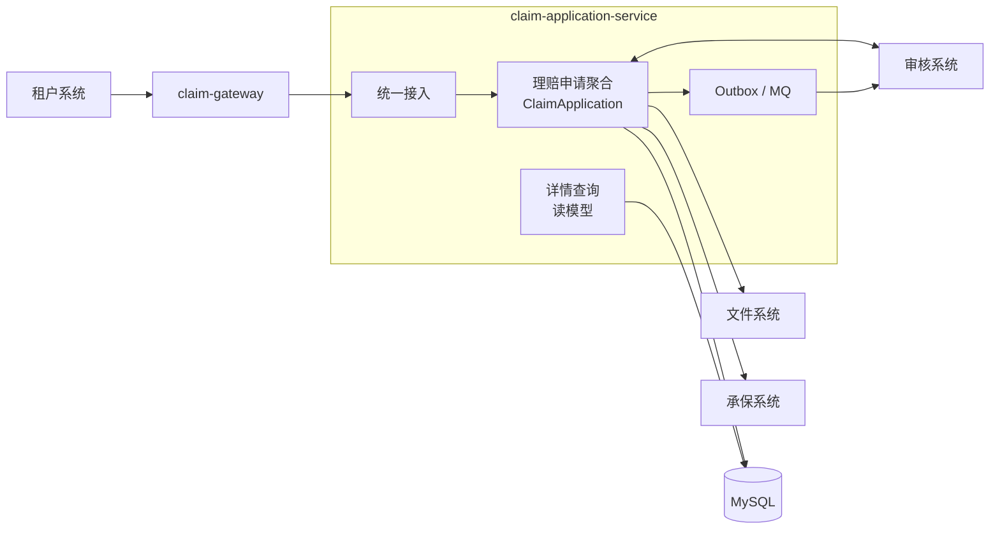

`claim-gateway` 只承担鉴权、租户识别、路由、入口流量治理和 TraceId 透传；它不处理租户业务协议，也不执行理赔申请业务规则。

### 模块内业务域与分层

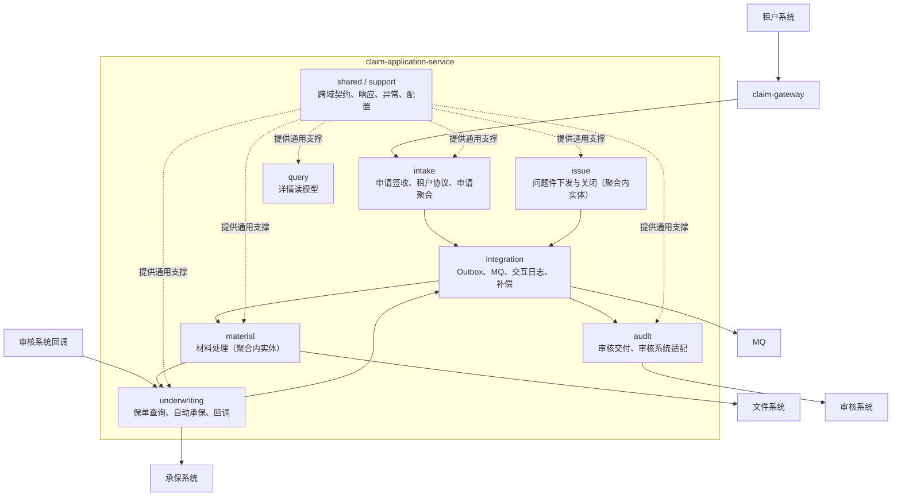

代码目录采用“层级优先、层内按对象角色分包”的组织方式：

- 根包是 DDD 四层 `interfaces`、`application`、`domain`、`infrastructure`，另有 `shared` 位于依赖图底部。层内按角色分包：`interfaces/{web,consumer,dto,scheduler}`、`application/{command,query,port,process,exception}`、`domain/claim`（聚合根、状态枚举）与 `domain/claim/{material,issue,person,port,exception}`、`domain/claimcase/{port}`（聚合外追加事实）、`infrastructure/{persistence,adapter,acl,mq,config}`、`shared/{exception,message,util}`。
- 依赖方向为 `interfaces → application → domain ← infrastructure`；`domain` 不依赖任何上层与框架，`infrastructure` 只依赖 `application/port`、`application/port/model`、`application/query/model`、`domain` 与 `shared`，不依赖用例编排或 `interfaces`，`application` 不依赖 `interfaces`/`infrastructure`。
- `interfaces/web` 放控制器、统一响应与异常处理、响应渲染与租户协议流水线（`tenantprotocol/core/{pipeline,stage}` 放流水线装配与五个阶段端口，`tenantprotocol/tenants/tenant_a` 放租户 request/解析/校验/转换）；`interfaces/consumer` 放 MQ 消费者与报文解析装配；`interfaces/dto` 放对外请求响应；`interfaces/scheduler` 放 Outbox 投递与补偿调度。
- `application/command` 放用例入参；`application/query` 与 `application/query/model` 放详情查询用例与读模型；`application/port` 与 `application/port/model` 放锁、发号、快照查询、外部系统调用、Outbox、消费去重、补偿策略与读模型端口；`application/process` 放用例编排、事务服务、结果模型、冲突解析与记录装配；`application/exception` 放应用异常与异步错误码。
- `domain/claim` 只含聚合根（`ClaimApplication`）与生命周期状态枚举，零框架依赖；聚合内实体的 `Material`、`ClaimApplicationIssue` 分别在 `domain/claim/material`、`domain/claim/issue`，人员值对象在 `domain/claim/person`；聚合 Repository 在 `domain/claim/port`，领域错误码在 `domain/claim/exception`；聚合根不暴露 setter 且构造器私有。案件关联事实 `ClaimCaseRelation` 不参与聚合加载，位于 `domain/claimcase`。
- `infrastructure/persistence` 放 DO、ORM `*DOMapper`、DO↔领域对象的 `*Converter`、仓储实现与读模型实现；`infrastructure/adapter` 放 Redis、Redisson、发号、分布式锁与熔断降级；`infrastructure/acl` 放审核、承保与文件服务的日志实现；`infrastructure/mq` 放 Outbox 发布；`infrastructure/config` 放配置属性与框架装配。哪些属于标准强制、哪些属于本项目方言，见 [005 Spec 目录词典](../../specs/005-application-service-package-refactoring/design.md) 与 [026 Spec 角色分包](../../specs/026-package-standard-alignment/design.md)，标准 DDD 各层的职责与判定方法见 [标准 DDD 架构说明](ddd-standard-architecture.md)。
- `shared/exception` 承载消息无关的 `BusinessException`、`DomainException` 与 `BusinessErrorCode`；`shared/message` 承载消息密封接口与具体消息 record；`shared/util` 承载摘要工具。文件系统、承保系统与审核系统由 `infrastructure/acl` 的日志实现提供：只打印调用日志并返回可继续流程的默认结果，接真实系统时替换本包实现。
- `application/process` 同时承载异步内核编排：Outbox 投递、消费去重、交互记录装配与滞留补偿；补偿允许重放业务用例，业务域允许复用内核的记录装配入口 `ClaimApplicationLifecycleRecordFactory`。
- 跨层引用规则由包名前缀即可判定：`interfaces` 不依赖 `infrastructure`，`application` 不依赖 `interfaces`/`infrastructure`，`domain` 不依赖任何上层，`shared` 不依赖业务分层；DO 不得跨出 `infrastructure/persistence`。规则由 `ClaimApplicationArchitectureTest` 校验，详见 [026 Spec 依赖规则](../../specs/026-package-standard-alignment/design.md)。
- JMeter 压测位于 `scripts/jmeter`，必须经 `claim-gateway` 的对外接口进入服务，不能绕过网关直调应用服务。

### 接口与异步边界

| 交互 | 发起方 | 处理方式 | 业务含义 |
| --- | --- | --- | --- |
| 理赔申请提交 | 租户系统 | 同步 | 完成校验、幂等、理赔申请落库并返回 `claimApplicationNo`；携带平台编号时按状态走重新申请或补材。 |
| 材料处理 | 理赔申请| 异步 | 材料处理完成后推进承保确认。 |
| 自动承保完成通知 | 承保系统 | 异步 | 无有效保单时进入 `UNDERWRITING`，通知后推进审核交付。 |
| 审核签收回调 | 审核系统 | 异步 | 一次性返回全部 `caseNo`，追加案件关联；`WAIT_AUDIT` 申请同事务迁移 `COMPLETED`，已完成申请只补齐关系。 |
| 问题件回调 | 审核系统 | 异步 | 创建未关闭问题件并挂起申请；关闭问题件后恢复等待审核。 |
| 详情查询 | 租户系统 | 同步 | 按申请编号返回摘要及材料、问题件或案件关联，租户不匹配返回 404。 |
| 理赔申请撤销 | 租户系统 | 同步发起 | 未完成审核签收时直接撤销；完成后协同审核系统撤销。 |

## 核心数据模型

### 核心对象

| 对象 | 职责 | 关键约束 |
| --- | --- | --- |
| `ClaimApplication` | 唯一聚合根，持有生命周期状态、受理尝试次数、人员信息、当前有效材料与全部问题件，并用 `version` 做乐观锁。 | `(tenantCode, externalClaimApplicationNo)` 唯一；`save` 以 `id + version` 条件更新。 |
| `Material` | 聚合内实体，首次材料和补材记录。 | 归属由根决定；使用 `batchNo` 区分材料批次；重新申请与补材时旧材料软删除。 |
| `ClaimApplicationIssue` | 聚合内实体，审核系统下发的问题件。 | 同一理赔申请同时只允许一条未关闭记录。 |
| `ClaimCaseRelation` | 理赔申请与审核签收返回案件的关联，是聚合外追加事实。 | `(tenantCode, claimApplicationNo, caseNo)` 唯一；不参与聚合加载与保存。 |
| `ClaimApplicationView` | 详情查询读模型（摘要 + 材料/问题件/案件关联）。 | 按租户与申请编号查询，不加载聚合、不写轨迹。 |
| `InteractionLog` | 外部系统调用、通知和回调的处理轨迹。 | 记录必要业务标识与结果，不记录完整敏感信息。 |
| `OutboxEvent` | 与本地业务数据同事务持久化的待投递事件。 | `eventId` 唯一，按事件和理赔申请幂等消费。 |

### ER 模型

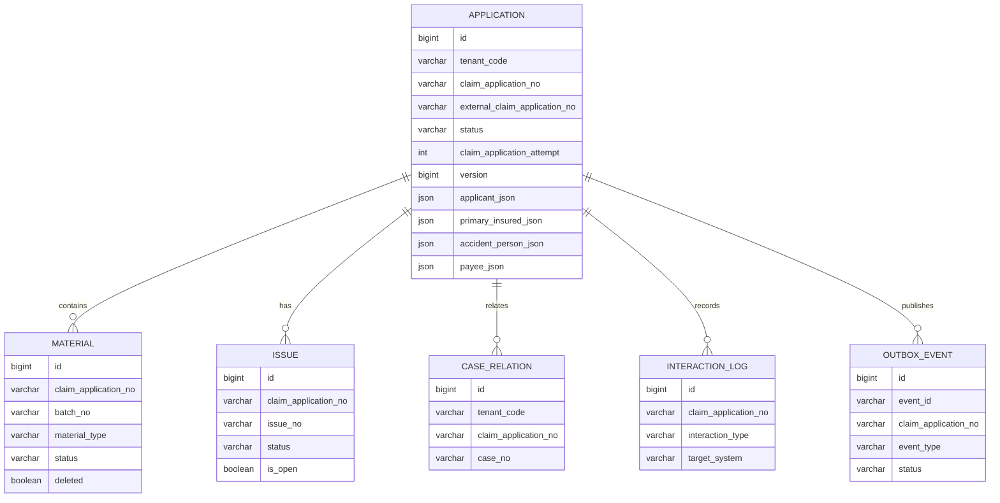

### 人员与材料数据

- 理赔申请使用 `applicantJson`、`primaryInsuredJson`、`accidentPersonJson`、`payeeJson` 四个 JSON 字段分别保存申请人、主被保险人、出险人和领款人，避免角色数据相互覆盖。
- 每个 JSON 字段必须有明确的版本和必填字段约束；租户转换器负责外部字段映射，领域模型只接收标准化数据。
- 证件号、银行卡号等敏感字段不得写入 INFO、WARN 和 ERROR 日志；日志仅记录脱敏值及 `claimApplicationNo`、租户和 TraceId。
- 首次提交和每次补材分别创建新的 `batchNo`。材料软删除只用于重新申请与补材覆盖旧材料，不物理删除审计数据。

### 数据约束与幂等基础

- 理赔申请主表唯一约束：`tenantCode + externalClaimApplicationNo`。
- 理赔申请聚合写库使用 `version` 乐观锁：`save` 以 `id + version` 条件更新，失败返回 `false` 且不写材料与问题件子表。
- 同一理赔申请可以有多条历史问题件，但同时只能有一条 `is_open = 1` 的问题件；数据库生成列唯一索引兜底。
- `ClaimCaseRelation` 唯一约束：`tenantCode + claimApplicationNo + caseNo`。
- OutboxEvent 以 `eventId` 唯一；消费者以事件标识和 `claimApplicationNo` 防止重复处理。

## 主状态机设计

### 状态定义

当前实现覆盖签收、材料处理、承保分流、问题件与审核完成链路，`ClaimApplicationStatus` 保留七个状态：

| 状态 | 业务含义 |
| --- | --- |
| `PENDING_ACCEPT` | 理赔申请已签收（或补材后重新进入），等待材料处理。 |
| `ACCEPTED` | 材料处理完成，申请受理成功。 |
| `ACCEPT_FAILED` | 当前申请尝试受理失败。 |
| `UNDERWRITING` | 未找到有效保单，自动承保处理中，等待完成通知。 |
| `WAIT_AUDIT` | 已进入审核签收流程，等待审核系统处理。 |
| `ISSUE` | 审核下发问题件，等待租户补材或审核关闭。 |
| `COMPLETED` | 审核系统已签收并返回案件号，理赔申请在平台内的生命周期结束；不可逆终态，同时记录 `completedAt`。 |

`ACCEPT_FAILED` 是当前申请尝试的结束状态，不是理赔申请聚合的永久终态。租户可以使用同一外部申请号重新申请，系统复用 `claimApplicationNo` 并开始新的申请尝试。`COMPLETED` 是审核完成后的终态：不得重新申请、补材、下发问题件或关闭未关闭问题件；已关闭问题件重复关闭按幂等返回。重复提交按可复用状态返回 `REUSED`，迟到的审核签收只补齐缺失案件关联。`REVOKED` 尚未实现。

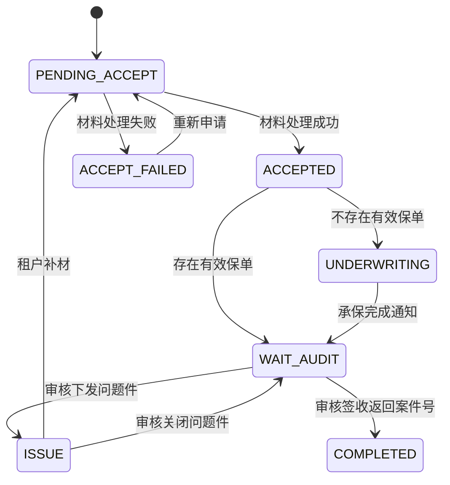

补材与重新申请的区别只在人员：重新申请用报文人员整体替换，补材保留聚合原人员。`COMPLETED` 只能由审核签收从 `WAIT_AUDIT` 迁入，且迁入前不得存在未关闭问题件。

状态推进规则：

- 异步通知只能在理赔申请当前状态符合预期时推进状态；迟到通知、重复通知和状态不匹配的通知只记录交互轨迹，不改变状态。
- 所有写操作通过聚合根方法推进状态，并一次 `save` 落库；保存返回 `false` 说明版本已过期，按重复事件或冲突规则处理，不覆盖其他执行者已写入的结果。
- 问题件下发与关闭由根统一迁移 `WAIT_AUDIT ⇄ ISSUE`；租户补材由根关闭未关闭问题件并迁移 `ISSUE → PENDING_ACCEPT`。
- 审核签收由根方法 `completeAudit()` 完成 `WAIT_AUDIT → COMPLETED`，同时写入完成时间；存在未关闭问题件时拒绝完成。
- 撤销能力尚未实现；实现后，撤销的状态迁移需在此表补充并通过根方法落地。

## 核心链路设计

### 统一接入、幂等与重新申请

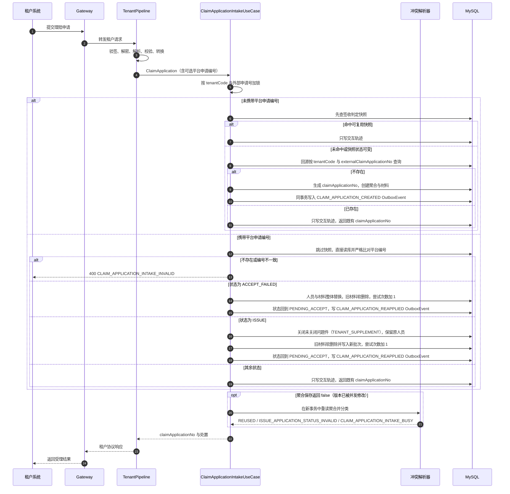

- 未携带平台申请编号：快照命中可直接复用时只写轨迹；库中不存在则创建；已存在一律按重复请求复用，不覆盖人员、材料与状态。
- 携带平台申请编号：跳过快照直接读库，编号必须与 `tenantCode + externalClaimApplicationNo` 对应记录一致，否则返回 `CLAIM_APPLICATION_INTAKE_INVALID`。
- 携带平台编号且状态为 `ACCEPT_FAILED` 时返回 `REAPPLIED`，沿用原 `claimApplicationNo`，人员与材料整体替换，旧材料软删除，尝试次数加 1，状态回到 `PENDING_ACCEPT`。
- 携带平台编号且状态为 `ISSUE` 并存在未关闭问题件时返回 `SUPPLEMENTED`，关闭该问题件（关闭人 `TENANT_SUPPLEMENT`），保留聚合原人员，旧材料软删除并写入新批次，尝试次数加 1，状态回到 `PENDING_ACCEPT`，随后重新走异步材料处理与承保分流。
- 其余状态按重复请求返回 `REUSED`，不覆盖数据。
- 首次创建、重新申请和补材的聚合、子表、交互轨迹与 OutboxEvent 在同一事务提交。
- 聚合 `save` 返回 `false` 表示 `id + version` 条件未命中，事务抛出内部冲突信号并整体回滚；由 `ClaimApplicationIntakeConflictResolver` 以 `REQUIRES_NEW` 重读：尝试次数已增大按 `REUSED`；补材时状态已离开 `ISSUE` 返回 `ISSUE_APPLICATION_STATUS_INVALID`；其余返回 `CLAIM_APPLICATION_INTAKE_BUSY`。

### 材料处理与承保确认

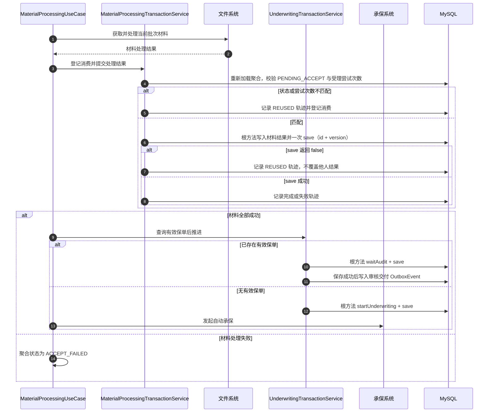

- 材料处理在事务外调用文件系统，事务内重新加载聚合、校验 `PENDING_ACCEPT` 与受理尝试次数后一次 `save`；过期事件、版本冲突和重复消费都只记录轨迹。
- 承保分流从 `ACCEPTED` 出发：有保单时由根迁移 `WAIT_AUDIT` 并在保存成功后写审核交付事件；无保单时由根迁移 `UNDERWRITING` 后再发起外部调用。
- 承保完成通知仅当申请处于 `UNDERWRITING` 时由根迁移 `WAIT_AUDIT`，保存成功后写审核交付事件；保存失败说明并发通知已先推进，按重复通知处理。
- 自动承保不定义业务失败状态。若完成通知遗漏，补偿任务查询承保结果；在取得完成通知或查询结果前，理赔申请保持 `UNDERWRITING`，前端可查询当前状态与交互记录。

### 审核交付与签收

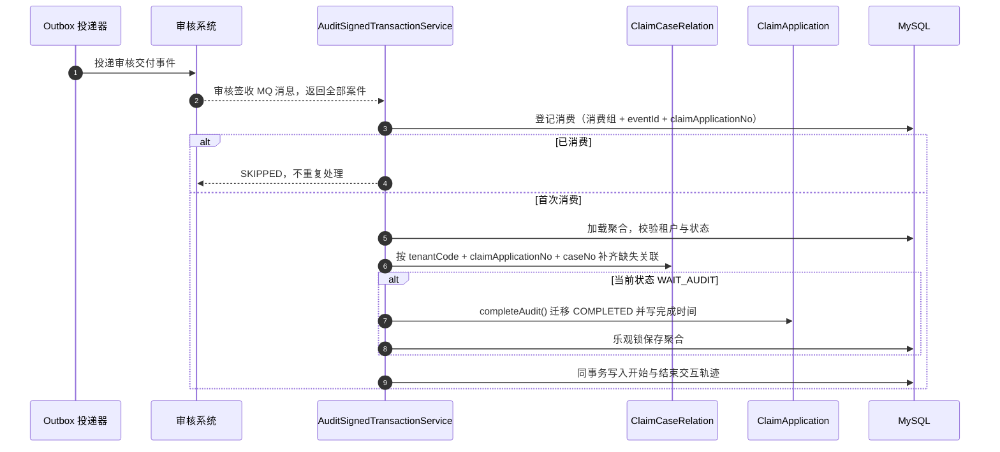

- 审核系统在一次签收回调中返回该理赔申请的全部 `caseNo`，重复回调只补齐缺失关系，不重复创建 `ClaimCaseRelation`。
- 审核签收在同一个 `@Transactional` 内完成消费登记、租户校验、状态校验、缺失案件关联追加、`WAIT_AUDIT → COMPLETED` 迁移与完成时间写入、聚合保存和交互轨迹写入；任一失败整体回滚。
- 租户不一致返回 `AUDIT_SIGNED_TENANT_MISMATCH`（400）；申请不存在返回 `CLAIM_APPLICATION_NOT_FOUND`（404）；状态不是 `WAIT_AUDIT`/`COMPLETED`，或 `WAIT_AUDIT` 仍存在未关闭问题件，返回 `AUDIT_SIGNED_STATUS_INVALID`（409）。
- `COMPLETED` 申请只补齐缺失案件关联，不改变状态与完成时间；版本冲突抛出内部冲突信号使事务回滚，交由 MQ 重投后按 `COMPLETED` 重放。
- `WAIT_AUDIT` 滞留补偿通过审核签收状态查询端口恢复：已签收且案件号非空时复用审核签收用例推进 `COMPLETED`，处理中保持状态，未找到时重新调用审核交付端口；查询失败、空案件号或签收失败写失败轨迹并等待下一轮。

### 问题件与补材

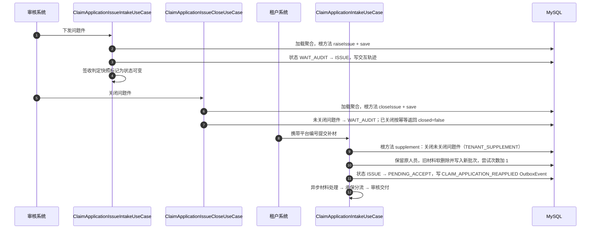

- 同一理赔申请可以经历多轮问题件，但同时只能有一条未关闭问题件；已有未关闭问题件时再次下发返回 `ISSUE_ALREADY_OPEN`。
- 问题件下发要求申请处于 `WAIT_AUDIT`；关闭未关闭问题件要求申请处于 `ISSUE`，关闭后回到 `WAIT_AUDIT`。
- 已关闭的问题件再次关闭按幂等返回 `closed=false`，不校验申请状态，也不写库。
- 租户补材由签收入口承担：关闭未关闭问题件、保留原人员、旧材料软删除、写入新批次、尝试次数加 1，状态回到 `PENDING_ACCEPT` 后重新走异步链路。
- 问题件下发、关闭与补材都通过一次 `save` 落库；保存失败时在保存事务之外重读聚合，已落库按幂等返回，否则返回状态冲突或处理中错误。

### 理赔申请撤销（规划）

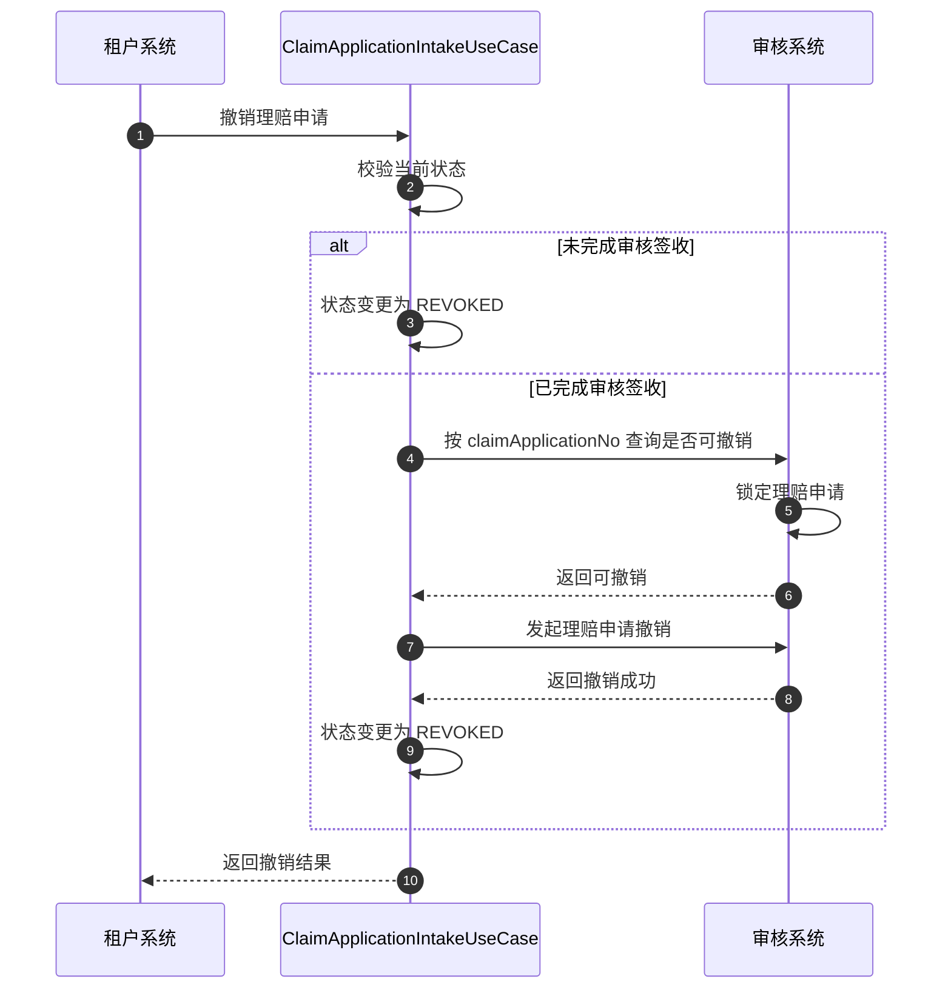

已完成审核签收的理赔申请在审核系统返回不可撤销、锁定失败或撤销失败时保持 `COMPLETED`，不进入 `REVOKED`。

撤销能力尚未实现，本节仅约束后续实现的协同顺序与失败保持语义；目标终态 `REVOKED` 待随撤销能力一起加入状态机。

## 详情查询读模型

### 查询接口

| 方法 | 路径 | 返回 |
| --- | --- | --- |
| GET | `/api/claim/v1/application/{claimApplicationNo}/materials` | 申请摘要 + 未删除材料 |
| GET | `/api/claim/v1/application/{claimApplicationNo}/issues` | 申请摘要 + 全部问题件 |
| GET | `/api/claim/v1/application/{claimApplicationNo}/cases` | 申请摘要 + 案件关联 |

- 租户来自 `TenantContext`；摘要查询同时按 `claimApplicationNo` 与 `tenantCode` 定位，跨租户与不存在使用同一错误码返回 404 `CLAIM_APPLICATION_QUERY_NOT_FOUND`，不暴露存在性。
- 缺少租户上下文返回 400 `CLAIM_APPLICATION_QUERY_INVALID`；未预期异常映射 500 `CLAIM_APPLICATION_QUERY_SYSTEM_ERROR`。
- 子集合为空返回 200 与空数组；材料按主键升序，问题件按创建时间与主键倒序，案件关联按创建时间与主键升序。
- 查询只经过 `application/query` 与 `infrastructure/persistence`，不加载领域聚合、不写交互轨迹；ArchUnit 规则禁止查询包依赖聚合仓储与轨迹仓储。
- 问题件按案件号查询的既有接口 `/api/claim/v1/cases/{caseNo}/issue` 响应结构不变，内部改为读模型实现。

## 并发控制与幂等

### 申请幂等与并发

- 理赔申请主表的唯一约束确保同一租户相同外部申请号不会创建多条主记录；签名锁在同一外部申请号上串行化签收。
- 创建、重复请求判断、重新申请、补材和 Outbox 写入必须在同一事务内完成。
- 未携带平台编号时，除创建外一律按重复请求复用；携带平台编号时只有 `ACCEPT_FAILED` 与未关闭问题件会改写聚合，`COMPLETED` 等其余状态只记录轨迹并按 `REUSED` 返回。
- 聚合写库使用 `t_claim_application.version` 乐观锁：`save` 以 `id + version` 条件更新，并同时维护材料与问题件子表；条件不命中返回 `false`，不写任何子表。
- `save` 返回 `false` 时事务抛出内部冲突信号并回滚，`ClaimApplicationIntakeConflictResolver` 以 `REQUIRES_NEW` 重读聚合完成分类：尝试次数已增大按 `REUSED`；补材时状态已离开 `ISSUE` 返回 `ISSUE_APPLICATION_STATUS_INVALID`；其余返回 `CLAIM_APPLICATION_INTAKE_BUSY`（HTTP 503）。
- 冲突重读必须在新事务中进行：MySQL 默认 `REPEATABLE_READ` 下原事务内重读仍会返回旧快照。

### 回调与事件幂等

- 审核签收回调通过 `ClaimCaseRelation` 唯一约束保证重复消息不重复建关联；同一 `eventId` 重投返回 `SKIPPED`，不同 `eventId` 只补插缺失案件号。`WAIT_AUDIT` 首次签收在同一事务内迁移 `COMPLETED`，已完成申请不再改变状态与完成时间。
- 问题件回调通过当前未关闭问题件保证重复消息不重复建问题件；已关闭问题件再次关闭按幂等返回。
- 承保完成通知仅允许将 `UNDERWRITING` 推进到 `WAIT_AUDIT`；条件不满足或保存失败只记录 InteractionLog。
- 材料处理在事务内校验 `PENDING_ACCEPT` 与受理尝试次数，过期批次、迟到事件和版本冲突都只记录轨迹。
- 所有异步处理在推进状态前通过聚合根方法校验当前状态；状态不匹配时只记录 InteractionLog。

## 入口保护：限流、判定快照与 Redis 降级

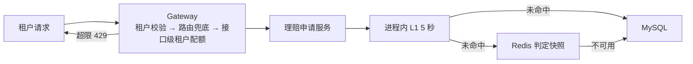

### 网关限流：路由兜底 + 接口级租户配额

- 只作用于签收路由 `claim-application-service`，其他路由和其他业务服务不受影响。
- 两层规则同时生效，实际生效阈值取较小者：

| 层 | Sentinel 资源 | 匹配方式 | 默认阈值 |
| --- | --- | --- | --- |
| 路由兜底 | 路由 ID `claim-application-service` | 不区分接口、不区分租户 | `default-qps` 50 |
| 接口级租户配额 | API 定义名，如 `claim-application-intake` | 路径匹配 + 请求头 `X-Tenant-Code` 精确匹配 | `tenant-a` 20 |

- 接口级配额只能更严：任一租户配额大于 `default-qps` 时网关启动失败；接口未配置的租户只受路由兜底约束。
- 同一路由下不同接口的租户配额互相独立，例如签收被限流时同一租户的承保回调仍可正常进入。
- 阈值口径是**单节点 QPS**：租户全局上界 = 单节点阈值 × 网关节点数。默认阈值是所有租户的公共上界。规则条数 = 1 条兜底 + 各接口已配置的租户配额条数。
- 超限返回 HTTP 429 与错误码 `CLAIM_APPLICATION_RATE_LIMITED`，请求不进入理赔申请服务，不产生签收轨迹。
- 缺少租户头的请求由网关租户校验直接 400 拒绝，不进入限流统计。
- 规则随网关启动从配置加载；Sentinel 控制台只做观测，控制台上的临时规则重启后失效。

### 签收判定快照

| 缓存值 | 含义 | TTL |
| --- | --- | --- |
| `A…\|状态` | 已过受理，重复请求可直接复用 | 1 小时 |
| `X` | 存在但状态可变（`PENDING_ACCEPT`、`ACCEPT_FAILED`） | 1 分钟 |
| `N` | 不存在 | 1 分钟 |

- 键为 `claim-applicationintake:snapshot:` + `sha256(租户编码:外部申请号)`，签收锁为 `claim-applicationintake:lock:` + 同一摘要；两者前缀必须区分，否则字符串快照会覆盖 Redisson 锁结构。
- 只有 `ACCEPTED`、`UNDERWRITING`、`WAIT_AUDIT`、`COMPLETED` 四种可复用状态写入可复用快照；命中即返回 `REUSED`，不读取聚合、不调用外部系统。
- `PENDING_ACCEPT` 与 `ACCEPT_FAILED` 不作为可直接复用的依据，必须回源数据库确认，重新申请语义不变。
- 快照不需要失效动作：安全状态在状态机中单调不可逆。进程内 L1 存活 5 秒、条目上限 10000，只用于吸收重复探测。
- 创建成功后把不存在标记覆盖为 `X`，避免刚创建的申请被空标记误判为不存在。

### Redis 降级

- 连续失败达到 3 次后熔断打开 10 秒，到期只放行一次探测；探测成功即关闭并要求发号器先抬升计数器，探测失败立即重新打开。
- 熔断期间锁、判定快照与发号不再发起 Redis 调用：锁降级为无锁、快照只走 L1 与 MySQL、发号改为本节点串行取当天最大尾号加一。
- 降级期间本节点签收受信号量限制（默认 10），超出直接返回 `CLAIM_APPLICATION_INTAKE_SYSTEM_ERROR`，不排队。
- 跨节点编号冲突仍由唯一键约束与用例重试收敛，重试上限 5 次；编号格式 `A` + `yyyyMMdd` + 8 位序列不因降级改变。
- 降级日志相邻两条间隔不小于 10 秒，只包含降级原因与当前并发数。

## 异步一致性

### Outbox、MQ 与补偿

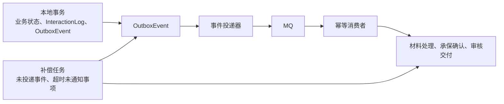

- 状态变更、InteractionLog 与 OutboxEvent 同事务提交，避免业务数据成功但异步流程未触发。
- 投递器只投递已提交的 OutboxEvent；投递失败的事件保留并由补偿任务重试。
- 消费者按照 `eventId` 和 `claimApplicationNo` 幂等处理；至少一次投递不会造成重复数据或重复状态推进。
- 承保完成通知缺失时，补偿任务查询承保结果，不将理赔申请标记为自动承保失败。
- 等待审核滞留时，补偿任务查询审核签收状态：已签收复用审核签收用例推进 `COMPLETED`，处理中保持 `WAIT_AUDIT`，未找到重新交付审核系统；查询失败、已签收但案件号为空或签收失败时写失败轨迹并等待下一轮。
- 状态不匹配或已进入终态的理赔申请收到迟到事件时，只记录交互轨迹，不触发业务补偿。

## 异常处理与可观测性

### 异常处理

- 业务校验失败、状态不允许迁移、唯一约束冲突和外部系统拒绝必须返回统一业务异常，并携带必要的 `claimApplicationNo`、租户或外部申请号上下文。
- 异常按层分型：领域不变式抛 `DomainException`，用例编排抛 `ApplicationException`，两者继承 `BusinessException`；入站适配与基础设施在自身边界内直接使用基类，全局处理器仍只捕获基类，HTTP 状态与响应结构不变。
- 不捕获异常后继续执行，不吞掉外部系统、MQ 或数据库异常。
- 自动承保的完成通知缺失不产生业务失败状态，由补偿查询恢复；查询结果未得到前保持 `UNDERWRITING`。
- 撤销能力实现后，审核撤销失败时保持当前状态（规划为 `COMPLETED`），不修改 `ClaimCaseRelation`，也不将理赔申请标记为已撤销。

### 日志与追踪

- 关键日志至少包含 `traceId`、`tenantCode`、`claimApplicationNo`、外部申请号的脱敏值和当前状态。
- InteractionLog 记录外部系统名称、交互类型、请求时间、结果和错误上下文，用于前端查询与故障诊断。
- 禁止记录 Token、密钥、完整证件号、银行卡号以及四个人员 JSON 的完整内容。
- 循环重试不大量输出 INFO 日志；同一异常由责任边界记录一次，避免重复打印堆栈。

## 对现有功能的影响

- 总架构中的理赔申请核心编号统一为 `claimApplicationNo`，案件使用 `sourceClaimApplicationNo` 追溯来源申请。
- `claim-gateway` 的职责保持不变；租户协议适配仍由理赔申请服务承担。
- 当前变更只定义理赔申请业务域架构与后续实现约束，不改变案件、AI、文件、承保或审核系统的内部业务实现。
- 后续代码、数据库变更和测试必须以本文档的状态机、数据约束、幂等规则和异步一致性方案为准。
