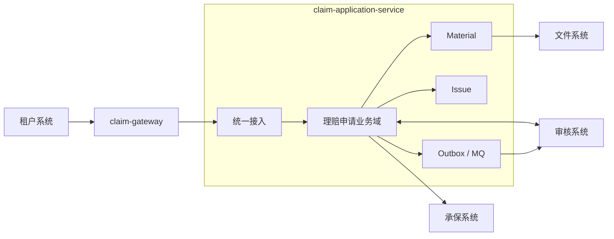
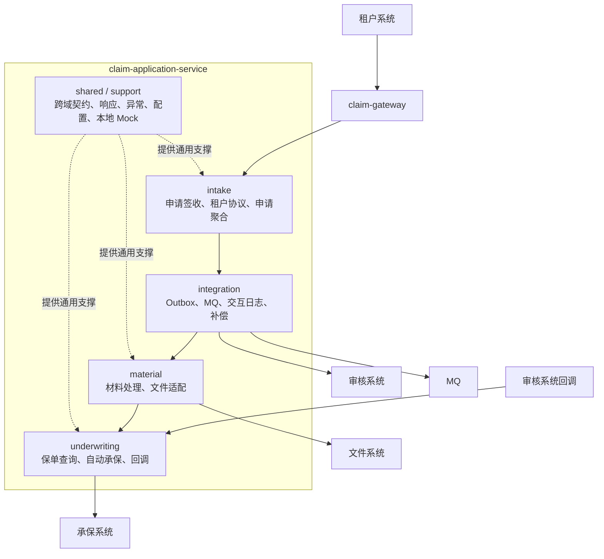
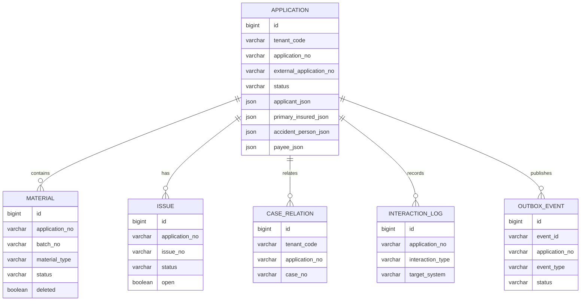
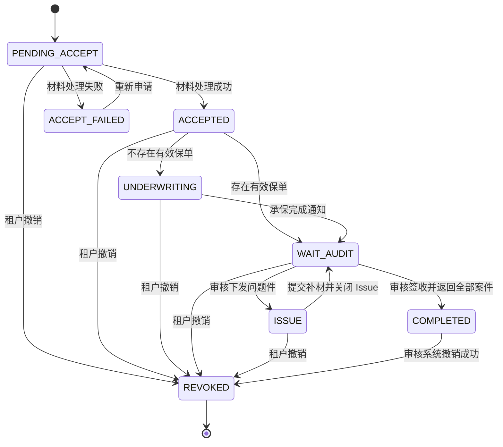
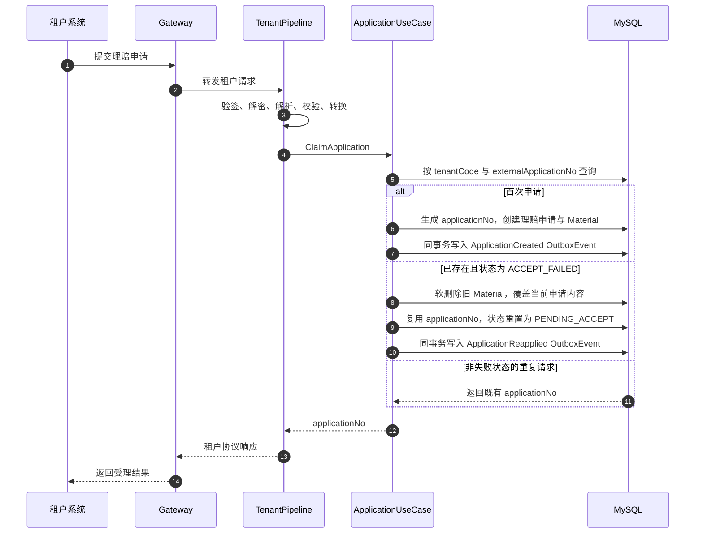
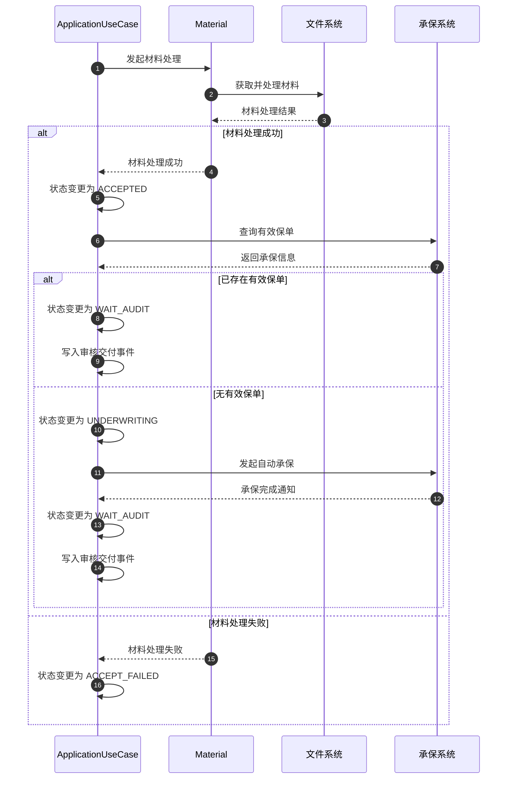
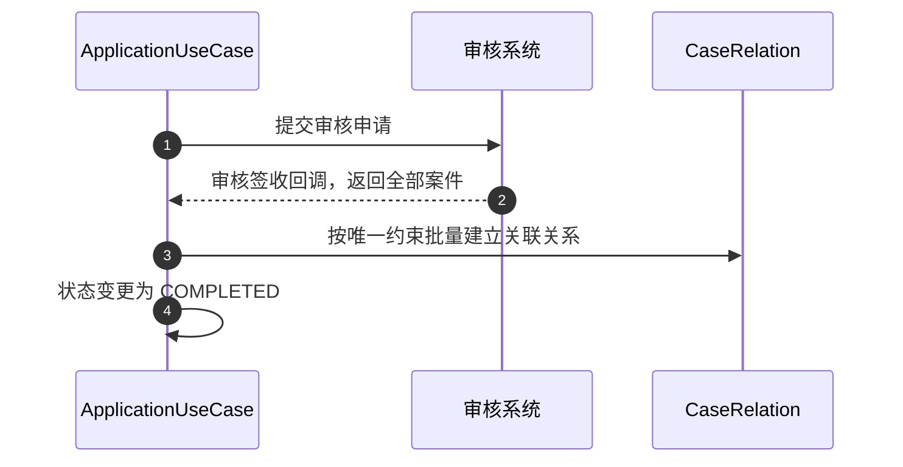
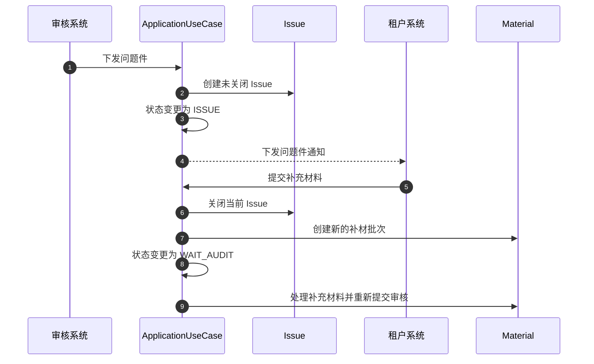
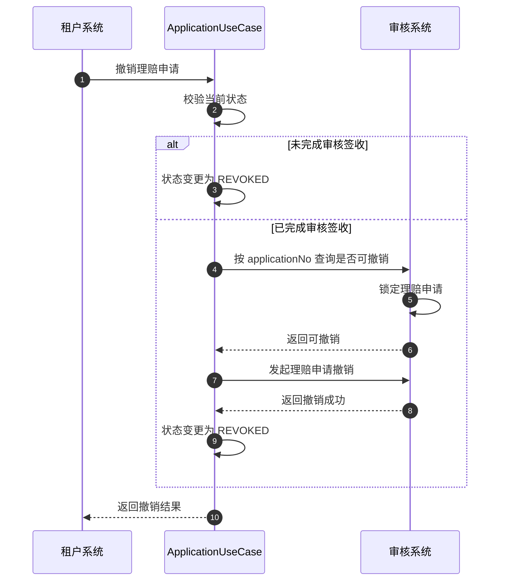
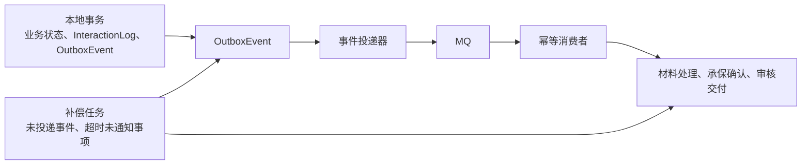

# 理赔申请受理系统架构设计

## 项目背景与目标

`claim-application-service` 是理赔申请进入平台后的统一受理服务。它面向多租户接收理赔申请，将租户协议转换为平台标准模型，并负责理赔申请从接收、材料处理、承保确认、审核交付、问题件处理到撤销的生命周期管理。

核心业务链路：

**统一接入 → 申请签收 → 材料处理 → 承保确认 → 审核交付 → 审核签收 → 理赔申请完成**

设计目标：

- 同步请求只确认平台已签收申请并返回 `applicationNo`，不等待材料、承保或审核等耗时处理。
- 租户协议差异只存在于适配层，核心业务只处理标准模型。
- 通过状态机、唯一约束、Outbox、MQ 和补偿机制保证重复请求、异步通知与跨系统交互可恢复、可追踪。
- 理赔申请与案件只建立关联；案件后续生命周期不属于本服务。

## 业务边界与职责

### 边界内

- 多租户理赔申请统一接入、校验与签收。
- 理赔申请、Material、Issue、CaseRelation 和交互记录管理。
- 有效保单查询与无保单场景下的自动承保协同。
- 审核申请交付、签收回调、问题件回调和补材重提。
- 理赔申请撤销。
- 异步事件可靠投递、消费幂等和补偿恢复。

### 边界外

- 审核规则、审核决策和审核系统内部处理。
- 案件的后续状态、阶段编排、推送与调度。
- 文件系统、承保系统、审核系统和 MQ 的内部实现。

### 核心职责

| 职责 | 说明 |
| --- | --- |
| 统一接入 | 接收不同租户协议，完成验签、解密、解析、校验、映射和响应转换。 |
| 申请受理 | 使用 `tenantCode + externalApplicationNo` 确认唯一性，创建或重置理赔申请。 |
| 材料管理 | 管理首次材料与补材批次，保留软删除材料的审计轨迹。 |
| 承保协同 | 查询有效保单；无保单时发起自动承保并等待完成通知。 |
| 审核协同 | 提交审核申请，接收一次性返回全部案件的审核签收回调。 |
| 问题件处理 | 同时只维护一条未关闭 Issue；租户提交补材后立即关闭当前 Issue。 |
| 撤销处理 | 撤销对象是理赔申请；已完成审核签收时需经审核系统确认、锁定和撤销。 |

## 总体架构

### 系统上下文

`claim-gateway` 只承担鉴权、租户识别、路由、入口流量治理和 TraceId 透传；它不处理租户业务协议，也不执行理赔申请业务规则。

### 模块内业务域与分层

代码目录采用“层级优先、层内分域”的组织方式：

- 根包是 DDD 四层 `interfaces`、`usecase`、`domain`、`infrastructure`，业务域 `intake`、`material`、`underwriting`、`integration` 作为每层的第二级子包；`shared`、`support` 保留为额外根包。
- 依赖方向为 `interfaces → usecase → domain ← infrastructure`；`domain` 不依赖任何上层，`infrastructure` 不依赖 `usecase`/`interfaces`，`usecase` 不依赖 `interfaces`/`infrastructure`。
- 目录命名遵循标准 DDD 词典：`interfaces/<域>` 按入站通道分为 `web`、`messaging`、`scheduling`、`tenantprotocol`，不设 `inbound` 中转层（出站适配器属于 `infrastructure`）；`domain` 只含聚合、值对象、枚举、业务异常与端口，零框架依赖，出站端口一律声明在 `domain`，聚合根不暴露 setter 且构造器私有；DO、ORM `*DOMapper`、DO↔领域对象的 `*Converter` 和仓储实现一律在 `infrastructure/<域>/persistence`，单聚合平铺、多聚合按与 `domain` 同名的子包分组。哪些属于标准强制、哪些属于本项目方言，见 [005 Spec 目录词典](../../specs/005-application-service-package-refactoring/design.md)，标准 DDD 各层的职责与判定方法见 [标准 DDD 架构说明](ddd-standard-architecture.md)。
- `shared` 放被多域复用的构件：`shared/contract` 承载消息信封、跨域命令与跨域异步异常及错误码，另有统一响应模型（`shared/interfaces/web`）与加密工具（`shared/infrastructure`）；`support` 放配置与仅用于本地联调的 Mock。
- `integration` 定位平台异步内核，承载 Outbox 投递、消费去重、交互日志记录装配与滞留补偿；补偿允许重放业务域用例，业务域允许复用内核的记录装配入口 `usecase/integration/record`。
- 跨域引用只允许落在对方 `domain`、`shared` 或 `integration` 对外提供的记录装配用例，禁止引用其他业务域的 `interfaces`、`infrastructure`，DO 不得跨域传递，`domain` 包不得依赖 Spring、MyBatis-Plus、Redisson、MapStruct、Feign、MQ 与 Jackson；规则由包名前缀即可判定，详见 [005 Spec 依赖方向规则](../../specs/005-application-service-package-refactoring/design.md)。
- JMeter 压测位于 `scripts/jmeter`，必须经 `claim-gateway` 的对外接口进入服务，不能绕过网关直调应用服务。

### 接口与异步边界

| 交互 | 发起方 | 处理方式 | 业务含义 |
| --- | --- | --- | --- |
| 理赔申请提交 | 租户系统 | 同步 | 完成校验、幂等、理赔申请落库并返回 `applicationNo`。 |
| 材料处理 | 理赔申请| 异步 | 材料处理完成后推进承保确认。 |
| 自动承保完成通知 | 承保系统 | 异步 | 无有效保单时进入 `UNDERWRITING`，通知后推进审核交付。 |
| 审核签收回调 | 审核系统 | 异步 | 一次性返回全部 `caseNo`，建立关联后完成理赔申请。 |
| 问题件回调 | 审核系统 | 异步 | 创建未关闭 Issue 并等待租户补材。 |
| 理赔申请撤销 | 租户系统 | 同步发起 | 未完成审核签收时直接撤销；完成后协同审核系统撤销。 |

## 核心数据模型

### 核心对象

| 对象 | 职责 | 关键约束 |
| --- | --- | --- |
| `ClaimApplication` | 申请聚合根，持有生命周期状态、外部申请号和人员信息。 | `(tenantCode, externalApplicationNo)` 唯一。 |
| `Material` | 首次材料和补材记录。 | 使用 `batchNo` 区分材料批次；重新申请时旧材料软删除。 |
| `Issue` | 审核系统下发的问题件。 | 同一理赔申请同时只允许一条未关闭记录。 |
| `CaseRelation` | 理赔申请与审核签收返回案件的关联。 | `(tenantCode, applicationNo, caseNo)` 唯一。 |
| `InteractionLog` | 外部系统调用、通知和回调的处理轨迹。 | 记录必要业务标识与结果，不记录完整敏感信息。 |
| `OutboxEvent` | 与本地业务数据同事务持久化的待投递事件。 | `eventId` 唯一，按事件和理赔申请幂等消费。 |

### ER 模型

### 人员与材料数据

- 理赔申请使用 `applicantJson`、`primaryInsuredJson`、`accidentPersonJson`、`payeeJson` 四个 JSON 字段分别保存申请人、主被保险人、出险人和领款人，避免角色数据相互覆盖。
- 每个 JSON 字段必须有明确的版本和必填字段约束；租户转换器负责外部字段映射，领域模型只接收标准化数据。
- 证件号、银行卡号等敏感字段不得写入 INFO、WARN 和 ERROR 日志；日志仅记录脱敏值及 `applicationNo`、租户和 TraceId。
- 首次提交和每次补材分别创建新的 `batchNo`。材料软删除只用于重新申请覆盖旧材料，不物理删除审计数据。

### 数据约束与幂等基础

- 理赔申请主表唯一约束：`tenantCode + externalApplicationNo`。
- 同一理赔申请可以有多条历史 Issue，但同时只能有一条 `open = true` 的 Issue。
- CaseRelation 唯一约束：`tenantCode + applicationNo + caseNo`。
- OutboxEvent 以 `eventId` 唯一；消费者以事件标识和 `applicationNo` 防止重复处理。

## 主状态机设计

### 状态定义

| 状态 | 业务含义 |
| --- | --- |
| `PENDING_ACCEPT` | 理赔申请已签收，等待材料处理。 |
| `ACCEPTED` | 材料处理完成，申请受理成功。 |
| `ACCEPT_FAILED` | 当前申请尝试受理失败。 |
| `UNDERWRITING` | 未找到有效保单，自动承保处理中，等待完成通知。 |
| `WAIT_AUDIT` | 已进入审核签收流程，等待审核系统处理。 |
| `ISSUE` | 审核系统下发问题件，等待租户补材。 |
| `COMPLETED` | 审核系统签收完成，已建立全部案件关联。 |
| `REVOKED` | 理赔申请撤销完成，生命周期终止。 |

`ACCEPT_FAILED` 是当前申请尝试的结束状态，不是理赔申请聚合的永久终态。租户可以使用同一外部申请号重新申请，系统复用 `applicationNo` 并开始新的申请尝试。`REVOKED` 是理赔申请的唯一生命周期终态。

状态推进规则：

- 异步通知只能在理赔申请当前状态符合预期时推进状态；迟到通知、重复通知和已撤销理赔申请的通知只记录交互轨迹，不改变状态。
- `COMPLETED` 后允许撤销，但只有审核系统按 `applicationNo` 确认可撤销、锁定并撤销成功后才进入 `REVOKED`。
- 理赔申请进入 `REVOKED` 后，审核签收、问题件、材料和承保通知都不能再次推进生命周期。

## 核心链路设计

### 统一接入、幂等与重新申请

- 首次请求创建理赔申请并返回新 `applicationNo`。
- `ACCEPT_FAILED` 后的重新申请沿用原 `applicationNo`，覆盖当前申请内容，旧 Material 软删除，历史失败原因和交互记录保留。
- 除 `ACCEPT_FAILED` 外，重复请求不覆盖数据，只返回既有 `applicationNo`。

### 材料处理与承保确认

自动承保不定义业务失败状态。若完成通知遗漏，补偿任务查询承保结果；在取得完成通知或查询结果前，理赔申请保持 `UNDERWRITING`，前端可查询当前状态与交互记录。

### 审核交付与签收

审核系统在一次签收回调中返回该理赔申请的全部 `caseNo`。重复回调只补齐缺失关系，不重复创建 CaseRelation，也不重复推进 `COMPLETED`。

### 问题件与补材

- 同一理赔申请可以经历多轮问题件，但同时只能有一条未关闭 Issue。
- 租户提交补材时立即关闭当前 Issue，并以新的 `batchNo` 记录补材。
- 重复下发同一未关闭问题件时，不创建新的 Issue，也不重复推进理赔申请状态。

### 理赔申请撤销

已完成审核签收的理赔申请在审核系统返回不可撤销、锁定失败或撤销失败时保持 `COMPLETED`，不进入 `REVOKED`。

## 并发控制与幂等

### 申请幂等

- 理赔申请主表的唯一约束确保同一租户相同外部申请号不会创建多条主记录。
- 创建、重复请求判断、重新申请重置和 Outbox 写入必须在同一事务内完成。
- 非失败状态下的重复请求直接返回既有 `applicationNo`。
- 重新申请只允许在 `ACCEPT_FAILED` 发生；并发重新申请通过主记录锁或条件更新保证只有一次状态重置生效。

### 回调与事件幂等

- 审核签收回调通过 CaseRelation 唯一约束保证重复消息不重复建关联。
- 问题件回调通过当前未关闭 Issue 保证重复消息不重复建问题件。
- 承保完成通知仅允许将 `UNDERWRITING` 推进到 `WAIT_AUDIT`。
- 所有异步处理在推进状态前校验理赔申请当前状态；状态不匹配时只记录 InteractionLog。

## 异步一致性

### Outbox、MQ 与补偿

- 状态变更、InteractionLog 与 OutboxEvent 同事务提交，避免业务数据成功但异步流程未触发。
- 投递器只投递已提交的 OutboxEvent；投递失败的事件保留并由补偿任务重试。
- 消费者按照 `eventId` 和 `applicationNo` 幂等处理；至少一次投递不会造成重复数据或重复状态推进。
- 承保完成通知缺失时，补偿任务查询承保结果，不将理赔申请标记为自动承保失败。
- 已撤销或状态不匹配的理赔申请收到迟到事件时，只记录交互轨迹，不触发业务补偿。

## 异常处理与可观测性

### 异常处理

- 业务校验失败、状态不允许迁移、唯一约束冲突和外部系统拒绝必须返回统一业务异常，并携带必要的 `applicationNo`、租户或外部申请号上下文。
- 不捕获异常后继续执行，不吞掉外部系统、MQ 或数据库异常。
- 自动承保的完成通知缺失不产生业务失败状态，由补偿查询恢复；查询结果未得到前保持 `UNDERWRITING`。
- 审核撤销失败时保持 `COMPLETED`，不修改 CaseRelation，也不将理赔申请标记为已撤销。

### 日志与追踪

- 关键日志至少包含 `traceId`、`tenantCode`、`applicationNo`、外部申请号的脱敏值和当前状态。
- InteractionLog 记录外部系统名称、交互类型、请求时间、结果和错误上下文，用于前端查询与故障诊断。
- 禁止记录 Token、密钥、完整证件号、银行卡号以及四个人员 JSON 的完整内容。
- 循环重试不大量输出 INFO 日志；同一异常由责任边界记录一次，避免重复打印堆栈。

## 对现有功能的影响

- 总架构中的理赔申请核心编号统一为 `applicationNo`，案件使用 `sourceApplicationNo` 追溯来源申请。
- `claim-gateway` 的职责保持不变；租户协议适配仍由理赔申请服务承担。
- 当前变更只定义理赔申请业务域架构与后续实现约束，不改变案件、AI、文件、承保或审核系统的内部业务实现。
- 后续代码、数据库变更和测试必须以本文档的状态机、数据约束、幂等规则和异步一致性方案为准。
