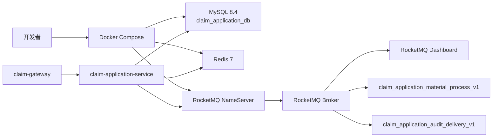
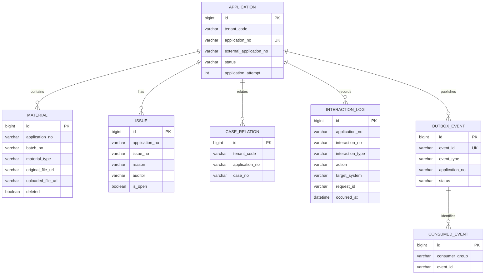

# 002 Application 本地基础设施、数据基线与集成契约设计

## 总体架构

本 Spec 固定 Application 服务的本地运行依赖和跨边界契约，不引入新的服务模块。`claim-application-service` 继续保持 `interfaces → usecase → domain ← infrastructure` 依赖方向；Docker、SQL 与契约文档位于 `deploy`、`docs`，不进入领域层。



## 改动模块

| 位置 | 本次开发产物 | 职责 |
|---|---|---|
| `specs/002-application-integration-foundation` | 三份 Spec 文档 | 需求、设计和可执行任务的唯一依据 |
| `deploy/docker-compose.yml` | 本地依赖服务编排 | 启动 MySQL、Redis、RocketMQ NameServer、Broker、Dashboard |
| `scripts/docker-start.sh` | 本地依赖启动脚本 | 选择本地环境文件，等待服务健康，幂等初始化 Topic 并输出服务状态 |
| `scripts/docker-stop.sh` | 本地依赖停止脚本 | 停止并移除本项目容器和网络，保留数据卷 |
| `deploy/mysql/init/01-create-database.sql` | 建库与应用账号 SQL | 创建 Application 私有库及应用账号 |
| `deploy/mysql/init/02-application-schema.sql` | Application 基础表 SQL | 创建七张基础表、索引和约束 |
| `deploy/README.md` | 本地环境说明 | 启动、停止、重置、健康检查和验证命令 |
| `deploy/health-check.md` | 运行检查说明 | 说明各服务的容器、命令行、Dashboard 与 Application 健康检查方式 |
| `docs/claim-application-integration-contract.md` | 集成契约 | HTTP 路径、请求头、消息信封、Topic 与消费者组 |
| `backend/claim-application-service/src/main/resources/application.yml` | 本地连接配置调整 | 用环境变量覆盖 MySQL、Redis、RocketMQ 地址和应用账号 |

除 `application.yml` 的连接信息外，本 Spec 不新增 Java 类、不新增 Controller、不新增 Mapper、不新增 MQ 消费函数。

## 本地服务设计

| 服务 | 镜像与版本 | 主机端口 | 持久化数据卷 | 健康检查 |
|---|---|---:|---|---|
| MySQL | `mysql:8.4.13` | `3306` | `claim-mysql-data` | `mysqladmin ping` |
| Redis | `redis:7.4.11-alpine` | `6379` | `claim-redis-data` | 使用应用 ACL 账号执行 `redis-cli ping` |
| RocketMQ NameServer | `apache/rocketmq:5.5.0` | `9876` | 无 | `mqadmin clusterList` |
| RocketMQ Broker | `apache/rocketmq:5.5.0` | `10909`、`10911` | 无 | `mqadmin clusterList` |
| RocketMQ Dashboard | `apacherocketmq/rocketmq-dashboard:2.1.0` | `8082` | 无 | HTTP 200 |

编排网络统一命名为 `claim-local-network`。MySQL、Redis、RocketMQ 容器拥有稳定服务名，Application 服务在宿主机启动时默认使用 `127.0.0.1` 地址，在容器网络内启动时使用服务名覆盖环境变量。

MySQL、Redis、RocketMQ 和 RocketMQ Dashboard 镜像均使用多架构镜像清单。Apple Silicon 开发机由 Docker Desktop 自动拉取 `linux/arm64` 变体，Compose 不得设置 `platform: linux/amd64`。本地 RocketMQ 不挂载持久化数据卷，容器重建后由 `scripts/docker-start.sh` 重新配置 Topic；该取舍消除了数据卷权限初始化容器，适用于本地开发，不适用于生产环境。

MySQL 与 Redis 默认账户设计如下，实际生产账户不使用此默认值：

| 配置项 | 默认值 |
|---|---|
| root 密码 | `root` |
| 数据库 | `claim_application_db` |
| Application 账号 | `claim_app` |
| Application 密码 | `claim_app` |
| Redis 应用账号 | `claim_app` |
| Redis 应用密码 | `claim_redis` |

## 核心数据模型



### 建库与建表 SQL

`01-create-database.sql`：

```sql
CREATE DATABASE IF NOT EXISTS claim_application_db
    DEFAULT CHARACTER SET utf8mb4
    DEFAULT COLLATE utf8mb4_0900_ai_ci;

CREATE USER IF NOT EXISTS 'claim_app'@'%' IDENTIFIED BY 'claim_app';
GRANT SELECT, INSERT, UPDATE, DELETE, CREATE, ALTER, INDEX, REFERENCES
    ON claim_application_db.* TO 'claim_app'@'%';
FLUSH PRIVILEGES;
```

`02-application-schema.sql`：

```sql
USE claim_application_db;

CREATE TABLE IF NOT EXISTS application (
    id BIGINT UNSIGNED NOT NULL AUTO_INCREMENT,
    tenant_code VARCHAR(64) NOT NULL,
    application_no VARCHAR(64) NOT NULL,
    external_application_no VARCHAR(128) NOT NULL,
    status VARCHAR(32) NOT NULL,
    application_attempt INT UNSIGNED NOT NULL DEFAULT 1,
    applicant_json JSON NULL,
    primary_insured_json JSON NULL,
    accident_person_json JSON NULL,
    payee_json JSON NULL,
    created_at DATETIME(3) NOT NULL DEFAULT CURRENT_TIMESTAMP(3),
    updated_at DATETIME(3) NOT NULL DEFAULT CURRENT_TIMESTAMP(3) ON UPDATE CURRENT_TIMESTAMP(3),
    PRIMARY KEY (id),
    UNIQUE KEY uk_application_no (application_no),
    UNIQUE KEY uk_tenant_external_application (tenant_code, external_application_no),
    KEY idx_application_status_updated_at (status, updated_at)
) ENGINE = InnoDB DEFAULT CHARSET = utf8mb4 COLLATE = utf8mb4_0900_ai_ci;

CREATE TABLE IF NOT EXISTS material (
    id BIGINT UNSIGNED NOT NULL AUTO_INCREMENT,
    application_no VARCHAR(64) NOT NULL,
    batch_no VARCHAR(64) NOT NULL,
    material_type VARCHAR(64) NOT NULL,
    original_file_url VARCHAR(1024) NOT NULL,
    uploaded_file_url VARCHAR(1024) NULL,
    status VARCHAR(32) NOT NULL,
    deleted TINYINT(1) NOT NULL DEFAULT 0,
    deleted_at DATETIME(3) NULL,
    created_at DATETIME(3) NOT NULL DEFAULT CURRENT_TIMESTAMP(3),
    updated_at DATETIME(3) NOT NULL DEFAULT CURRENT_TIMESTAMP(3) ON UPDATE CURRENT_TIMESTAMP(3),
    PRIMARY KEY (id),
    KEY idx_material_application_batch (application_no, batch_no),
    KEY idx_material_application_deleted (application_no, deleted)
) ENGINE = InnoDB DEFAULT CHARSET = utf8mb4 COLLATE = utf8mb4_0900_ai_ci;

CREATE TABLE IF NOT EXISTS issue (
    id BIGINT UNSIGNED NOT NULL AUTO_INCREMENT,
    application_no VARCHAR(64) NOT NULL,
    issue_no VARCHAR(64) NOT NULL,
    reason VARCHAR(512) NOT NULL,
    auditor VARCHAR(128) NOT NULL,
    issue_content_json JSON NOT NULL,
    status VARCHAR(32) NOT NULL,
    is_open TINYINT(1) NOT NULL DEFAULT 1,
    open_application_no VARCHAR(64) GENERATED ALWAYS AS (
        CASE WHEN is_open = 1 THEN application_no ELSE NULL END
    ) STORED,
    closed_at DATETIME(3) NULL,
    created_at DATETIME(3) NOT NULL DEFAULT CURRENT_TIMESTAMP(3),
    updated_at DATETIME(3) NOT NULL DEFAULT CURRENT_TIMESTAMP(3) ON UPDATE CURRENT_TIMESTAMP(3),
    PRIMARY KEY (id),
    UNIQUE KEY uk_issue_no (issue_no),
    UNIQUE KEY uk_open_issue_application (open_application_no),
    KEY idx_issue_application_created_at (application_no, created_at)
) ENGINE = InnoDB DEFAULT CHARSET = utf8mb4 COLLATE = utf8mb4_0900_ai_ci;

CREATE TABLE IF NOT EXISTS case_relation (
    id BIGINT UNSIGNED NOT NULL AUTO_INCREMENT,
    tenant_code VARCHAR(64) NOT NULL,
    application_no VARCHAR(64) NOT NULL,
    case_no VARCHAR(64) NOT NULL,
    created_at DATETIME(3) NOT NULL DEFAULT CURRENT_TIMESTAMP(3),
    updated_at DATETIME(3) NOT NULL DEFAULT CURRENT_TIMESTAMP(3) ON UPDATE CURRENT_TIMESTAMP(3),
    PRIMARY KEY (id),
    UNIQUE KEY uk_tenant_application_case (tenant_code, application_no, case_no),
    KEY idx_case_relation_application (application_no)
) ENGINE = InnoDB DEFAULT CHARSET = utf8mb4 COLLATE = utf8mb4_0900_ai_ci;

CREATE TABLE IF NOT EXISTS interaction_log (
    id BIGINT UNSIGNED NOT NULL AUTO_INCREMENT,
    application_no VARCHAR(64) NOT NULL,
    interaction_no VARCHAR(64) NOT NULL,
    interaction_type VARCHAR(64) NOT NULL,
    action VARCHAR(32) NOT NULL,
    direction VARCHAR(16) NOT NULL,
    target_system VARCHAR(64) NOT NULL,
    request_id VARCHAR(128) NULL,
    trace_id VARCHAR(128) NULL,
    result_status VARCHAR(32) NOT NULL,
    error_code VARCHAR(64) NULL,
    error_message VARCHAR(512) NULL,
    occurred_at DATETIME(3) NOT NULL,
    created_at DATETIME(3) NOT NULL DEFAULT CURRENT_TIMESTAMP(3),
    updated_at DATETIME(3) NOT NULL DEFAULT CURRENT_TIMESTAMP(3) ON UPDATE CURRENT_TIMESTAMP(3),
    PRIMARY KEY (id),
    KEY idx_interaction_application_occurred_at (application_no, occurred_at),
    KEY idx_interaction_group_occurred_at (interaction_no, occurred_at),
    KEY idx_interaction_request_id (request_id)
) ENGINE = InnoDB DEFAULT CHARSET = utf8mb4 COLLATE = utf8mb4_0900_ai_ci;

CREATE TABLE IF NOT EXISTS outbox_event (
    id BIGINT UNSIGNED NOT NULL AUTO_INCREMENT,
    event_id VARCHAR(64) NOT NULL,
    event_type VARCHAR(64) NOT NULL,
    event_version INT UNSIGNED NOT NULL DEFAULT 1,
    application_no VARCHAR(64) NOT NULL,
    tenant_code VARCHAR(64) NOT NULL,
    payload JSON NOT NULL,
    status VARCHAR(32) NOT NULL,
    retry_count INT UNSIGNED NOT NULL DEFAULT 0,
    next_retry_at DATETIME(3) NULL,
    published_at DATETIME(3) NULL,
    created_at DATETIME(3) NOT NULL DEFAULT CURRENT_TIMESTAMP(3),
    updated_at DATETIME(3) NOT NULL DEFAULT CURRENT_TIMESTAMP(3) ON UPDATE CURRENT_TIMESTAMP(3),
    PRIMARY KEY (id),
    UNIQUE KEY uk_outbox_event_id (event_id),
    KEY idx_outbox_status_next_retry_at (status, next_retry_at),
    KEY idx_outbox_application_created_at (application_no, created_at)
) ENGINE = InnoDB DEFAULT CHARSET = utf8mb4 COLLATE = utf8mb4_0900_ai_ci;

CREATE TABLE IF NOT EXISTS consumed_event (
    id BIGINT UNSIGNED NOT NULL AUTO_INCREMENT,
    consumer_group VARCHAR(128) NOT NULL,
    event_id VARCHAR(64) NOT NULL,
    application_no VARCHAR(64) NOT NULL,
    consumed_at DATETIME(3) NOT NULL DEFAULT CURRENT_TIMESTAMP(3),
    created_at DATETIME(3) NOT NULL DEFAULT CURRENT_TIMESTAMP(3),
    updated_at DATETIME(3) NOT NULL DEFAULT CURRENT_TIMESTAMP(3) ON UPDATE CURRENT_TIMESTAMP(3),
    PRIMARY KEY (id),
    UNIQUE KEY uk_consumed_event (consumer_group, event_id),
    KEY idx_consumed_application (application_no)
) ENGINE = InnoDB DEFAULT CHARSET = utf8mb4 COLLATE = utf8mb4_0900_ai_ci;
```

`material.original_file_url` 保存租户首次提交的文件地址，`material.uploaded_file_url` 保存文件系统上传、转存后的地址。`issue.reason` 和 `issue.auditor` 分别保存问题原因和下发问题件的审核人。`interaction_log` 使用一行记录一个已发生的事件：`interaction_no` 是同一行为组的关联键，`interaction_type` 表示行为类型，例如 `IMAGE_UPLOAD`，`action` 表示阶段，例如 `STARTED`、`COMPLETED`、`FAILED`，`occurred_at` 表示该事件的实际发生时间。一次影像上传的开始与完成应写入两行日志，使用同一 `interaction_no`，按 `occurred_at` 排序后还原完整行为。`issue.open_application_no` 使用生成列和唯一索引表达“一个 Application 同时只允许一条未关闭 Issue”；关闭 Issue 后该列为 `NULL`，允许保留多条历史关闭记录。

## MQ 契约设计

| Topic | 事件类型 | 生产条件 | 消费者组 | 消费职责 |
|---|---|---|---|---|
| `claim_application_material_process_v1` | `APPLICATION_CREATED`、`APPLICATION_REAPPLIED` | Application 签收或重新申请的本地事务提交后 | `claim-application-material-processor-v1` | 异步处理指定申请的材料 |
| `claim_application_audit_delivery_v1` | `AUDIT_DELIVERY_REQUESTED` | Application 已进入 `WAIT_AUDIT` 的本地事务提交后 | `claim-application-audit-delivery-v1` | 向审核系统交付申请 |

所有 Topic 配置 8 个读队列、8 个写队列，消息保留 72 小时。后续如需调整吞吐、保留时间或死信策略，必须先修改本 Spec。

消息信封：

```json
{
  "eventId": "019a9c8c-4d02-7d19-9f16-32d447d4ee66",
  "eventType": "APPLICATION_CREATED",
  "eventVersion": 1,
  "applicationNo": "AP202610270001",
  "tenantCode": "tenant-a",
  "occurredAt": "2026-10-27T10:00:00+08:00",
  "traceId": "5bba2a7f468c4efe",
  "payload": {}
}
```

`payload` 只承载该事件必要的非敏感业务数据。需要人员信息或材料明细时，消费者以 `applicationNo` 读取 Application 私有库，不在 MQ 中广播完整人员 JSON、证件号和银行卡号。

## HTTP 契约设计

### 公共请求头与响应

| 请求头 | 适用范围 | 必填 | 说明 |
|---|---|---|---|
| `X-Tenant-Code` | 全部接口 | 是 | 租户编码 |
| `X-Protocol-Version` | 全部接口 | 是 | 租户协议版本 |
| `X-Trace-Id` | 全部接口 | 否 | 缺失时由网关生成并向下游透传 |
| `X-Request-Id` | 三个回调接口 | 是 | 回调发送方生成的稳定请求标识 |

| 接口 | 方法 | 用途 | 业务关联字段 |
|---|---|---|---|
| `/api/application/v1/applications` | `POST` | 租户提交理赔申请 | `externalApplicationNo` |
| `/api/application/v1/applications/{applicationNo}/materials` | `POST` | 租户提交补充材料 | `applicationNo`、`batchNo` |
| `/api/application/v1/applications/{applicationNo}/revoke` | `POST` | 租户发起 Application 撤销 | `applicationNo` |
| `/api/application/v1/callbacks/underwriting-completed` | `POST` | 承保系统通知自动承保完成 | `applicationNo`、`X-Request-Id` |
| `/api/application/v1/callbacks/audit-signed` | `POST` | 审核系统通知签收及全部 Case | `applicationNo`、`caseNos`、`X-Request-Id` |
| `/api/application/v1/callbacks/audit-issues` | `POST` | 审核系统下发问题件 | `applicationNo`、`issueNo`、`X-Request-Id` |

成功响应的公共信封固定如下：

```json
{
  "code": "SUCCESS",
  "message": "success",
  "traceId": "5bba2a7f468c4efe",
  "data": {}
}
```

公共错误信封固定如下。错误码由后续业务 Spec 在本结构内补充，不得修改字段名：

```json
{
  "code": "INVALID_REQUEST",
  "message": "请求参数不合法",
  "traceId": "5bba2a7f468c4efe",
  "data": null
}
```

申请、补材和撤销的具体 JSON 字段，及回调请求体的字段校验规则，由依赖它们的业务 Spec 定义；本 Spec 仅冻结接口地址、方法、公共头和关联字段。

## 事务、幂等与异常处理

- `application`、`material`、`issue`、`case_relation`、`interaction_log`、`outbox_event` 的实际写入事务由后续用例 Spec 定义；本 Spec 通过唯一约束提供并发安全基础。
- 任何事件处理都以 `eventId` 和消费者组在 `consumed_event` 中去重；插入冲突代表已成功处理或正在处理，后续消费逻辑不得重复推进状态。
- 回调以 `X-Request-Id` 结合 `applicationNo`、`issueNo` 或 `caseNo` 进行幂等；传输请求标识不替代业务唯一约束。InteractionLog 的开始、完成、失败分别作为独立事件落库，查询同一 `interaction_no` 可得到完整行为链路。
- Topic 初始化或数据库初始化失败必须直接失败并输出上下文；不得吞异常或伪造初始化成功。
- DDL 禁止创建外键，避免 Application 服务异步处理、逻辑删除和跨表演进被物理约束阻塞；关联完整性由领域规则和唯一约束保证。

## 对现有功能的影响

- `claim-application-service` 的 local profile 将由硬编码 root 连接改为可覆盖的 Application 应用账号连接；未设置环境变量时仍可连接默认 Docker 环境。
- 当前 Nacos 在 local profile 禁用，因此本次不改变 Nacos、网关路由或其他服务配置。
- 当前应用尚未写入数据库或 MQ，不存在既有数据迁移和消息兼容负担。
- 后续 Application 业务 Spec 必须使用本文件中的表、Topic、消费者组、HTTP 路径和消息信封；需求变更先修改本 Spec，再实施代码。
