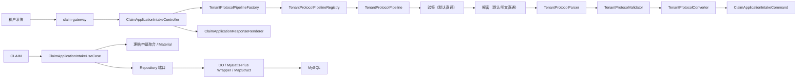
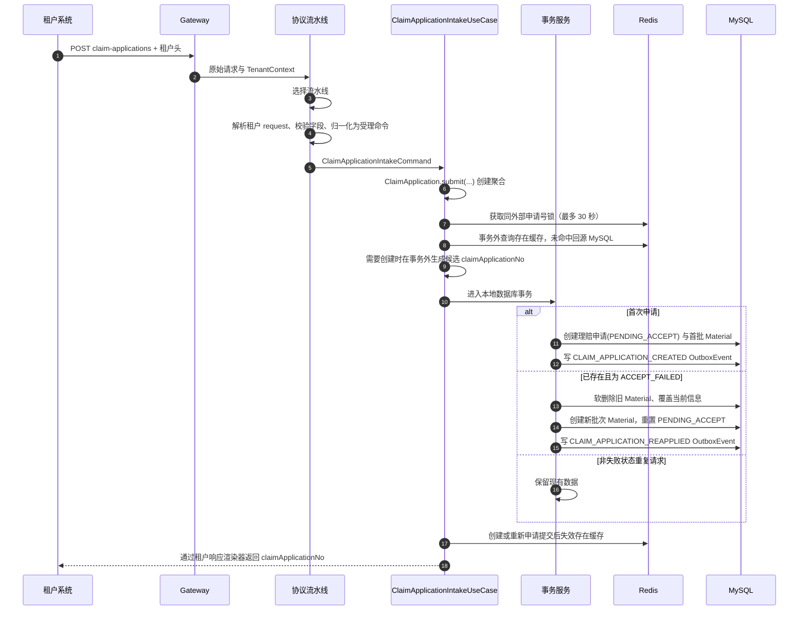
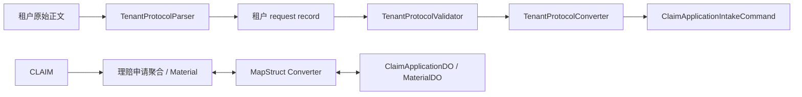
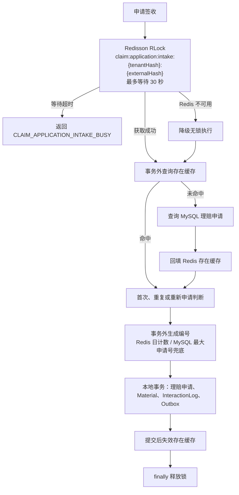

# 003 理赔申请统一接入与签收设计

## 总体架构

统一接入将租户私有协议隔离在接入层。接口层接收 HTTP 请求并由工厂根据租户上下文获取协议流水线；流水线内部按“验签、解密、解析、校验、转换”五步把租户报文归一化为签收用例的标准入参 `ClaimApplicationIntakeCommand`；用例层据此创建 `ClaimApplication` 聚合，再执行幂等签收和事务编排；领域层的 `ClaimApplication` 维护理赔申请状态规则；基础设施层完成 DO、Mapper、Repository、编号生成和 Outbox 持久化。



## 核心链路设计



## 改动模块

模块名按 005 的层级优先目录记录：根包是 `interfaces`、`usecase`、`domain`、`infrastructure` 四层，签收业务域是层内第二级（聚合在 `domain` 层叫 `claim`）。

| 模块 | 改动内容 | 职责 |
|---|---|---|
| `interfaces/intake`（`web` + `web/render` + `tenantprotocol`） | 申请接入 Controller、协议流水线工厂与注册中心（`tenantprotocol/core/pipeline`）、解析/校验/转换端口（`tenantprotocol/core/stage`）、每租户一套协议组件（`tenantprotocol/tenants/{tenant_a,tenant_b}`）、响应渲染路由、HTTP DTO | 处理 HTTP 与租户上下文，不包含签收业务规则 |
| `usecase/intake` | 申请签收用例、材料工厂、数据库事务服务、结果模型 | 管理幂等、重试和跨组件编排，事务内只访问数据库 |
| `domain/claim`（含 `person`、`port`、`exception`） | 理赔申请聚合、状态枚举、`PersonInfo` 人员基类与 `Applicant`/`PrimaryInsured`/`AccidentPerson`/`Payee` 四个角色值对象与 `Gender` 枚举（`person`）、Repository 等端口（`port`）、签收业务异常与错误码 | 维护聚合规则和状态约束，不依赖 Spring 或 ORM |
| `infrastructure/intake`（`persistence`、`cache`、`lock`、`number`） | DO、MyBatis-Plus Mapper 与 Wrapper 查询、仓储实现、DO↔领域转换器与人员 JSON 转换、编号生成、Redisson 锁与降级配置 | 实现领域端口和 Redis 故障降级，不编写手写 SQL |
| `domain/material` | `Material`、`MaterialSubmission`、`MaterialRepository`、`MaterialBatchNoGenerator` | 签收创建的材料领域类型与批次编号端口，由 `usecase/intake` 跨域引用 |
| `domain/integration` | `OutboxEvent`、`InteractionLog` 与各自 Repository 端口 | 由签收用例在同一事务内写入的异步事件与交互轨迹契约 |
| `shared` | `interfaces/web` 的 `ApiResponse` 统一响应结构、`infrastructure` 的 `Sha256Digest` 摘要工具、`contract` 内的跨域异步异常与错误码 | 多域复用且不含签收业务规则的构件 |
| 根 POM 与理赔申请服务 POM | MapStruct、Redisson、Lombok 及其注解处理器绑定 | 生成 DTO、领域对象和 DO 间的映射实现 |
| `application.yml` | 就绪探针分组只包含 `db` | Redis 是可降级依赖，缓存故障不得摘除实例 |

## 主要类职责

| 类或模块 | 职责 |
|---|---|
| `ClaimApplicationIntakeController` | 接收申请提交，读取 TenantContext，调用协议流水线工厂与签收用例，并渲染统一响应 |
| `ClaimApplicationResponseRenderer` | 平台统一响应结构渲染器，按错误码映射响应体、HTTP 状态与 400、500、503 |
| `TenantProtocolPipeline` | 租户协议流水线端口，定义单条租户协议的支持判断与执行入口，输出 `ClaimApplicationIntakeCommand` |
| `TenantProtocolPipelineRegistry` | 注册全部租户协议流水线，按租户编码和协议版本选择唯一流水线，拒绝不支持或配置冲突的协议 |
| `TenantProtocolPipelineFactory` | 根据租户上下文获取对应的租户协议流水线，执行协议适配并返回 `ClaimApplicationIntakeCommand`，同时拒绝跨租户的转换结果 |
| `AbstractTenantProtocolPipeline` | 租户协议流水线模板，固定「验签 → 解密 → 解析 → 校验 → 转换」执行链路；校验节点默认装配注解约束校验器，并提供 `validateTenantRules` 扩展点供租户追加跨字段规则；验签、解密提供默认实现，最终产出平台统一的受理命令 |
| `TenantProtocolParser` | 把原始正文反序列化为租户 request 对象，不使用 Jackson JsonNode |
| `TenantProtocolValidator` | 校验租户 request 上声明的 Bean Validation 约束，违规按字段路径报出 |
| `TenantProtocolConverter` | 把租户 request 归一化为 `ClaimApplicationIntakeCommand` 受理命令，拒绝无法识别的枚举编码 |
| `BeanValidationTenantProtocolValidator` | 注解约束适配器：取字段路径字典序最小的违规，按「字段路径 + 注解文案」构造 `ClaimApplicationIntakeException.invalid`；由 008 引入，替代每租户手写校验器与 `TenantProtocolFieldGuard` |
| `ClaimApplicationIntakeUseCase` | 编排分布式锁、事务外存在性与编号准备、唯一冲突重试；不承担字段校验 |
| `ClaimApplicationIntakeMaterialFactory` | 装配本次签收的材料批次：取批次号并让 `MaterialSubmission` 在 `domain/material` 内生成材料聚合，不访问数据库 |
| `ClaimApplicationLifecycleRecordFactory` | 交互事件与 Outbox 记录的唯一装配入口，位于 `usecase/integration/record`，由 005 收敛而来，签收侧只调用不自建 |
| `ClaimApplicationIntakeTransactionService` | 数据库事务服务，完成首次创建、重复复用、重新申请和冲突解析，事务内不访问 Redis |
| `PersonInfo` | 领域人员值对象的密封基类，承载姓名、性别枚举、证件类型和证件号四个基础字段与相等语义；`Applicant`、`PrimaryInsured`、`AccidentPerson`、`Payee` 是它的四个终态子类，只声明业务角色，聚合与受理命令按角色类型持有四类人员 |
| `Gender` | 人员性别枚举 `MALE`、`FEMALE`，由租户转换器完成归一化 |
| `ClaimApplication` | 理赔申请聚合根，由签收用例调用 `submit(...)` 工厂从受理命令创建；维护四类人员、提交材料、申请尝试次数与状态重置规则 |
| `ClaimApplicationStatus` | `PENDING_ACCEPT`、`ACCEPTED`、`ACCEPT_FAILED`、`UNDERWRITING`、`WAIT_AUDIT`、`ISSUE`、`COMPLETED`、`REVOKED` 状态定义 |
| `MaterialSubmission` | 协议转换出的提交材料值对象，只含材料类型与初始文件地址，落库时转换为 `Material` |
| `Material` | 材料批次、初始文件地址、上传后文件地址、处理状态和逻辑删除规则 |
| `ClaimApplicationDO`、`MaterialDO` | 与 `t_claim_application`、`t_claim_application_material` 表一一对应的基础设施数据对象 |
| `ClaimApplicationDataConverter`、`MaterialDataConverter` | MapStruct 映射领域模型和 DO，只做字段映射不写业务规则；`*Mapper` 一词专指 ORM 数据映射 |
| `PersonInfoJsonConverter` | 人员值对象与数据库人员 JSON 列之间的序列化转换：写方向按 `PersonInfo` 基类只序列化四个基础字段，读方向按列名还原对应角色类型（抽象基类不能被直接反序列化，落库形状由该转换器内部的快照记录承载），由 `ClaimApplicationDataConverter` 复用 |
| `ClaimApplicationDOMapper`、`MaterialDOMapper` | 只继承 `BaseMapper`，查询与更新条件由 Repository 使用 Wrapper 构造，不编写手写 SQL |
| `MybatisPlusConfiguration` | 注册分页插件，为取最大申请编号等单条查询提供分页改写 |
| `ClaimApplicationNoGenerator` | 优先通过 Redis 当前日计数生成编号；计数缺失或不可用时查询 MySQL 当天最大申请号并加一；冲突后可把计数器与 MySQL 最大尾号对齐 |
| `MaterialBatchNoGenerator` | 通过日期和 UUID 随机段生成材料批次编号 |
| `ClaimApplicationIntakeLock` | 封装 Redisson `RLock`：最多等待 30 秒、watchdog 续期、Redis 故障时降级为无锁执行 |
| `ClaimApplicationExistenceQuery` | 以旁路缓存查询同租户外部申请号是否已存在，Redis 不可用时回源 MySQL |
| `Sha256Digest` | 统一 SHA-256 十六进制摘要，供锁 Key 与缓存 Key 复用 |
| `RedissonConfiguration` | 延迟建立 Redisson 连接并收紧连接、命令超时与重试，保证 Redis 停机时应用可启动且快速切换降级链路 |
| `TenantAProtocolPipeline` | 使用默认验签、解密节点，串联租户 A 解析、校验、转换组件，支持 `tenant-a/v1` |
| `TenantAIntakeRequest`、`TenantARequestParser/Converter` | 租户 A request DTO（必填约束以注解声明）及其解析、转换实现 |
| `TenantBProtocolPipeline` | 使用默认验签、解密节点，串联租户 B 解析、校验、转换组件，支持 `tenant-b/v1` |
| `TenantBIntakeRequest`、`TenantBRequestParser/Converter` | 租户 B request DTO（必填约束以注解声明）及其解析、转换实现 |

所有新增类使用中文 JavaDoc，日期使用 `2026-10-27`。

## 示例租户协议适配

示例流水线仅用于验证“多协议进入同一平台模型”的边界，租户编码固定为 `tenant-a`、`tenant-b`，禁止作为生产真实租户协议。

| 协议 | 租户头 | 外部申请号 | 人员结构 | 材料结构 | 特殊转换 |
|---|---|---|---|---|---|
| 租户 A | `X-Tenant-Code: tenant-a`、`X-Protocol-Version: v1` | `requestNo` | `applicant/insured/accident/payee` 下的 `fullName/sex/idType/idNo` | `attachments[].type/sourceUrl` | 字段同义映射 |
| 租户 B | `X-Tenant-Code: tenant-b`、`X-Protocol-Version: v1` | `claimReference` | `claimant/mainInsured/injured/beneficiary` 下的 `name/genderCode/credential.type/credential.number` | `evidences[].documentCode/fileDownloadUrl` | `1 -> MALE`，`2 -> FEMALE` |

`TenantProtocolPipelineRegistry` 持有全部流水线实例，`TenantProtocolPipelineFactory` 根据租户上下文获取唯一实例并执行适配。每种租户协议由一条 `TenantProtocolPipeline` 承载，固定包含以下五个节点：

1. 验签：`AbstractTenantProtocolPipeline.verifySignature` 默认直通；真实租户覆写后按租户协议验证签名，失败时使用统一业务异常拒绝请求。
2. 解密：`AbstractTenantProtocolPipeline.decrypt` 默认原样返回明文；真实租户覆写后解密已验签正文，失败时使用统一业务异常拒绝请求。
3. `TenantProtocolParser`：把明文正文反序列化为租户 request record（如 `TenantAIntakeRequest`），JSON 不合法或结构不匹配时抛 `CLAIM_APPLICATION_INTAKE_INVALID`；禁止使用 Jackson `JsonNode` 传递报文。
4. `TenantProtocolValidator`：模板默认装配 `BeanValidationTenantProtocolValidator`，执行租户 request 上声明的 Bean Validation 约束，覆盖必填文本、嵌套对象与数组元素；错误信息按「字段路径 + 注解文案」输出（如 `applicant.fullName 不能为空`），不携带原始正文；租户新增字段只需在 request record 上声明注解，不新增校验类。注解表达不了的跨字段、跨节点规则由租户覆写 `validateTenantRules` 追加，在注解校验之后执行。
5. `TenantProtocolConverter`：把 request 归一化为 `ClaimApplicationIntakeCommand` 受理命令，负责字段去空格与枚举编码映射，无法识别的编码按字段拒绝。

`AbstractTenantProtocolPipeline` 负责匹配租户编码与协议版本、按顺序调用五个节点、拒绝空报文。流水线只输出尚未分配平台申请编号的 `ClaimApplicationIntakeCommand`；聚合创建、`claimApplicationNo`、`status` 与持久化仍由签收用例完成，租户协议层不得访问 Repository、编号生成器、分布式锁或状态变更逻辑，也不得引用 `ClaimApplication`。

## 核心数据模型

### 理赔申请

| 字段 | 来源 | 签收规则 |
|---|---|---|
| `id` | 数据库自增主键 | 仅用于持久化更新条件，不作为业务标识对外传递 |
| `tenantCode` | TenantContext | 首次创建后不可因重复请求修改 |
| `claimApplicationNo` | 编号生成器 | 平台全局唯一；重新申请复用 |
| `externalClaimApplicationNo` | 协议转换结果 | 与租户组成唯一键 |
| `status` | 领域状态枚举 | 首次和重新申请均为 `PENDING_ACCEPT` |
| `claimApplicationAttempt` | 领域模型 | 首次为 1，重新申请递增 |
| `applicant` | 协议转换结果 | 申请人（`Applicant`）标准化信息；首次写入，重新申请覆盖 |
| `primaryInsured` | 协议转换结果 | 主被保险人（`PrimaryInsured`）标准化信息；供后续保单查询使用 |
| `accidentPerson` | 协议转换结果 | 出险人（`AccidentPerson`）标准化信息；首次写入，重新申请覆盖 |
| `payee` | 协议转换结果 | 领款人（`Payee`）标准化信息；首次写入，重新申请覆盖 |
| `materials` | 协议转换结果 | 本次提交的材料；只用于签收，落库后由 `Material` 独立管理，回读聚合时不填充 |
| `createdAt` / `updatedAt` | 数据库维护 | 分别记录创建与最后更新时间，不由业务代码赋值 |

四类人员各是一个角色类型，同继承人员基类 `PersonInfo`，因此装配按类型而非位置对齐，四个角色互相顶替在编译期即不可能。落库时由 `PersonInfoJsonConverter` 写入 `applicant_json`、`primary_insured_json`、`accident_person_json`、`payee_json` 四个 JSON 列，列内只保存基类的四个基础字段，角色由列名决定：

| 字段 | 含义 |
|---|---|
| `name` | 人员姓名 |
| `gender` | 性别枚举 `MALE`、`FEMALE` |
| `certificateType` | 证件类型 |
| `certificateNo` | 证件号码 |

### Material

| 字段 | 来源 | 签收规则 |
|---|---|---|
| `claimApplicationNo` | 理赔申请| 关联当前理赔申请|
| `batchNo` | 批次编号生成器 | 同一次提交共用；重新申请必须新建 |
| `materialType` | 协议转换结果 | 必填 |
| `originalFileUrl` | 协议转换结果 | 必填，保留租户初始地址 |
| `uploadedFileUrl` | 文件处理后续流程 | 本次为 `null` |
| `status` | 领域常量 | 本次固定 `PENDING_PROCESS` |
| `deleted` | 领域规则 | 重新申请时旧材料置为 `true` |

`t_claim_application`、`t_claim_application_material`、`t_claim_interaction_log`、`t_claim_outbox_event` 的表结构复用 `002` 初始化 SQL，本 Spec 不新增数据库表。`t_claim_interaction_log.claim_application_no` 保持 `NOT NULL`：只有签收受理成功后才会产生平台申请编号和交互轨迹，签收受理前的失败只记录应用日志，不写交互表。新增 DO 必须严格匹配既有列、生成列和唯一约束。

`deploy/mysql/init/02-application-schema.sql` 是数据库字段语义的唯一来源：所有表和列必须声明中文 `COMMENT`，领域模型与 DO 的字段 JavaDoc 必须与对应列语义一致。新增字段、变更字段含义或调整枚举语义时，先同步 SQL 注释和本节数据模型，再修改代码。

理赔申请编号默认使用 Redis Key `claim:application:number:{yyyyMMdd}` 的原子计数器。Key 不存在时，在 Redisson 编号初始化锁内查询 `t_claim_application` 表当天最大 `claim_application_no` 并将尾号写入计数器，再递增取得新号。Redis 完全不可用时直接查询同一最大值并加一，不写 Redis；用例层必须依赖 `uk_claim_application_no` 的唯一冲突重试，以处理并发降级时出现的相同候选编号。

持久化层只使用 MyBatis-Plus：`Mapper` 继承 `BaseMapper`，条件查询使用 `LambdaQueryWrapper`、`lambdaUpdate`，取最大编号使用 `selectPage` 分页；禁止在 Mapper 上编写 `@Select`、`@Update` 手写 SQL。

## MapStruct 映射设计



- 租户 request 到 `ClaimApplicationIntakeCommand` 的映射属于具体 `TenantProtocolConverter`，不由公共 MapStruct Mapper 处理。
- 流水线产出的 `ClaimApplicationIntakeCommand` 只携带归一化后的业务字段；`claimApplicationNo`、`status`、`claimApplicationAttempt`、`batchNo`、逻辑删除标记等业务字段由用例或领域模型显式赋值。
- 领域对象与 DO 之间使用 MapStruct 映射，四类人员角色值对象经 `PersonInfoJsonConverter` 写入对应 JSON 列，回读时按列名还原角色类型，材料 URL 按同名字段复制。
- MapStruct Mapper 只处理数据转换，不查询数据库、不生成编号、不变更状态。

## 并发控制与旁路缓存设计



- 签收锁 Key 对租户编码和外部申请号进行 SHA-256 摘要，避免 Redis Key 与日志泄漏原始业务标识。
- 使用 `tryLock` 最多等待 30 秒且不指定租约，使 Redisson watchdog 自动续期；等待超时抛 `CLAIM_APPLICATION_INTAKE_BUSY`；Redis 抛出连接异常时降级为无锁执行并记录告警，由数据库唯一约束保证幂等；释放动作在 `finally` 中且仅由当前持锁线程执行。
- 存在缓存与编号生成都在事务外完成：缓存 Key 仅存布尔值，命中值 TTL 为 10 分钟，空值 TTL 为 1 分钟；首次创建、重新申请或缓存被判定为陈旧时删除 Key。
- 数据库事务内不得访问 Redis；存在性缓存提示为“已存在”但数据库无记录时，事务抛内部陈旧标记，由用例淘汰缓存后重新准备编号并重试。
- Redis 计数器缺失时，在 Redisson 编号初始化锁（最多等待 30 秒）中查询当天 MySQL 最大申请号恢复计数；初始化锁未取得或 Redis 不可用时直接按最大申请号加一生成候选值，不递增未初始化的计数器。MySQL `uk_claim_application_no` 始终是并发降级的最终唯一性防线。
- Redis 计数器可能落后于数据库（旧快照恢复、故障期间由 MySQL 兜底发号）：唯一键冲突且不存在同外部申请号记录时，调用 `ClaimApplicationNoGenerator.synchronizeDailyCounter()` 以 CAS 循环把计数器抬升到 MySQL 当天最大尾号（只抬升不回退），再在同一请求内重试，避免持续生成已占用编号。
- `RedissonConfiguration` 除延迟初始化外，收紧连接与命令超时（连接 2 秒、命令 1 秒、重试 1 次、重试间隔 200 毫秒），使 Redis 故障时约 1 秒内切到 MySQL 降级链路，而不是按默认重试等待近 10 秒。

## 接口设计

| 项目 | 定义 |
|---|---|
| 路径 | `POST /api/application/v1/claim-applications` |
| 调用方 | 租户系统 |
| 必填请求头 | `X-Tenant-Code`、`X-Protocol-Version` |
| 可选请求头 | `X-Trace-Id` |
| 请求体 | 租户私有协议，由对应 `TenantProtocolPipeline` 解析 |
| 成功响应 | 默认统一结构：`code=SUCCESS`，`data.claimApplicationNo` 为平台申请编号 |
| 业务错误 | `TENANT_PROTOCOL_UNSUPPORTED`、`TENANT_PROTOCOL_AMBIGUOUS`、`CLAIM_APPLICATION_INTAKE_INVALID`、`CLAIM_APPLICATION_INTAKE_BUSY`、租户验签/解密/解析错误 |
| 系统错误 | `CLAIM_APPLICATION_INTAKE_SYSTEM_ERROR` |
| 响应渲染 | `ClaimApplicationResponseRenderer` 统一提供响应体、HTTP 状态和响应头 |

统一结构渲染器按错误码映射 HTTP 状态：

| 错误码 | HTTP 状态 |
|---|---|
| `TENANT_PROTOCOL_UNSUPPORTED`、`TENANT_PROTOCOL_AMBIGUOUS`、`CLAIM_APPLICATION_INTAKE_INVALID` | 400 |
| `CLAIM_APPLICATION_INTAKE_BUSY` | 503 |
| `CLAIM_APPLICATION_INTAKE_SYSTEM_ERROR` | 500 |

响应外形与错误码语义均由平台渲染器统一处理，租户协议差异只体现在入参报文；真实租户响应外形差异由后续 Spec 实现。

统一成功响应示例：

```json
{
  "code": "SUCCESS",
  "message": "success",
  "traceId": "5bba2a7f468c4efe",
  "data": {
    "claimApplicationNo": "A2026102700000001"
  }
}
```

## JMeter 压测设计

| 脚本 | 场景 | 请求生成方式 | 断言 | 预期结果 |
|---|---|---|---|---|
| `application-intake-throughput.jmx` | 多个唯一外部申请并发签收 | 每次请求使用 JMeter UUID 生成 `requestNo` | HTTP 200、`code=SUCCESS`、`X-Trace-Id` | 每个请求经网关对外入口成功签收 |
| `application-intake-idempotency.jmx` | 同外部申请号并发签收 | 所有线程共享 `EXTERNAL_APPLICATION_NO` | HTTP 200、`code=SUCCESS`、`X-Trace-Id`；JSON 提取并断言响应 `claimApplicationNo` 一致 | 所有请求经网关对外入口返回同一理赔申请编号 |

脚本默认调用 `tenant-a/v1`，目标为 `claim-gateway` 的 `127.0.0.1:8080`，通过 JMeter 用户变量调整网关地址、并发数、循环次数和外部申请号。压测仅通过对外 HTTP 接口及其响应验收，不直接操作或查询数据库、Repository、MQ，也不直连理赔申请服务端口。

## 并发控制、事务与异常处理

- 首次创建依赖 `(tenant_code, external_claim_application_no)` 唯一约束；发生唯一冲突后重新读取当前理赔申请，不重复创建。
- Redisson 锁最多等待 30 秒，使用 watchdog 续期；Redis 故障时降级为无锁执行，不得跳过 MySQL 唯一约束和事务校验。
- 存在性判断与申请编号生成在事务外完成，事务内只做数据库写入，避免长时间持有数据库行锁和连接。
- 存在性缓存与数据库不一致、唯一键冲突后仍无既有记录时，淘汰缓存并在同一请求内重试，最多 3 次；唯一键冲突后仍无既有记录时同时校准 Redis 日计数器。
- 重新申请使用状态条件更新（`WHERE id = ? AND status = 'ACCEPT_FAILED'`），确保仅 `ACCEPT_FAILED` 可以被一次请求重置；并发请求已先完成重置时更新行数为 0，本次请求按重复请求返回复用结果，不覆盖对方写入。
- 理赔申请、Material、InteractionLog、OutboxEvent 的首次创建和重新申请重置在一个本地事务内提交。
- InteractionLog 只在申请号产生后记录 `STARTED`、`COMPLETED`、`REUSED` 事件；签收受理前的失败不产生申请号，也不写交互轨迹，只记录应用日志和租户错误响应。
- 未知异常、数据库异常和 Outbox 写入异常不得吞掉；核心事务回滚后返回统一系统异常。

## 对现有功能的影响

- 复用 `002` 建立的本地 MySQL 表、OutboxEvent、InteractionLog、网关路由和租户上下文。
- 新增 MapStruct 仅用于理赔申请服务数据转换，不改变其他服务依赖或领域边界。
- 理赔申请状态枚举为后续材料处理、承保、审核、问题件和撤销 Spec 提供唯一状态定义；后续状态规则变更必须先修改本 Spec。
