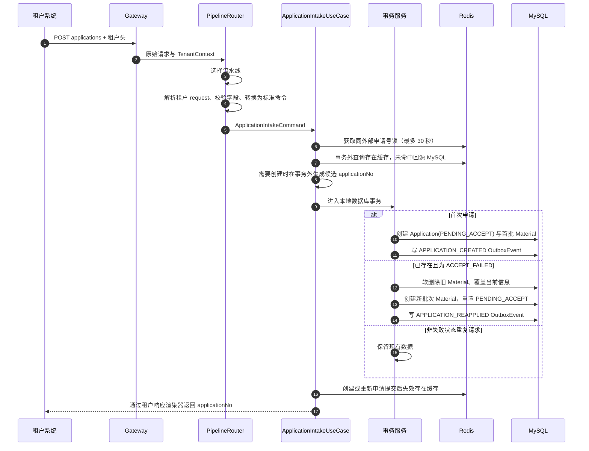
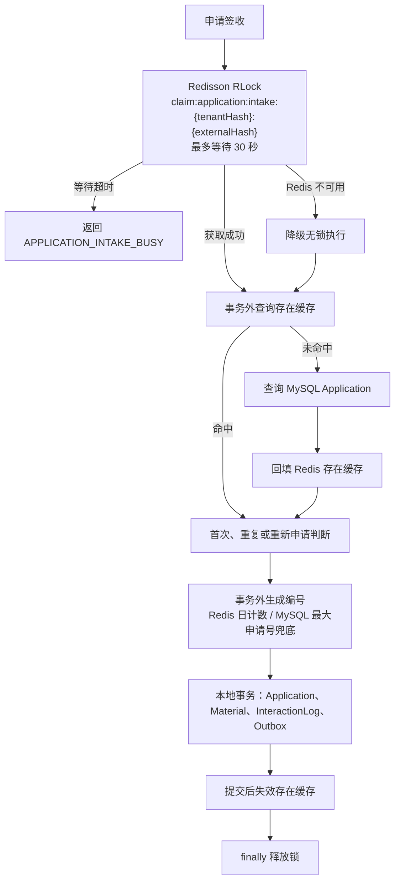

# 003 理赔申请统一接入与签收设计

## 总体架构

统一接入将租户私有协议隔离在接入层。接口层接收 HTTP 请求并根据租户上下文路由协议流水线；流水线内部按“解析、校验、转换”三步把租户报文转换为标准命令；用例层执行幂等签收和事务编排；领域层维护 Application 状态规则；基础设施层完成 DO、Mapper、Repository、编号生成和 Outbox 持久化。

```mermaid
flowchart LR
    TENANT["租户系统"] --> GATEWAY["claim-gateway"]
    GATEWAY --> CONTROLLER["ApplicationIntakeController"]
    CONTROLLER --> ROUTER["TenantApplicationPipelineRouter"]
    ROUTER --> PIPELINE["TenantApplicationPipeline"]
    PIPELINE --> PARSER["TenantApplicationParser"]
    PARSER --> VALIDATOR["TenantApplicationValidator"]
    VALIDATOR --> CONVERTER["TenantApplicationConverter"]
    CONVERTER --> COMMAND["ApplicationIntakeCommand"]
    COMMAND --> USECASE["ApplicationIntakeUseCase"]
    USECASE --> DOMAIN["Application / Material"]
    USECASE --> REPOSITORY["Repository 端口"]
    CONTROLLER --> RESPONSE["TenantApplicationResponseRouter"]
    RESPONSE --> UNIFIED["UnifiedApplicationResponseRenderer"]
    REPOSITORY --> PERSISTENCE["DO / MyBatis-Plus Wrapper / MapStruct"]
    PERSISTENCE --> MYSQL["MySQL"]
```



## 核心链路设计



## 改动模块

| 模块 | 改动内容 | 职责 |
|---|---|---|
| `interfaces` | 申请接入 Controller、协议流水线路由、解析/校验/转换组件、响应渲染路由、HTTP DTO | 处理 HTTP 与租户上下文，不包含签收业务规则 |
| `usecase` | 申请签收用例、记录工厂、数据库事务服务、标准命令、结果模型 | 管理幂等、重试和跨组件编排，事务内只访问数据库 |
| `domain` | Application、Material、状态枚举、Repository 端口 | 维护聚合规则和状态约束，不依赖 Spring 或 ORM |
| `infrastructure` | DO、MyBatis-Plus Mapper 与 Wrapper 查询、Repository、MapStruct、编号生成、Redisson 锁与降级配置 | 实现领域端口和 Redis 故障降级，不编写手写 SQL |
| 根 POM 与 Application POM | MapStruct、Redisson、Lombok 及其注解处理器绑定 | 生成 DTO、命令、领域对象和 DO 间的映射实现 |
| `application.yml` | 就绪探针分组只包含 `db` | Redis 是可降级依赖，缓存故障不得摘除实例 |

## 主要类职责

| 类或模块 | 职责 |
|---|---|
| `ApplicationIntakeController` | 接收申请提交，读取 TenantContext，调用协议流水线路由与签收用例，并按租户渲染响应 |
| `TenantApplicationResponseRenderer` | 定义租户响应结构渲染端口，实现方决定响应体、HTTP 状态和响应头 |
| `TenantApplicationResponseRouter` | 按租户选择唯一渲染器；未匹配或缺少租户上下文时使用统一结构 |
| `UnifiedApplicationResponseRenderer` | 平台统一响应结构兜底实现，按错误码映射 400、500、503 |
| `TenantApplicationPipeline` | 定义单条租户协议的支撑判断与执行入口，输出 ApplicationIntakeCommand |
| `TenantApplicationPipelineRouter` | 按租户编码和协议版本选择唯一流水线，拒绝不支持或配置冲突的协议 |
| `AbstractTenantApplicationPipeline` | 流水线模板，固定“解析 → 校验 → 转换”顺序并统一空报文处理 |
| `TenantApplicationParser` | 把原始正文反序列化为租户 request 对象，不使用 Jackson JsonNode |
| `TenantApplicationValidator` | 校验租户 request 的必填字段与嵌套结构 |
| `TenantApplicationConverter` | 把租户 request 归一化为标准命令，拒绝无法识别的枚举编码 |
| `TenantApplicationValidation` | 租户报文校验的公共判断，统一错误码与字段路径定位 |
| `ApplicationIntakeCommand` | 标准化外部申请号、四类人员信息和首次材料，不含 HTTP 或租户私有字段 |
| `ApplicationIntakeUseCase` | 编排参数校验、分布式锁、事务外存在性与编号准备、唯一冲突重试 |
| `ApplicationIntakeRecordFactory` | 构建材料、交互事件和 Outbox 记录，不访问数据库与 Redis |
| `ApplicationIntakeTransactionService` | 数据库事务服务，完成首次创建、重复复用、重新申请和冲突解析，事务内不访问 Redis |
| `PersonInfo` | 标准人员值对象，承载姓名、性别枚举、证件类型和证件号 |
| `Gender` | 人员性别枚举 `MALE`、`FEMALE`，由租户转换器完成归一化 |
| `Application` | Application 聚合根，维护申请尝试次数、人员信息和状态重置规则 |
| `ApplicationStatus` | `PENDING_ACCEPT`、`ACCEPTED`、`ACCEPT_FAILED`、`UNDERWRITING`、`WAIT_AUDIT`、`ISSUE`、`COMPLETED`、`REVOKED` 状态定义 |
| `Material` | 材料批次、初始文件地址、上传后文件地址、处理状态和逻辑删除规则 |
| `ApplicationDO`、`MaterialDO` | 与 `t_claim_application`、`t_claim_application_material` 表一一对应的基础设施数据对象 |
| `ApplicationDataMapper`、`MaterialDataMapper` | MapStruct 映射标准命令、领域模型和 DO，禁止在 Mapper 中编写业务规则 |
| `ApplicationDOMapper`、`MaterialDOMapper` | 只继承 `BaseMapper`，查询与更新条件由 Repository 使用 Wrapper 构造，不编写手写 SQL |
| `MybatisPlusConfiguration` | 注册分页插件，为取最大申请编号等单条查询提供分页改写 |
| `ApplicationNoGenerator` | 优先通过 Redis 当前日计数生成编号；计数缺失或不可用时查询 MySQL 当天最大申请号并加一；冲突后可把计数器与 MySQL 最大尾号对齐 |
| `MaterialBatchNoGenerator` | 通过日期和 UUID 随机段生成材料批次编号 |
| `ApplicationIntakeLock` | 封装 Redisson `RLock`：最多等待 30 秒、watchdog 续期、Redis 故障时降级为无锁执行 |
| `ApplicationExistenceQuery` | 以旁路缓存查询同租户外部申请号是否已存在，Redis 不可用时回源 MySQL |
| `Sha256Digest` | 统一 SHA-256 十六进制摘要，供锁 Key 与缓存 Key 复用 |
| `RedissonConfiguration` | 延迟建立 Redisson 连接并收紧连接、命令超时与重试，保证 Redis 停机时应用可启动且快速切换降级链路 |
| `DemoInsurerAApplicationPipeline` | 串联 A 租户解析、校验、转换组件，支持 `demo-insurer-a/v1` |
| `DemoInsurerAIntakeRequest`、`DemoInsurerARequestParser/Validator/Converter` | A 租户 request DTO 及其解析、校验、转换实现 |
| `DemoInsurerBApplicationPipeline` | 串联 B 租户解析、校验、转换组件，支持 `demo-insurer-b/v1` |
| `DemoInsurerBIntakeRequest`、`DemoInsurerBRequestParser/Validator/Converter` | B 租户 request DTO 及其解析、校验、转换实现 |

所有新增类使用中文 JavaDoc，日期使用 `2026-10-27`。

## 示例租户协议适配

示例流水线仅用于验证“多协议进入同一标准命令”的边界，编码均以 `demo-` 开头，禁止作为生产真实租户协议。

| 协议 | 租户头 | 外部申请号 | 人员结构 | 材料结构 | 特殊转换 |
|---|---|---|---|---|---|
| Demo Insurer A | `X-Tenant-Code: demo-insurer-a`、`X-Protocol-Version: v1` | `requestNo` | `applicant/insured/accident/payee` 下的 `fullName/sex/idType/idNo` | `attachments[].type/sourceUrl` | 字段同义映射 |
| Demo Insurer B | `X-Tenant-Code: demo-insurer-b`、`X-Protocol-Version: v1` | `claimReference` | `claimant/mainInsured/injured/beneficiary` 下的 `name/genderCode/credential.type/credential.number` | `evidences[].documentCode/fileDownloadUrl` | `1 -> MALE`，`2 -> FEMALE` |

每种租户协议由一条 `TenantApplicationPipeline` 承载，内部固定三个组件：

1. `TenantApplicationParser`：把原始正文反序列化为租户 request record（如 `DemoInsurerAIntakeRequest`），JSON 不合法或结构不匹配时抛 `APPLICATION_INTAKE_INVALID`；禁止使用 Jackson `JsonNode` 传递报文。
2. `TenantApplicationValidator`：校验 request 的必填文本与嵌套对象、数组，错误信息携带字段路径（如 `applicant.fullName`），不携带原始正文。
3. `TenantApplicationConverter`：把 request 归一化为 `ApplicationIntakeCommand`，负责字段去空格与枚举编码映射，无法识别的编码按字段拒绝。

`AbstractTenantApplicationPipeline` 负责匹配租户编码与协议版本、按顺序调用三个组件、拒绝空报文。流水线只输出 `ApplicationIntakeCommand`，不得直接调用 Repository、编号、锁或状态变更逻辑。

## 核心数据模型

### Application

| 字段 | 来源 | 签收规则 |
|---|---|---|
| `tenantCode` | TenantContext | 首次创建后不可因重复请求修改 |
| `applicationNo` | 编号生成器 | 平台全局唯一；重新申请复用 |
| `externalApplicationNo` | 标准命令 | 与租户组成唯一键 |
| `status` | 领域状态枚举 | 首次和重新申请均为 `PENDING_ACCEPT` |
| `applicationAttempt` | 领域模型 | 首次为 1，重新申请递增 |
| 四类人员 JSON | 标准命令 | 首次写入；仅重新申请覆盖 |

人员 JSON 对应统一 `PersonInfo`：

| 字段 | 含义 |
|---|---|
| `name` | 人员姓名 |
| `gender` | 性别枚举 `MALE`、`FEMALE` |
| `certificateType` | 证件类型 |
| `certificateNo` | 证件号码 |

### Material

| 字段 | 来源 | 签收规则 |
|---|---|---|
| `applicationNo` | Application | 关联当前 Application |
| `batchNo` | 批次编号生成器 | 同一次提交共用；重新申请必须新建 |
| `materialType` | 标准命令 | 必填 |
| `originalFileUrl` | 标准命令 | 必填，保留租户初始地址 |
| `uploadedFileUrl` | 文件处理后续流程 | 本次为 `null` |
| `status` | 领域常量 | 本次固定 `PENDING_PROCESS` |
| `deleted` | 领域规则 | 重新申请时旧材料置为 `true` |

`t_claim_application`、`t_claim_application_material`、`t_claim_interaction_log`、`t_claim_outbox_event` 的表结构复用 `002` 初始化 SQL，本 Spec 不新增数据库表。`t_claim_interaction_log.application_no` 保持 `NOT NULL`：只有签收受理成功后才会产生平台申请编号和交互轨迹，签收受理前的失败只记录应用日志，不写交互表。新增 DO 必须严格匹配既有列、生成列和唯一约束。

Application 编号默认使用 Redis Key `claim:application:number:{yyyyMMdd}` 的原子计数器。Key 不存在时，在 Redisson 编号初始化锁内查询 `t_claim_application` 表当天最大 `application_no` 并将尾号写入计数器，再递增取得新号。Redis 完全不可用时直接查询同一最大值并加一，不写 Redis；用例层必须依赖 `uk_application_no` 的唯一冲突重试，以处理并发降级时出现的相同候选编号。

持久化层只使用 MyBatis-Plus：`Mapper` 继承 `BaseMapper`，条件查询使用 `LambdaQueryWrapper`、`lambdaUpdate`，取最大编号使用 `selectPage` 分页；禁止在 Mapper 上编写 `@Select`、`@Update` 手写 SQL。

## MapStruct 映射设计


- 租户 request 到标准命令的映射属于具体 `TenantApplicationConverter`，不由公共 MapStruct Mapper 处理。
- 标准命令到领域对象的默认字段复制可以由 MapStruct 完成；`applicationNo`、`batchNo`、`status`、申请次数、逻辑删除标记等业务字段由用例或领域模型显式赋值。
- 领域对象与 DO 之间使用 MapStruct 映射，四类人员 JSON 和材料 URL 按同名字段复制。
- MapStruct Mapper 只处理数据转换，不查询数据库、不生成编号、不变更状态。

## 并发控制与旁路缓存设计



- 签收锁 Key 对租户编码和外部申请号进行 SHA-256 摘要，避免 Redis Key 与日志泄漏原始业务标识。
- 使用 `tryLock` 最多等待 30 秒且不指定租约，使 Redisson watchdog 自动续期；等待超时抛 `APPLICATION_INTAKE_BUSY`；Redis 抛出连接异常时降级为无锁执行并记录告警，由数据库唯一约束保证幂等；释放动作在 `finally` 中且仅由当前持锁线程执行。
- 存在缓存与编号生成都在事务外完成：缓存 Key 仅存布尔值，命中值 TTL 为 10 分钟，空值 TTL 为 1 分钟；首次创建、重新申请或缓存被判定为陈旧时删除 Key。
- 数据库事务内不得访问 Redis；存在性缓存提示为“已存在”但数据库无记录时，事务抛内部陈旧标记，由用例淘汰缓存后重新准备编号并重试。
- Redis 计数器缺失时，在 Redisson 编号初始化锁（最多等待 30 秒）中查询当天 MySQL 最大申请号恢复计数；初始化锁未取得或 Redis 不可用时直接按最大申请号加一生成候选值，不递增未初始化的计数器。MySQL `uk_application_no` 始终是并发降级的最终唯一性防线。
- Redis 计数器可能落后于数据库（旧快照恢复、故障期间由 MySQL 兜底发号）：唯一键冲突且不存在同外部申请号记录时，调用 `ApplicationNoGenerator.synchronizeDailyCounter()` 以 CAS 循环把计数器抬升到 MySQL 当天最大尾号（只抬升不回退），再在同一请求内重试，避免持续生成已占用编号。
- `RedissonConfiguration` 除延迟初始化外，收紧连接与命令超时（连接 2 秒、命令 1 秒、重试 1 次、重试间隔 200 毫秒），使 Redis 故障时约 1 秒内切到 MySQL 降级链路，而不是按默认重试等待近 10 秒。

## 接口设计

| 项目 | 定义 |
|---|---|
| 路径 | `POST /api/application/v1/applications` |
| 调用方 | 租户系统 |
| 必填请求头 | `X-Tenant-Code`、`X-Protocol-Version` |
| 可选请求头 | `X-Trace-Id` |
| 请求体 | 租户私有协议，由对应 `TenantApplicationPipeline` 解析 |
| 成功响应 | 默认统一结构：`code=SUCCESS`，`data.applicationNo` 为平台申请编号 |
| 业务错误 | `TENANT_PROTOCOL_UNSUPPORTED`、`TENANT_PROTOCOL_AMBIGUOUS`、`APPLICATION_INTAKE_INVALID`、`APPLICATION_INTAKE_BUSY`、租户验签/解密/解析错误 |
| 系统错误 | `APPLICATION_INTAKE_SYSTEM_ERROR` |
| 响应渲染 | `TenantApplicationResponseRenderer` 按租户提供响应体、HTTP 状态和响应头；未实现时由 `UnifiedApplicationResponseRenderer` 返回统一结构 |

统一结构渲染器按错误码映射 HTTP 状态：

| 错误码 | HTTP 状态 |
|---|---|
| `TENANT_PROTOCOL_UNSUPPORTED`、`TENANT_PROTOCOL_AMBIGUOUS`、`APPLICATION_INTAKE_INVALID` | 400 |
| `APPLICATION_INTAKE_BUSY` | 503 |
| `APPLICATION_INTAKE_SYSTEM_ERROR` | 500 |

租户渲染器只决定本租户协议外形，错误码语义仍由平台统一处理；两个示例租户沿用统一结构，真实租户响应差异由后续 Spec 实现。

统一成功响应示例：

```json
{
  "code": "SUCCESS",
  "message": "success",
  "traceId": "5bba2a7f468c4efe",
  "data": {
    "applicationNo": "A2026102700000001"
  }
}
```

## JMeter 压测设计

| 脚本 | 场景 | 请求生成方式 | 断言 | 预期结果 |
|---|---|---|---|---|
| `application-intake-throughput.jmx` | 多个唯一外部申请并发签收 | 每次请求使用 JMeter UUID 生成 `requestNo` | HTTP 200、`code=SUCCESS` | 每个请求各创建一条 Application |
| `application-intake-idempotency.jmx` | 同外部申请号并发签收 | 所有线程共享 `EXTERNAL_APPLICATION_NO` | HTTP 200、`code=SUCCESS` | 所有响应返回同一 applicationNo，数据库仅一条 Application |

脚本默认调用 `demo-insurer-a/v1`，通过 JMeter 用户变量调整服务地址、并发数、循环次数和外部申请号。压测会写入本地数据库；执行前必须确认目标是本地开发库，执行后按 `tenant_code` 与外部申请号核对 Application、Material、InteractionLog、OutboxEvent 数据。

## 并发控制、事务与异常处理

- 首次创建依赖 `(tenant_code, external_application_no)` 唯一约束；发生唯一冲突后重新读取当前 Application，不重复创建。
- Redisson 锁最多等待 30 秒，使用 watchdog 续期；Redis 故障时降级为无锁执行，不得跳过 MySQL 唯一约束和事务校验。
- 存在性判断与申请编号生成在事务外完成，事务内只做数据库写入，避免长时间持有数据库行锁和连接。
- 存在性缓存与数据库不一致、唯一键冲突后仍无既有记录时，淘汰缓存并在同一请求内重试，最多 3 次；唯一键冲突后仍无既有记录时同时校准 Redis 日计数器。
- 重新申请使用状态条件更新（`WHERE id = ? AND status = 'ACCEPT_FAILED'`），确保仅 `ACCEPT_FAILED` 可以被一次请求重置；并发请求已先完成重置时更新行数为 0，本次请求按重复请求返回复用结果，不覆盖对方写入。
- Application、Material、InteractionLog、OutboxEvent 的首次创建和重新申请重置在一个本地事务内提交。
- InteractionLog 只在申请号产生后记录 `STARTED`、`COMPLETED`、`REUSED` 事件；签收受理前的失败不产生申请号，也不写交互轨迹，只记录应用日志和租户错误响应。
- 未知异常、数据库异常和 Outbox 写入异常不得吞掉；核心事务回滚后返回统一系统异常。

## 对现有功能的影响

- 复用 `002` 建立的本地 MySQL 表、OutboxEvent、InteractionLog、网关路由和租户上下文。
- 新增 MapStruct 仅用于 Application 服务数据转换，不改变其他服务依赖或领域边界。
- Application 状态枚举为后续材料处理、承保、审核、问题件和撤销 Spec 提供唯一状态定义；后续状态规则变更必须先修改本 Spec。
