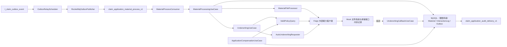
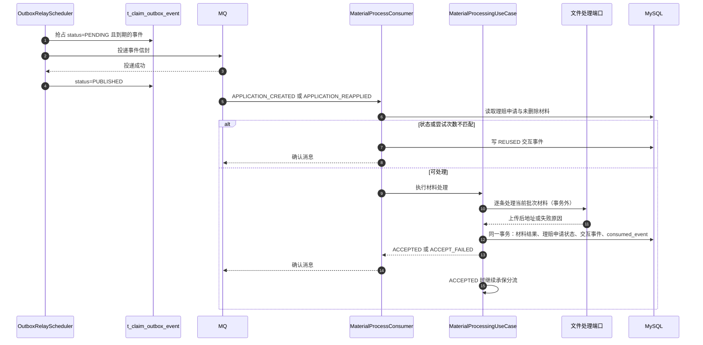
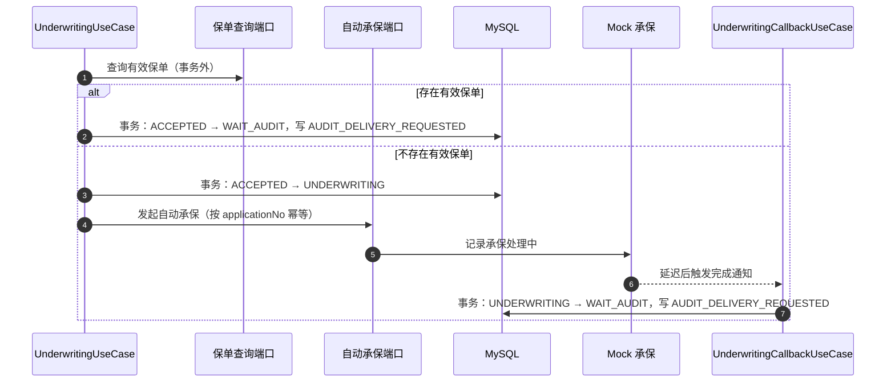

# 004 材料处理与承保确认设计

## 总体架构

本 Spec 在 003 已建成的签收链路之后补齐异步段：投递器把 Outbox 事件送到 MQ，消费者驱动材料处理与承保分流。文件系统和承保系统不属于本项目实现范围，统一以"领域端口 + 本服务内模拟接口"呈现：用例只依赖端口，Feign 适配器调用模拟接口，模拟接口以内存数据返回结果。

依赖方向沿用 `interfaces → usecase → domain ← infrastructure`。领域层只声明端口，Feign、MQ、内存模拟、定时调度全部落在基础设施层。

## 核心链路设计

### 事件投递与材料处理

### 承保分流与完成通知

## 改动模块

模块名按 005 的层级优先目录记录：根包是 `interfaces`、`usecase`、`domain`、`infrastructure` 四层，业务域是层内第二级（申请聚合在 `domain` 层叫 `claim`）。

| 模块 | 改动内容 | 职责 |
|---|---|---|
| `domain/claim` | `ClaimApplication` 生命周期迁移方法、`ApplicationRepository` 查询与条件更新、`PersonInfo` 证件号读取 | 维护状态迁移前置条件，不依赖 Spring、MQ、Feign |
| `domain/material` + `usecase/material` + `interfaces/material` + `infrastructure/material` | `Material`、`MaterialRepository`、`MaterialStatus`、`MaterialFileProcessor` 端口；材料处理用例与事务服务；`MaterialProcessConsumer`；材料持久化与 Feign 文件客户端 | 材料聚合、消息接收与文件处理编排 |
| `domain/underwriting` + `usecase/underwriting` + `interfaces/underwriting` + `infrastructure/underwriting` | `ValidPolicyQuery`、`AutoUnderwritingRequester`、`UnderwritingResultQuery` 端口与 `PolicySnapshot`、`UnderwritingResult` 值对象；承保分流、回调用例与事务服务；回调 HTTP 接口；Feign 承保客户端 | 保单查询、自动承保发起与承保完成确认 |
| `domain/integration` + `usecase/integration` + `interfaces/integration` + `infrastructure/integration` | `OutboxEventRepository`、`ConsumedEventRepository`、`InteractionLogRepository` 端口与实现；`ApplicationLifecycleRecordFactory` 记录装配；`OutboxRelayUseCase` 与 MQ 投递器；`ApplicationCompensationUseCase` 补偿调度；`OutboxRelayPolicy`、`ApplicationCompensationPolicy` 策略端口及其 `infrastructure/integration/config` 配置适配器 | 平台异步内核：投递、消费去重、交互轨迹与滞留补偿，允许编排业务域用例 |
| `shared` | `ApplicationEventEnvelope`、`UnderwritingCompletedCommand` 跨域契约；统一响应模型与异步错误码、异常 | 多域复用的消息与协议构件，不含业务规则 |
| `support` | 模拟文件系统与模拟承保存储及其 HTTP 接口 | 仅 `claim.mock.enabled` 打开时生效的外部系统模拟 |
| `application.yml` | Feign 地址与超时、MQ 绑定、投递与补偿阈值、模拟外部能力开关 | 本地可运行、生产可覆盖 |
| 根 POM 与理赔申请POM | 引入 `spring-cloud-starter-openfeign` | 声明式外部调用 |

## 主要类职责

| 类或模块 | 职责 |
|---|---|
| `OutboxRelayScheduler` | 按固定间隔触发投递用例，异常只记录日志，不中断后续调度 |
| `OutboxRelayUseCase` | 抢占事件、组装消息信封、调用投递端口、按结果更新事件状态与退避时间 |
| `OutboxEventPublisher` | 消息投递端口，按事件类型选择 Topic |
| `RocketMqOutboxPublisher` | 基于 `StreamBridge` 实现投递端口 |
| `MaterialProcessConsumer` | 订阅材料处理 Topic，解析信封并调用材料处理用例 |
| `MaterialProcessingUseCase` | 校验事件与当前申请一致性，编排材料处理与后续承保分流 |
| `MaterialProcessingTransactionService` | 单事务写入材料结果、理赔申请状态、交互事件与消费登记 |
| `UnderwritingUseCase` | 事务外查询保单，按结果推进到 `WAIT_AUDIT` 或 `UNDERWRITING` 并发起自动承保 |
| `UnderwritingTransactionService` | 条件推进 `ACCEPTED → WAIT_AUDIT` 或 `ACCEPTED → UNDERWRITING`，需要时写入审核交付事件 |
| `UnderwritingCallbackUseCase` | 承保完成通知幂等处理，推进 `UNDERWRITING → WAIT_AUDIT` |
| `ApplicationCompensationUseCase` | 恢复投递滞留、`ACCEPTED` 滞留与 `UNDERWRITING` 超时 |
| `ApplicationLifecycleRecordFactory` | 构建交互事件与 `AUDIT_DELIVERY_REQUESTED` 事件，不访问数据库 |
| `ClaimApplication` | 平台统一理赔申请模型，持有四类 `PersonInfo` 人员值对象；保单查询通过 `primaryInsuredCertificateNo()` 读取主被保险人证件号 |
| `MaterialFileProcessor` | 材料文件上传端口，返回上传后地址或失败原因 |
| `ValidPolicyQuery`、`AutoUnderwritingRequester`、`UnderwritingResultQuery` | 承保能力端口：保单查询、发起自动承保、查询承保结果，用例层只依赖这三个接口 |
| `FeignMaterialFileProcessor`、`FeignValidPolicyQuery`、`FeignAutoUnderwritingRequester`、`FeignUnderwritingResultQuery` | 端口适配器：把领域请求转换为 Feign 报文，异常向上抛出表示外部系统不可用 |
| `FileSystemFeignClient`、`UnderwritingFeignClient` | 声明式外部客户端，默认指向本服务的模拟接口，超时由 Feign 配置统一收紧 |
| `MockFileSystemStore` | 内存保存模拟上传结果，按源地址幂等，仅模拟开关开启时启用 |
| `MockFileSystemController` | 模拟文件系统接口，供联调与失败场景验证使用 |
| `MockUnderwritingStore` | 内存保存保单列表与自动承保记录，仅模拟开关开启时启用 |
| `MockUnderwritingController` | 模拟承保接口，供联调与验证使用 |
| `ApplicationCompensationScheduler` | 定时触发补偿用例，单类补偿异常不中断其余补偿 |
| `UnderwritingCallbackController` | 承保系统回调入口，只做报文解析与结果渲染 |
| `ConsumedEventRepository` | 消费登记端口，按消费者组与事件标识去重 |

所有新增类使用中文 JavaDoc，日期使用 `2026-10-27`。

## 数据模型

本 Spec **不新增表、不修改既有表结构**，只使用 002 已冻结的列。

| 对象 | 状态流转 | 说明 |
|---|---|---|
| `t_claim_application.status` | `PENDING_ACCEPT → ACCEPTED`、`PENDING_ACCEPT → ACCEPT_FAILED`、`ACCEPTED → WAIT_AUDIT`、`ACCEPTED → UNDERWRITING`、`UNDERWRITING → WAIT_AUDIT` | 全部使用带期望状态与尝试次数的条件更新 |
| `t_claim_application_material.status` | `PENDING_PROCESS → PROCESSED`、`PENDING_PROCESS → FAILED` | 只更新当前未删除的材料，`uploaded_file_url` 在处理成功时写入 |
| `t_claim_outbox_event.status` | `PENDING → SENDING → PUBLISHED`；发送失败回到 `PENDING` 并累加 `retry_count`、写入 `next_retry_at`；超过上限置 `FAILED` | `published_at` 记录投递成功时间；`SENDING` 超时由补偿重置为 `PENDING` |
| `t_claim_consumed_event` | 一次消费成功写一行 | `(consumer_group, event_id)` 唯一，重复插入视为已处理 |
| 模拟外部能力数据 | 仅进程内存 | 保单按被保人证件号存储，承保记录按 `applicationNo` 存储，上传结果按源地址存储，重启即失效 |

`t_claim_outbox_event.payload` 需要携带 `traceId`，否则投递器无法按 002 信封契约组装消息。003 在构建事件时已持有 `traceId`，本 Spec 在 003 的事件构建中补充该字段，不改变表结构。

## MQ 与投递设计

| 项目 | 取值 |
|---|---|
| 消费绑定 | `materialProcess-in-0`，目标 `claim_application_material_process_v1`，消费组 `claim-application-material-processor-v1` |
| 审核交付 Topic | `claim_application_audit_delivery_v1`，消费组 `claim-application-audit-delivery-v1`，本 Spec 只生产不消费 |
| 信封 | 严格使用 002 定义的 `eventId`、`eventType`、`eventVersion`、`applicationNo`、`tenantCode`、`occurredAt`、`traceId`、`payload` |
| 事件类型路由 | `APPLICATION_CREATED`、`APPLICATION_REAPPLIED` → 材料处理 Topic；`AUDIT_DELIVERY_REQUESTED` → 审核交付 Topic |
| 发送语义 | 至少一次；幂等由 `t_claim_consumed_event` 与条件更新共同保证 |
| 消费异常 | 抛出异常交由 binder 重试，不做本地无限重试，也不吞掉异常 |

投递流程：

1. 按 `status = PENDING` 且 `next_retry_at` 为空或已到期，按 `created_at` 升序取一批事件。
2. 逐条以条件更新把 `PENDING` 抢占为 `SENDING`，抢占失败的记录直接跳过，避免多实例重复发送。
3. 组装信封并发送；成功后置 `PUBLISHED` 并写 `published_at`。
4. 失败时 `retry_count + 1`，按 `base * 2^n` 计算 `next_retry_at`（不超过上限）并回到 `PENDING`；超过最大次数置 `FAILED`。
5. `SENDING` 状态停留超过阈值时，由补偿任务重置为 `PENDING`，处理进程崩溃场景。

## 本地模拟外部能力设计

文件系统与承保系统都不是本项目实现范围，两者遵循同一套约束：领域层只声明端口，基础设施层提供 Feign 适配器，模拟接口由本服务提供、以内存数据返回结果，只在显式开启模拟开关时注册，生产配置下不生效。后续审核系统对接沿用同一形态。

### 文件系统

| 接口 | 用途 | 行为 |
|---|---|---|
| `POST /mock/file-system/v1/uploads` | 文件上传（业务链路） | 入参 `applicationNo`、`batchNo`、`materialType`、`sourceUrl`，按源地址幂等，返回 `uploadedFileUrl` 与文件标识 |
| `GET /mock/file-system/v1/uploads` | 查看已模拟的上传记录 | 只返回申请编号、批次、材料类型、模拟地址和登记时间 |
| `DELETE /mock/file-system/v1/uploads` | 清空模拟上传记录 | 供联调与测试重置，不涉及磁盘文件 |

- 模拟地址固定形如 `mock://file-system/{applicationNo}/{batchNo}/{materialType}`，不下载、不转存真实文件，也不落库。
- 失败模拟按材料类型配置：命中 `claim.mock.file-system.fail-material-types` 的材料返回失败，用于验证 `ACCEPT_FAILED` 链路。
- 延迟模拟由 `claim.mock.file-system.delay` 控制，用于验证外部调用超时与消息重投。
- 真实文件系统接入时替换 Feign 适配器的地址即可，端口与事务编排不变。

### 承保系统

| 接口 | 用途 | 行为 |
|---|---|---|
| `POST /mock/underwriting/policies` | 登记有效保单 | 按被保人证件号写入内存，重复登记覆盖 |
| `DELETE /mock/underwriting/policies/{certificateNo}` | 清除保单 | 移除后查询返回无有效保单 |
| `GET /mock/underwriting/policies` | 查看当前保单 | 只返回证件号、保单号和登记时间，不返回人员姓名 |
| `POST /mock/underwriting/v1/policy-queries` | 保单查询（业务链路） | 入参 `tenantCode`、`insuredCertificateNo`，返回 `hasValidPolicy` 与 `policyNo` |
| `POST /mock/underwriting/v1/auto-underwritings` | 发起自动承保（业务链路） | 按 `applicationNo` 幂等，记录为处理中，并延迟完成 |
| `GET /mock/underwriting/v1/auto-underwritings/{applicationNo}` | 查询承保结果（补偿使用） | 返回 `PROCESSING`、`COMPLETED` 或 `NOT_FOUND` |
| `POST /mock/underwriting/auto-underwritings/{applicationNo}/complete` | 手工触发完成 | 立即完成并触发承保完成通知，供联调使用 |

- 自动完成后是否发送通知由 `claim.mock.underwriting.notify-on-complete` 控制，默认发送；关闭后用于验证补偿查询链路。
- 完成通知直接在进程内调用 `UnderwritingCallbackUseCase`，与 HTTP 回调入口使用同一套幂等规则；HTTP 入口保留给真实承保系统与手工验证。
- 模拟数据不落库、不参与事务，重启后保单列表和承保记录清空；仍在 `UNDERWRITING` 的申请由补偿任务持续查询，查不到记录时重发自动承保请求。

## 接口设计

| 项目 | 定义 |
|---|---|
| 承保完成回调 | `POST /api/application/v1/callbacks/underwriting-completed` |
| 必填请求头 | `X-Request-Id`（回调发送方生成，重试保持不变）、`X-Trace-Id`（可选） |
| 请求体 | `applicationNo` |
| 成功响应 | 统一结构 `code=SUCCESS`；重复、迟到或状态不匹配同样返回成功 |
| 业务错误 | `CALLBACK_INVALID`（400）、`APPLICATION_NOT_FOUND`（404） |
| 系统错误 | `APPLICATION_ASYNC_SYSTEM_ERROR`（500） |

回调处理规则：

- 报文缺少 `applicationNo` 或请求头缺少 `X-Request-Id` 返回 `CALLBACK_INVALID`。
- 申请不存在返回 `APPLICATION_NOT_FOUND`。
- 申请存在但不在 `UNDERWRITING`：返回成功，写一条 `REUSED` 交互事件。
- 申请在 `UNDERWRITING`：同一事务推进到 `WAIT_AUDIT`、写 `AUDIT_DELIVERY_REQUESTED` 事件和 `COMPLETED` 交互事件。

## 并发控制、事务与异常处理

- 状态迁移一律使用条件更新：`WHERE application_no = ? AND status = ? AND application_attempt = ?`；影响行数为 0 表示已被其他执行者推进，按重复处理并记录轨迹。
- 材料处理结果、理赔申请状态、交互事件与消费登记写入同一本地事务，避免出现"材料已处理但状态未推进"。
- 文件处理、保单查询、自动承保请求都在事务外执行；外部调用失败不进入失败状态，只保留原状态等待重试。
- 文件上传与自动承保请求必须幂等：上传按 `applicationNo + batchNo + materialType + originalFileUrl` 去重，自动承保按 `applicationNo` 去重；进程崩溃后消息重投不得产生重复数据或覆盖已完成结果。
- 所有外部调用收紧超时：Feign 连接 1 秒、读取 2 秒，避免消费线程长时间占用。
- 消费侧不做吞异常处理，数据库或外部系统异常交由 binder 重试；达到重试上限的情况依赖补偿任务恢复，不修改业务状态。
- 补偿任务只按状态和超时时间筛选记录，不扫描全表；状态已变化的记录跳过并记录日志。
- 补偿参数（批量、间隔、阈值）全部来自配置，不硬编码。

## 对现有功能的影响

- 003 的事件构建需要把 `traceId` 写入 Outbox 载荷，用于组装信封；其余签收逻辑不变。
- `ApplicationRepository`、`MaterialRepository`、`OutboxEventRepository` 新增查询与条件更新方法，已有方法签名不变。
- `claim-application-service` 新增 Feign 依赖与定时调度；就绪探针仍只依赖数据库，MQ 与承保系统故障不摘除实例。
- 002 冻结的 Topic、消费者组、信封和回调路径保持不变；本 Spec 不新增 Topic。
- 材料处理失败会推进到 `ACCEPT_FAILED`，与 003 的重新申请规则衔接；重新申请产生的新批次由本 Spec 的消费链路重新处理。
