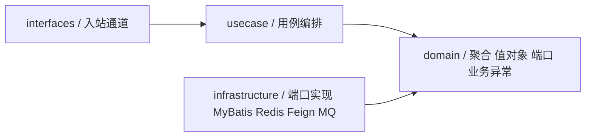
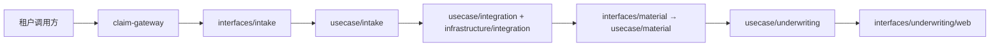

# 005 理赔申请服务包重构设计

## 总体架构

服务采用"层级优先、层内分域"的包结构：最外层是 DDD 的四层，层内再按业务域拆子包。层的职责与依赖方向由标准规定；目录组织形式（先层级还是先域）属于项目方言，本 Spec 定案为先层级、层内分域。



## 目标目录

```text
com.wangguangwu.claim.application
├── interfaces      intake/{web,tenantprotocol/{core,tenant}} · material/messaging
│                   underwriting/web · integration/scheduling
├── usecase         intake{,/result} · material{,/command,/result}
│                   underwriting{,/result} · integration/{outbox,record,compensation}
├── domain          claim{,/exception} · material · underwriting
│                   integration/{outbox,interaction,consumption}
├── infrastructure  intake/{cache,lock,number,persistence} · material/{external,number,persistence}
│                   underwriting/external · integration/{messaging,persistence/{outbox,interaction,consumption}}
├── shared          interfaces/web · contract · infrastructure
└── support         config · mock/{interfaces/web,infrastructure}
```

| 层 | 内容 |
|---|---|
| `interfaces` | 只承担入站通道：HTTP 控制器与响应渲染、MQ 消费者、`@Scheduled` 触发器、租户协议防腐流水线。按业务域拆子包，域内按通道再分。 |
| `usecase` | 用例编排、事务服务、记录装配、命令入参与结果出参。按业务域拆子包。 |
| `domain` | 聚合根、值对象、枚举、业务异常与错误码、出站端口与策略端口，零框架依赖。子包按聚合命名：理赔申请聚合叫 `claim`，其余按域叫 `material`、`underwriting`、`integration/{outbox,interaction,consumption}`。 |
| `infrastructure` | `*DO`、ORM 数据映射、DO↔领域对象转换器、仓储实现、缓存、锁、编号生成、Feign 出站适配、MQ 投递、策略端口的 `*Properties` 配置适配器。按业务域拆子包，域内按技术角色再分。 |
| `shared` | 仅被多域复用的跨域契约：消息信封、跨域命令、异步异常与错误码、统一 HTTP 响应模型、通用加密摘要。 |
| `support` | Spring 配置与受 `claim.mock.enabled` 控制的本地 Mock 能力。 |

## 目录词典：标准强制项与本项目方言

标准 DDD（Vernon《IDDD》、Alibaba COLA、Fowler《PoEAA》）规定的是层的职责、依赖方向和对象角色，不规定目录组织形式、目录粒度与包名拼写。两者分列如下，后续争议按此裁定，不再重新讨论。

标准强制，不得偏离：

- `domain` 只包含聚合根、值对象、枚举、业务异常与错误码、端口（Repository/Gateway 接口），对 Spring、MyBatis-Plus、Redisson、MapStruct、Feign、MQ、Jackson 零依赖。
- 端口一律声明在 `domain`（多端口聚合集中在该聚合的 `port` 子包），实现一律在 `infrastructure`；`infrastructure` 只允许依赖 `domain` 与 `shared`。
- 持久化角色一律位于 `infrastructure`：`*DO` 持久化对象、ORM 数据映射、DO 与领域对象之间的转换器、仓储实现。DO 不得出现在 `domain`、`usecase`、`interfaces`。
- 依赖方向单向：`interfaces → usecase → domain ← infrastructure`。`domain` 不依赖任何上层；`infrastructure` 不依赖 `usecase`/`interfaces`；`usecase` 不依赖 `interfaces`/`infrastructure`。
- 聚合根封装：领域对象不暴露公开 setter，构造器私有，状态迁移只能通过命名领域方法，不变式由聚合自己校验；从数据库重建聚合走 owning 域的反水化工厂，不做"先构造再逐字段 set"。
- 聚合组装只发生在用例与领域：入站适配器不得 import、构造或拼装聚合根，只产出用例声明的 `*Command` 入参；聚合由用例调用 owning 域的工厂方法创建。否则同一个聚合有两处组装知识，替换入站通道要连着改领域装配。
- 配置绑定属于实现细节：`@ConfigurationProperties` 一律在 `infrastructure` 并实现 `domain` 的策略端口，`usecase` 只依赖端口，不依赖 Spring 的配置绑定。
- 聚合创建知识只留在 owning 域：外部只能调用该域 `domain` 暴露的工厂方法，不得 `new` 他域聚合或逐字段拼装其状态；同一种记录的装配只允许一个入口，且装配入口不得自带业务词汇——方向、目标系统、结果状态这类固定映射挂在说出它们的枚举上，由领域工厂读取，不允许在用例层再写一份 `switch`。
- `*Mapper` 一词专指 ORM 数据映射（Fowler Data Mapper，本项目即 `extends BaseMapper<XxxDO>`）；DO 与领域对象的转换器不得叫 `Mapper`。
- 同一后缀在整棵树上只能有一种含义；两个类名只差一个词（`*Validation` 与 `*Validator`）视为职责未说清，必须改名拆开。

本项目方言，标准不规定，由本 Spec 定案：

- 目录组织形式为"层级优先、层内分域"：根包是四层，业务域是层内第二级。理由是与服务原始基线一致，`interfaces`、`domain`、`infrastructure` 一眼可辨层职责，跨域引用只在第二级包名上体现。
- 入站层名沿用基线 `interfaces`，编排层名沿用基线 `usecase`（类名后缀仍是 `*UseCase`、`*TransactionService`），不采用 COLA 的 `adapter`/`app`。
- `interfaces/<域>` 下按入站通道命名：`web`（HTTP）、`messaging`（MQ）、`scheduling`（定时任务），不设 `inbound`/`outbound` 中转层——出站适配器按标准属于 `infrastructure`，`interfaces` 天然只有入站。任何 `@Scheduled` 触发器都是入站通道，无论它触发的是投递还是补偿，一律落 `interfaces/integration/scheduling`。租户协议流水线是入站防腐层，保留业务语义包名 `tenantprotocol/{core,tenants}`：`core/pipeline` 放流水线契约、模板、注册表与工厂，`core/stage` 放解析/校验/转换三个节点端口与字段守卫；`tenants/{tenant_a,tenant_b}` 按租户各放一套 request/流水线/解析/校验/转换。
- `domain` 层内理赔申请聚合子包叫 `claim`，与聚合类 `ClaimApplication` 对应；`intake` 只作为 `interfaces`/`usecase`/`infrastructure` 的域名键，因为签收是用例不是聚合。
- `infrastructure/<域>/persistence` 按聚合分组：域内只有一个聚合时平铺 `DO/DOMapper/Converter/MyBatis*Repository`；有 ≥2 个聚合时使用与 `domain` 同名的聚合子包（现为 `infrastructure/integration/persistence/{outbox,interaction,consumption}`）。
- 出站适配器按技术角色命名：`external`（外部系统）、`cache`、`lock`、`number`、`messaging`。不采用 COLA 的统一 `gatewayimpl`，因为同域存在多个异质出站端口，角色名比统一后缀更可辨。
- 类名后缀词典：`*DO`、`*DOMapper`、`*Converter`、`MyBatis*Repository`（仓储实现保留技术前缀，比 `Impl` 更自描述）、端口用 `*Repository`/`*Query`/`*Generator`/`*Lock`/`*Requester`；`*UseCase` 一律是用例入口具体类，不为它保留单实现接口（无第二实现、无跨模块替换需求的接口只是间接层）；`*TransactionService` 一律是事务边界；`interfaces` 内的报文必填守卫用 `*FieldGuard`，与实现它的 `*Validator` 端口区分开；用例运行参数端口用 `*Policy`，其配置实现用 `*Properties`。
- 策略端口的配置适配器落 `infrastructure/<域>/config`（现为 `OutboxRelayProperties`、`ApplicationCompensationProperties` 实现 `domain/integration/{outbox,compensation}` 的 `OutboxRelayPolicy`、`ApplicationCompensationPolicy`）；`support/config` 只放框架装配（MyBatis-Plus、Redisson），本地 Mock 的配置随 Mock 留在 `support/mock`。退避算法这类纯技术曲线随适配器实现，用例只问"这次失败后等多久"；调度间隔由 `@Scheduled` 占位符读取配置项，不复制进策略端口。
- 子包仅在承担分组作用时存在：父目录已有自有类时允许角色或聚合子包；纯粹只挂一个子目录的中转层必须删除。拆分的触发条件是同一包里出现两类以上互不相干的职责、且每类可聚成 ≥2 个类——本轮据此新增 `domain/<聚合>/port`、`domain/claim/person`、`tenantprotocol/core/{pipeline,stage}`、`tenants/{tenant_a,tenant_b}`、`interfaces/intake/web/render`；只剩一个端口的域（`interaction`、`consumption`、`compensation`）端口留在聚合包，不建中转层。
- `shared`、`support` 保留为根包，内部仍按层名分子包（`shared/interfaces/web`、`shared/infrastructure`、`support/mock/interfaces/web`），避免同一棵树里混用 `adapter` 与 `interfaces` 两个词。
- `ApplicationEventType` 作为 Outbox 的事件词汇表放 `domain/integration/outbox`，其携带的 Stream 绑定名是本项目接受的务实耦合：绑定名只是字符串常量、不构成框架依赖，拆到 `infrastructure` 配置表只增加一处映射，不改变行为。

按该词典已同步重命名与重定位：`ApplicationDataMapper` → `ApplicationDataConverter`、`MaterialDataMapper` → `MaterialDataConverter`；`UnderwritingCallbackExceptionHandler` 的 `@RestControllerAdvice(basePackages)` 随包路径同步；端口 `OutboxEventPublisher` 与事件词汇 `ApplicationEventType` 入 `domain/integration/outbox`；`OutboxRelayScheduler` 入 `interfaces/integration/scheduling`；`UuidMaterialBatchNoGenerator` 入 `infrastructure/material/number`，与它实现的端口同域；`ApplicationIntakeException`、`ApplicationIntakeErrorCode` 入 `domain/claim/exception`；`ApplicationAsyncException`、`ApplicationAsyncErrorCode` 入 `shared/contract`；`TenantProtocolValidation` → `TenantProtocolFieldGuard`；`ApplicationIntakeService` → `ClaimApplicationIntakeUseCase`（同时删除单实现接口）；`MaterialSubmission` 由 `domain/material` 入 `domain/claim`；`ApplicationIntakeCacheStaleException` → `ApplicationExistenceMismatchException`（留在 `usecase/intake`，不再借用缓存词汇）；`tenantprotocol/tenant` → `tenantprotocol/tenants`；`usecase/integration/{outbox,compensation}` 的两个 `*Properties` 入 `infrastructure/integration/config`；`ApplicationRepository` 等 13 个端口入所属聚合的 `port` 子包（单端口域除外），`PersonInfo` 基类与四个人员角色入 `domain/claim/person`，流水线装配四件套与三个阶段端口入 `tenantprotocol/core/{pipeline,stage}`，两套示例租户协议各入 `tenantprotocol/tenants/{tenant_a,tenant_b}`，租户响应渲染三件套入 `interfaces/intake/web/render`。

聚合封装与所有权归位（只改变类的公开形态与调用点，不改变状态流转、错误码和对外契约）：

- `ClaimApplication`、`Material` 去 Lombok `@Setter`，构造器改私有，新增 `restore(...)` 反水化工厂；`id` 由 `restore` 入参或 `bindId(...)` 守卫方法绑定，不再事后逐字段回填。
- `MaterialDataConverter` 保留 MapStruct，读方向改为接口 `default` 方法调用 `Material.restore(...)`。`ApplicationDataConverter` 改为普通 Spring 组件、读写两个方向都显式书写：聚合根不暴露 setter 使 MapStruct 无法生成读方向，而 MapStruct 又不能向抽象 mapper 基类做构造器注入，人员 JSON 的读写又必须共用同一个 Spring 管理的 `ObjectMapper`，因此该转换器整体手写。
- 异步记录装配收敛为单一入口 `usecase/integration/record/ApplicationLifecycleRecordFactory`：签收的 `APPLICATION_CREATED`/`APPLICATION_REAPPLIED` 事件与交互日志改由它构造，载荷字段、`interaction_type`、`direction`、`target_system`、`result_status` 与归位前逐项一致（新增 `InteractionType.APPLICATION_INTAKE` 映射到 `INBOUND` + `CLAIM_APPLICATION_SERVICE`）。该工厂只做载荷序列化与标识生成：交互事件由 `domain/integration/interaction/InteractionLog.of(...)` 装配，方向与目标系统读自 `InteractionType.direction()`/`targetSystem()`，结果状态读自 `InteractionAction.resultStatus()`，错误说明按列宽截断也收进领域工厂；为此新增 `InteractionDirection`、`InteractionResultStatus` 两个枚举。
- `usecase/intake/ApplicationIntakeRecordFactory` 缩为只管材料批次的 `ClaimApplicationIntakeMaterialFactory`；材料聚合的创建回到 `domain/material`：由 `MaterialSubmission` 提供 `toMaterial(applicationNo, batchNo)`，签收侧只传入平台申请编号与批次编号，不拼装材料状态。

位置与名称复核（在目录形状定案后追加，只改类的公开形态、名称与注解作用域，不改状态流转、错误码与对外契约）：

- 删除 `ClaimApplicationIntakeUseCase` 接口（单实现、无替换需求），实现类 `ApplicationIntakeService` 改名 `ClaimApplicationIntakeUseCase`，与其余三域的用例入口命名一致；控制器注入的类型全名不变。
- `TenantProtocolValidation`（静态字段必填守卫）改名 `TenantProtocolFieldGuard`，消除与 `TenantProtocolValidator`（校验端口）只差一个词的同名混淆；它原先兼管的"构建不合法异常"下沉为领域异常上的命名工厂 `ApplicationIntakeException.invalid(message)`，`interfaces` 与 `usecase` 中原先各自拼装 `APPLICATION_INTAKE_INVALID` 的四处构造点统一走该工厂。
- `ApplicationIntakeExceptionHandler` 的 `@RestControllerAdvice` 由无作用域改为 `basePackages = "...interfaces.intake.web"`：无限制的兜底 advice 会接管其他入站通道的异常，与已经限定作用域的 `UnderwritingCallbackExceptionHandler` 优先级不确定。
- 交互事件聚合的构造点从 `usecase` 收回 `domain`，归零扫描第 10 项去掉 `usecase/integration/record` 白名单，并新增第 11 项"交互词汇不得在 `domain` 之外重复定义"。

标准 DDD 归位追加（T9，只改公开形态、名称与归属，不改状态流转、错误码与对外契约）：

- 租户协议流水线的产物由 `ClaimApplication` 改为 `ClaimApplicationIntakeCommand`：`TenantProtocolConverter`、`TenantProtocolPipeline`、`AbstractTenantProtocolPipeline`、`TenantProtocolPipelineFactory` 的返回类型同步更换，聚合由 `ClaimApplicationIntakeUseCase` 调用 `ClaimApplication.submit(...)` 创建。`interfaces` 对 `ClaimApplication` 的引用降为 0，对 `domain` 的依赖只剩业务异常与四个人员角色类型（`Applicant`/`PrimaryInsured`/`AccidentPerson`/`Payee`）、`Gender`、`MaterialSubmission`。
- 命令入参放 `usecase/intake/command`，与既有 `usecase/intake/result` 对称；命令只携带归一化后的业务事实，`applicationNo`、`status`、`applicationAttempt`、`batchNo` 仍由用例与领域分配。
- `OutboxRelayPolicy`、`ApplicationCompensationPolicy` 两个策略端口入 `domain/integration/{outbox,compensation}`，`*Properties` 适配器入 `infrastructure/integration/config`；指数退避的移位与截断算法随适配器（原在用例内的 `backoffSeconds` 与 `MAX_BACKOFF_EXPONENT` 移出），用例改为 `now().plus(policy.retryDelay(attemptCount))`。
- 用例测试改为打桩策略端口，不再 import 基础设施适配器；退避曲线由新增的 `OutboxRelayPropertiesTest` 直接覆盖。

## 依赖方向规则

目录迁移后按下列规则约束跨域引用，规则由包名前缀即可判定（域键 = 第二级包名，`domain` 层的 `claim` 与其余三层的 `intake` 视为同一个域）：

- 允许：任何层引用 `shared`；`interfaces` 引用同域 `usecase`；`usecase`/`infrastructure` 引用任意域的 `domain`（聚合、值对象、端口、业务异常）。
- 允许：业务域 `usecase` 使用 `usecase/integration/record` 装配交互与 Outbox 记录，`integration` 的内核定位就是承载这类跨域异步构件。
- 允许：`usecase/integration/compensation` 调用业务域 `usecase` 重放用例；`usecase/material` 调用 `usecase/underwriting` 完成材料成功后的承保分流；`support.mock` 调用业务域 `usecase` 模拟外部回调。
- 禁止：引用其他业务域的 `interfaces` 或 `infrastructure`，包含 DO、`*DOMapper`、仓储实现、Feign 客户端和 Redis 实现。
- 禁止：同层跨域引用 `interfaces`（入站通道不被别的域调用）。
- 禁止：`domain` 依赖框架或依赖 `interfaces`/`usecase`/`infrastructure`/`support`；`infrastructure` 依赖 `usecase`/`interfaces`；`usecase` 依赖 `interfaces`/`infrastructure`，包括用 `@ConfigurationProperties` 直接绑定配置。
- 跨域传递的消息信封、命令 DTO、异常与错误码等契约一律放 `shared.contract`，不得留在 owning 域的 `usecase` 内被其他域直接引用。

## 核心链路设计

目录迁移不改变现有调用关系：租户请求由 `interfaces/intake` 接收并归一化为受理命令，签收用例在 `usecase/intake` 创建聚合并编排，签收事件由 `usecase/integration` 装配、`infrastructure/integration/messaging` 投递，`interfaces/material` 消费事件并触发 `usecase/material`，材料成功后分流到 `usecase/underwriting`，承保回调重新进入 `interfaces/underwriting/web`。



## 数据模型和接口设计

- 数据库表、HTTP 路径、MQ Topic、Feign 请求和配置项均不变。
- Java package 是唯一变更面；所有生产代码、测试代码与文档中的包路径同步更新。
- JMeter 保持 `scripts/jmeter` 目录，默认经 `claim-gateway:8080` 调用对外接口。

## 基础设施与异常处理

- MyBatis、Redis、Redisson、Feign、RocketMQ 实现移至 `infrastructure/<域>`，只服务本域，其他域不得引用。
- 当前 Mock 保持在 `support/mock`，仍受 `claim.mock.enabled` 控制；本次不改变本地 Feign 地址。
- 异步异常与错误码、跨域消息契约 `ApplicationEventEnvelope`、`UnderwritingCompletedCommand` 因被多域使用留在 `shared/contract`，统一响应模型放 `shared/interfaces/web`，错误码、HTTP 映射和字段名不变。
- 旧的"业务域优先"目录（`intake`、`material`、`underwriting`、`integration` 作为根包）不留壳、不留 `.gitkeep`、不留空目录。

## 对现有功能的影响

- Spring Boot 应用类仍位于根包，组件扫描范围覆盖新包结构。
- Maven 坐标、依赖和应用配置不变。
- 本次不改变 Mock 生命周期，后续独立化前本地异步联调仍可用。
- 领域不变式失败仍抛 `IllegalStateException` 并由 `interfaces` 兜底映射为系统错误码；把不变式违反改为本域业务异常与明确错误码会改变对外错误语义，另立 Spec 处理，不在本次范围。
