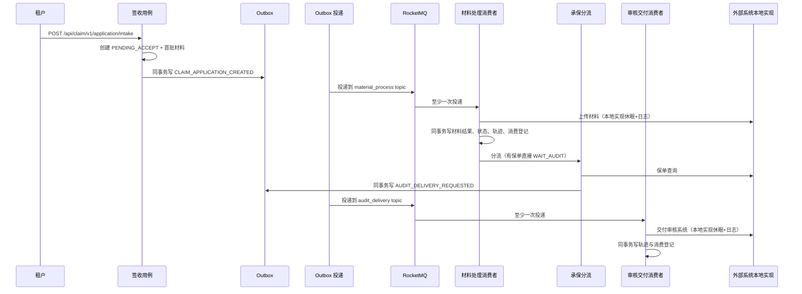

# 009 签收后异步链路设计

## 一、改动模块

| 模块 | 类或文件 | 改动 |
|---|---|---|
| `domain/audit` | 新增 `AuditDeliveryRequest`、`ServiceAuditSystemPort`（端口） | 审核交付的入参与外部系统抽象 |
| `domain/integration/interaction` | `InteractionType` | 新增 `AUDIT_DELIVERY(OUTBOUND, "AUDIT_SYSTEM")` |
| `domain/integration/compensation` | `ClaimApplicationCompensationPolicy` | 新增 `pendingAcceptTimeout()` |
| `domain/claim/port` | `ClaimApplicationRepository` | 复用 `findByStatusUpdatedBefore`，不新增方法 |
| `usecase/audit` | 新增 `AuditDeliveryUseCase`、`AuditDeliveryTransactionService` | 交付编排与单事务落库 |
| `usecase/integration/compensation` | `ClaimApplicationCompensationUseCase` | 新增 `redrivePendingAcceptClaimApplications()` |
| `interfaces/audit/messaging` | 新增 `AuditDeliveryConsumer` | 函数式消费 bean `auditDelivery` |
| `interfaces/integration/scheduling` | `ClaimApplicationCompensationScheduler` | 增加一步补偿 |
| `infrastructure/audit/external` | 新增 `LocalAuditSystemClient` | 审核交付本地实现 |
| `infrastructure/material/external` | 新增 `LocalMaterialFileProcessor`；删除 `FeignMaterialFileProcessor`、`FileSystemFeignClient` | 文件上传本地实现 |
| `infrastructure/underwriting/external` | 新增 `LocalValidPolicyQuery`、`LocalAutoUnderwritingRequester`、`LocalUnderwritingResultQuery`；删除三个 `Feign*` 与 `UnderwritingFeignClient` | 承保三个端口本地实现 |
| `infrastructure/integration/config` | 新增 `LocalIntegrationProperties` | 本地实现的延迟与结果配置 |
| `support/mock` | 删除 6 个类（709 行） | 假件下线 |
| `pom.xml` | 删除 `spring-cloud-starter-openfeign` | 无 Feign 客户端后不再需要 |
| `ClaimApplicationServiceApplication` | 删除 `@EnableFeignClients` | 同上 |
| `application.yml` | 消费重投、本地实现、补偿阈值；删除 mock 与外部 URL | 配置收敛 |

## 二、核心链路



无保单时链路在承保处分叉：`UNDERWRITING` → 自动承保请求 → 承保结果查询（本地实现返回 `COMPLETED`）→ `WAIT_AUDIT` → 审核交付。

## 三、类职责

| 类 | 职责 |
|---|---|
| `AuditDeliveryConsumer` | 声明 `auditDelivery` 消费函数，把消息信封转成交付命令，不做业务判断 |
| `AuditDeliveryUseCase` | 判重、读取申请、校验状态、调用审核系统端口、委托事务服务落库 |
| `AuditDeliveryTransactionService` | 单事务登记消费、写 `STARTED/COMPLETED/REUSED` 轨迹 |
| `ServiceAuditSystemPort` | 审核交付端口，`void deliver(AuditDeliveryRequest)` |
| `LocalAuditSystemClient` | 端口实现：休眠、打印交互日志、按配置抛错 |
| `LocalMaterialFileProcessor` | 文件上传端口实现：休眠、打日志、按 `fail-material-types` 返回失败结果 |
| `LocalValidPolicyQuery` | 保单查询端口实现：休眠、按 `valid-policy` 返回 |
| `LocalAutoUnderwritingRequester` | 自动承保请求端口实现：休眠、打日志、直接返回 |
| `LocalUnderwritingResultQuery` | 承保结果查询端口实现：休眠、按 `underwriting-result` 返回 |
| `LocalIntegrationProperties` | `claim.integration.local.*` 配置绑定 |

## 四、消费失败处理

### 4.1 事务边界

材料处理与审核交付都遵循同一形状：外部调用在事务外，业务结果、轨迹与消费登记在同一个本地事务内提交。

- 外部调用抛异常 → 事务不开启 → 无消费登记、无轨迹 → 消息重投后可重新执行。
- 事务内任一步失败 → 整体回滚 → 同一条消息重投不会看到半成品。
- 消费登记 `(consumer_group, event_id)` 唯一键是幂等的最终防线。

### 4.2 重投与死信

消费函数只在最外层做一件事：捕获异常记录一条 ERROR 后原样抛出，交给 binder 由 RocketMQ 重投；不吞异常、不确认消费。重投次数用 binder 的 push 消费者属性显式声明：

```yaml
spring:
  cloud:
    stream:
      rocketmq:
        bindings:
          materialProcess-in-0:
            consumer:
              push:
                max-reconsume-times: ${CLAIM_APPLICATION_MQ_MAX_RECONSUME_TIMES:3}
          auditDelivery-in-0:
            consumer:
              push:
                max-reconsume-times: ${CLAIM_APPLICATION_MQ_MAX_RECONSUME_TIMES:3}
```

重投耗尽后 broker 自动把消息写入死信主题，平台不消费死信：

| 消费组 | 死信主题 |
|---|---|
| `claim-application-material-processor-v1` | `%DLQ%claim-application-material-processor-v1` |
| `claim-application-audit-delivery-v1` | `%DLQ%claim-application-audit-delivery-v1` |

不在代码里做"可重试/不可重试"异常分类：事件结构非法、申请不存在这类错误重投 3 次后同样进死信，人工排查成本低于维护分类器。

### 4.3 观测

- 每次消费失败由 `AuditDeliveryConsumer` / `MaterialProcessConsumer` 打印一条 ERROR，含 `consumerGroup`、`claimApplicationNo`、`eventId` 与异常摘要；只打印摘要不打印堆栈，堆栈由本地实现与 binder 输出，避免同一异常重复打印。
- 每次重投由 binder 打印消费失败日志。
- 本地实现抛错时自己打印一条 ERROR，带 `claimApplicationNo` 与目标系统。
- 死信只通过 broker 侧观察，平台不额外落表，避免为失败路径新建数据模型。

## 五、补偿

### 5.1 新增 PENDING_ACCEPT 滞留补偿

```yaml
claim:
  compensation:
    pending-accept-timeout: ${CLAIM_APPLICATION_COMPENSATION_PENDING_ACCEPT_TIMEOUT:5m}
```

调度每轮新增一步 `PENDING_ACCEPT 滞留补偿`：按 `findByStatusUpdatedBefore(PENDING_ACCEPT, now - timeout, batchSize)` 取申请，直接调用材料处理用例：

```java
String eventId = "compensation-" + claimApplication.getClaimApplicationNo()
        + "-" + claimApplication.getClaimApplicationAttempt();
materialProcessingUseCase.process(new MaterialProcessCommand(claimApplication.getClaimApplicationNo(),
        claimApplication.getTenantCode(), eventId, traceId, claimApplication.getClaimApplicationAttempt()));
```

- 不走 Outbox：补偿是兜底重放，不是新业务事实，写事件表只会让滞留期间堆积重复事件。
- 事件标识稳定：失败回滚时消费登记同时回滚，下一轮用同一标识重试；成功后状态离开 `PENDING_ACCEPT`，不会被再次选中。
- 与真实消息并发：材料结果是条件更新，状态推进带尝试次数条件，消费登记唯一键兜底，二者只会有一个生效。

### 5.2 为什么不给 WAIT_AUDIT 加补偿

审核交付不改变业务状态，平台无法从数据判断"这条申请是否已交付"。要判断就得新增交付状态位或交付记录表，属于新的数据模型；而交付失败本身会由重投与死信覆盖。因此本 Spec 不加 `WAIT_AUDIT` 补偿，死信人工重放是这一段的最终兜底。

## 六、外部系统本地实现

### 6.1 配置

```yaml
claim:
  integration:
    local:
      # 每次外部调用的模拟耗时，用于观察异步链路与消费耗时。
      delay: ${CLAIM_APPLICATION_LOCAL_INTEGRATION_DELAY:200ms}
      # 保单查询结果，用于覆盖"有保单直接等待审核"与"无保单进入自动承保"两条分支。
      valid-policy: ${CLAIM_APPLICATION_LOCAL_VALID_POLICY:false}
      # 承保结果查询返回值，取值 COMPLETED / PROCESSING / NOT_FOUND。
      underwriting-result: ${CLAIM_APPLICATION_LOCAL_UNDERWRITING_RESULT:COMPLETED}
      # 命中这些材料类型时上传返回失败，用于验证受理失败链路。
      fail-material-types: []
      # 开启后审核交付固定失败，用于验证重投与死信。
      fail-audit-delivery: ${CLAIM_APPLICATION_LOCAL_FAIL_AUDIT_DELIVERY:false}
```

### 6.2 实现约定

- 休眠封装为一个私有方法：时长为 0 直接返回；`InterruptedException` 恢复中断标记后抛 `IllegalStateException`。
- 日志统一格式：`外部系统本地实现调用，targetSystem={}, interactionType={}, claimApplicationNo={}, delay={}`，不打印证件号、文件地址、报文。保单查询端口的入参不含申请编号，日志中该字段固定为 `-`。
- 文件上传成功返回 `https://local.invalid/material/<claimApplicationNo>/<materialType>`，失败返回约定错误码 `LOCAL_UPLOAD_REJECTED`。

### 6.3 与端口的关系

端口与领域模型不变，只把 HTTP 适配器换成进程内适配器。将来接真实系统时新增 `Feign*` 或 `Rest*` 实现并删除对应的 `Local*`，调用方不需要改动。

## 七、审核交付消费细节

```java
public void deliver(AuditDeliveryCommand command) {
    if (consumedEventRepository.exists(CONSUMER_GROUP, command.eventId())) {
        log.info("审核交付事件已消费，跳过处理，claimApplicationNo={}, eventId={}",
                command.claimApplicationNo(), command.eventId());
        return;
    }
    ClaimApplication claimApplication = claimApplicationRepository
            .findByClaimApplicationNo(command.claimApplicationNo())
            .orElseThrow(() -> new IllegalStateException("审核交付事件对应的申请不存在，claimApplicationNo="
                    + command.claimApplicationNo()));
    String interactionNo = recordFactory.newInteractionNo();
    if (!claimApplication.isInStatus(ClaimApplicationStatus.WAIT_AUDIT)) {
        transactionService.recordReused(command, interactionNo);
        return;
    }
    auditSystemPort.deliver(new AuditDeliveryRequest(command.claimApplicationNo(),
            command.tenantCode(), command.traceId()));
    transactionService.recordDelivered(command, interactionNo);
}
```

`recordReused` 与 `recordDelivered` 都是单事务方法，内部先 `consumedEventRepository.register`，唯一键冲突返回 `SKIPPED`。

## 八、删除清单

| 删除对象 | 原因 |
|---|---|
| `support/mock/**` 6 个类 | 由本地实现取代，且假件不应留在业务包 |
| `FileSystemFeignClient`、`FeignMaterialFileProcessor` | 文件上传不再走 HTTP |
| `UnderwritingFeignClient`、`FeignValidPolicyQuery`、`FeignAutoUnderwritingRequester`、`FeignUnderwritingResultQuery` | 承保不再走 HTTP |
| `spring-cloud-starter-openfeign` 依赖与 `@EnableFeignClients` | 无 Feign 客户端 |
| `claim.integration.file-system.url`、`claim.integration.underwriting.url` | 本地实现不需要地址 |
| `claim.mock.*` 与 local profile 中的自指 URL | 假件开关失效 |

承保完成回调 HTTP 入口保留：它是外部系统回调平台的正向入口，不属于假件。

## 九、对现有功能的影响

| 功能 | 影响 |
|---|---|
| 签收 | 无变化 |
| 材料处理 | 端口实现替换，状态流转、轨迹、幂等不变 |
| 承保分流 | 端口实现替换；有/无保单由配置决定，不再依赖 mock 登记接口 |
| 承保回调 | 无变化，仍可手工调用 |
| Outbox 投递 | 无变化 |
| 补偿 | 新增一步，其余三步不变 |
| 联调文档 | 依赖 mock HTTP 入口的场景改写为配置开关 + 重启 |
| 006 P2-2 | 由本 Spec 交付（709 行假件移出生产包） |

## 十、验证方式

1. `mvn -B clean package` 全反应堆通过。
2. 启动 MySQL、Redis、RocketMQ 与应用、网关，走签收黄金路径：
   - `valid-policy=true`：签收后 3 秒内到 `WAIT_AUDIT`，轨迹含 `MATERIAL_PROCESS` 与 `AUDIT_DELIVERY` 两组 `STARTED/COMPLETED`。
   - `valid-policy=false`：轨迹含 `UNDERWRITING`，随后 `AUDIT_DELIVERY`。
3. 重复投递：手工向 topic 重发同一信封，日志出现"已消费，跳过"，`t_claim_consumed_event` 行数不变。
4. 死信：`fail-audit-delivery=true` 且 `max-reconsume-times=1`，日志出现两次失败，broker 日志可见死信投递。
5. 补偿：`pending-accept-timeout=10s`，停止消费或丢弃材料消息，观察补偿把申请推进到 `ACCEPTED`，轨迹只有一组完整行为组。
6. 敏感信息：`grep` 应用日志，确认无证件号与文件原始地址。

## 十一、不做什么

- 不实现死信消费者与自动重放。
- 不新增交付状态位或交付记录表。
- 不引入消息分类器、规约框架或新的重试抽象。
- 不改动签收、Outbox 投递与承保回调的既有语义。
- 不写单元测试：按项目口径，验证走运行栈黄金路径。
