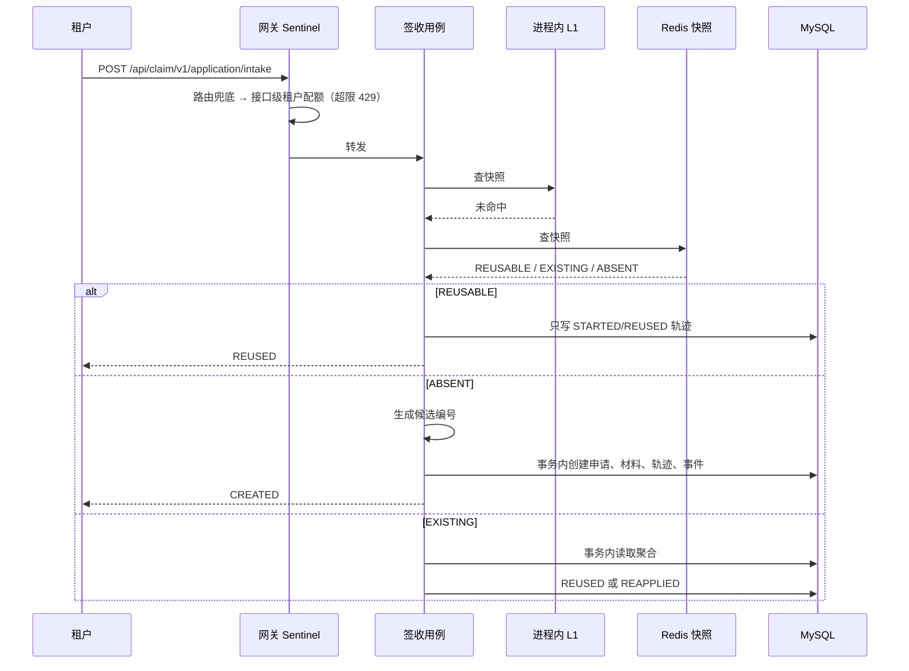

# 010 签收扩容保护设计

## 一、改动模块

| 模块 | 类或文件 | 改动 |
|---|---|---|
| `domain/claim` | 新增 `ClaimApplicationIntakeSnapshot`、`ClaimApplicationIntakeLookup`、`ClaimApplicationIntakeLookupKind` | 判定快照与查询结果模型 |
| `domain/claim/port` | 新增 `ClaimApplicationIntakeSnapshotQuery`；删除 `ClaimApplicationExistenceQuery` | 一次查询同时回答"是否可复用"与"是否存在" |
| `infrastructure/intake/cache` | 新增 `RedisClaimApplicationIntakeSnapshotQuery`；删除 `RedisClaimApplicationExistenceQuery` | 单键快照缓存 + 进程内 L1 |
| `infrastructure/intake/resilience` | 新增 `RedisAvailabilityCircuit` | Redis 可用性熔断 |
| `infrastructure/intake/number` | `RedisMySqlClaimApplicationNoGenerator` | 降级路径串行化；熔断恢复后抬升计数器 |
| `infrastructure/intake/lock` | `RedissonClaimApplicationIntakeLock` | 接入熔断；降级期并发闸门 |
| `usecase/intake` | `ClaimApplicationIntakeUseCase`、`ClaimApplicationIntakeTransactionService` | 快照命中直接复用；新增只写轨迹的 `recordReused`；事务服务的存在性入参由 `boolean` 改为查询结论；重试次数取配置 |
| `infrastructure/intake/config` | 新增 `ClaimApplicationIntakeProperties`、`ClaimApplicationRedisCircuitProperties` | `claim.intake.*` 与 `claim.redis.circuit.*` 配置绑定 |
| `claim-gateway` | 新增 `rate-limit` 包下规则装配与限流响应；新增 `monitoring` 包下控制台上报注册；`pom.xml` 引入 sentinel 适配器与 transport | 路由兜底 + 接口级租户配额；控制台观测 |
| `deploy` | `docker-compose.yml`、`.env.example` | 本地 Sentinel 控制台 |
| `docs` | 契约、架构、联调文档 | 限流、缓存与降级口径同步 |

## 二、核心链路



Redis 熔断打开时，`L1 → DB` 直连，锁降级为无锁并受降级并发闸门约束，发号走本节点串行降级路径。

## 三、类职责

| 类 | 职责 |
|---|---|
| `ClaimApplicationIntakeSnapshotQuery` | 按租户与外部申请号查询判定快照，返回可复用快照、仅存在、或不存在三种结论 |
| `ClaimApplicationIntakeLookup` | 查询结果：种类 + 平台申请编号 + 状态；`REUSABLE` 时前两者必填 |
| `RedisClaimApplicationIntakeSnapshotQuery` | 单键缓存实现：L1 → Redis → MySQL，回填规则与 TTL 在此定义 |
| `ClaimApplicationIntakeOutcome` | 事务服务的返回：对外结果 + 本次回源观察到的可复用快照（没有则为空） |
| `RedisAvailabilityCircuit` | 连续失败计数、熔断打开 10 秒、半开探测、恢复标记 |
| `RedisMySqlClaimApplicationNoGenerator` | Redis 计数发号；降级时本节点串行取最大号；恢复时抬升计数器 |
| `RedissonClaimApplicationIntakeLock` | 同外部申请号锁；熔断期无锁 + 降级并发闸门 |
| `ClaimApplicationIntakeProperties` | `claim.intake.*` 配置 |
| `ClaimApplicationRedisCircuitProperties` | `claim.redis.circuit.*` 配置 |
| `ClaimApplicationRateLimitProperties`（网关） | `claim.gateway.rate-limit.*` 配置：路由兜底阈值 + 各接口的租户配额 |
| `ApiPathMatchStrategy`（网关） | 接口路径匹配策略：精确、前缀、正则，映射到 Sentinel 常量 |
| `ClaimApplicationRateLimitConfiguration`（网关） | 启动注册 API 定义，再加载路由兜底规则与接口租户规则 |
| `ClaimApplicationRateLimitBlockHandler`（网关） | 限流响应 429 与错误码 |
| `SentinelTransportEnvironmentPostProcessor`（网关） | 在容器刷新前写控制台地址等系统属性，让 Sentinel 心跳上报生效 |

## 四、判定快照缓存

### 4.1 键、值与 TTL

- 键：`claim-applicationintake:snapshot:` + `sha256(租户编码:外部申请号)`；签收锁用 `claim-applicationintake:lock:` + 同一摘要，两者前缀必须区分，否则字符串快照与 Redisson 锁结构互相覆盖。
- 值三种：

| 值 | 含义 | TTL |
|---|---|---|
| `A2026102900000058\|WAIT_AUDIT` | 已过受理，可直接复用 | 1 小时 |
| `X` | 存在，但状态可变（`PENDING_ACCEPT` / `ACCEPT_FAILED`） | 1 分钟 |
| `N` | 不存在 | 1 分钟 |

- 值按字符串编解码写入，Redis 中保存的就是上表的可读标记，运维可直接 `GET` 校验，联调与演练不依赖应用日志。

### 4.2 命中与未命中

- `A…|状态`：直接返回 `REUSED`，只调用事务服务写 `STARTED`/`REUSED` 两条轨迹，不读聚合。
- `X`：跳过编号生成，进入原事务流程读聚合，由状态决定 `REUSED` 或 `REAPPLIED`；事务服务把回源观察到的可复用快照随结果返回，用例在事务提交后调用 `markReusable` 把 `X` 升级为 `A…|状态`，后续重复请求才真正不再读库。
- `N`：生成候选编号并创建；创建成功后把键覆盖为 `X`，避免空标记把刚创建的申请误判为不存在。
- 未命中：读一次聚合（`findByTenantAndExternalClaimApplicationNo`）。状态属于安全集合则写 `A…|状态` 并直接复用；状态可变写 `X`；不存在写 `N`。

空标记只用于回源确认不存在后的短暂占位，创建成功即被 `X` 覆盖；覆盖失败不影响正确性，最多让下一次请求多做一次唯一键冲突重试。

### 4.3 为什么不需要失效

安全集合 `ACCEPTED`、`UNDERWRITING`、`WAIT_AUDIT` 在 `ClaimApplicationStatus` 的状态机里单调不可逆：`PENDING_ACCEPT → ACCEPTED / ACCEPT_FAILED`，之后只能向 `UNDERWRITING`、`WAIT_AUDIT` 前进，永不回到 `ACCEPT_FAILED`。因此这三个状态对签收的答案恒为 `REUSED`，缓存不需要在材料处理、承保、回调、补偿四处做失效，也不存在"缓存说可复用、实际已受理失败"的错判。

`PENDING_ACCEPT` 与 `ACCEPT_FAILED` 恰恰是可变的两个状态，只写 `X` 而不写入快照，保证"受理失败仍可重新处理"。

### 4.4 进程内 L1

- 结构：`ConcurrentHashMap` 存值 + 写入时间，TTL 5 秒，条目上限 10000，超限不再写入（靠 TTL 自然淘汰）。
- 作用：Redis 故障时吸收重复探测，避免每请求都回源；因为只缓存上述三种结论，多节点短暂不一致最坏就是多读一次库。

## 五、网关限流：路由兜底 + 接口级租户配额

### 5.1 依赖与装配

网关引入两个依赖，版本都由现有 Spring Cloud Alibaba BOM 统一：

- `sentinel-spring-cloud-gateway-v6x-adapter`（对应 Spring Cloud Gateway 4.x）：限流适配。
- `sentinel-transport-simple-http`：与控制台通信的心跳与命令通道。

仍不引 `spring-cloud-starter-alibaba-sentinel`：本项目只需要网关限流与控制台观测，不需要 WebFlux 通用埋点与 SCA 的 Sentinel 自动装配。规则不依赖控制台，启动时由 `ClaimApplicationRateLimitConfiguration` 把配置转换成规则。

Sentinel 网关过滤器由 `new SentinelGatewayFilter(order)` 装配，排序值取 `HIGHEST_PRECEDENCE + 20`：排在 `TraceIdGlobalFilter`（+0）与租户校验 `TenantGlobalFilter`（+10）之后，缺少租户头的请求不会进入限流统计。该过滤器实现 `Ordered`，Bean 上的 `@Order` 不生效。

### 5.2 两层规则

| 层 | 资源 | 资源模式 | 条件 | 作用 |
|---|---|---|---|---|
| 路由兜底 | `claim-application-service` | `RESOURCE_MODE_ROUTE_ID` | 无参数 | 整个 `/api/claim/**` 的单节点上界 |
| 接口租户配额 | 配置里的接口名 | `RESOURCE_MODE_CUSTOM_API_NAME` | Header `X-Tenant-Code` + `EXACT` | 该接口下某租户的专属配额 |

- 接口资源通过 `GatewayApiDefinitionManager.loadApiDefinitions` 注册：每个配置项生成一个 `ApiDefinition`，含一条 `ApiPathPredicateItem`（路径 + 匹配策略）。必须先注册 API 定义再 `loadRules`，否则接口规则找不到资源。
- 请求同时命中路由兜底与接口配额时取两者较小者；接口配额不得大于路由兜底阈值，启动时校验。
- 未在接口级配置的路径只受路由兜底约束；未在接口级配置的租户同样只受路由兜底约束。
- 同一租户在不同接口上的配额相互独立：签收接口超限不会消耗同租户的承保回调额度。
- 参数下标由 `GatewayRuleManager` 按资源统一分配，不手工指定；`CONTROL_BEHAVIOR_DEFAULT`（快速失败），统计窗口 1 秒。
- 当前配置：签收接口 `/api/claim/v1/application/intake` 精确匹配，`tenant-a` 20 QPS；承保回调不再占用签收配额，只受路由兜底 50 约束。

### 5.3 响应

`BlockRequestHandler` 写出 429 与 `{"code":"CLAIM_APPLICATION_RATE_LIMITED","message":"租户请求超过限流阈值"}`，与网关现有 400 拒绝体保持同一结构；两条规则命中时响应一致。

### 5.4 阈值口径

Sentinel 本地规则是节点独立的，每个阈值的全局上界 = 单节点阈值 × 网关节点数。规则条数 = 1 条路由兜底 + 每个接口的租户数，改阈值要改配置并重启网关。配置注释、契约文档与联调文档都按这个口径写；需要精确全局配额时再上集群流控，本 Spec 不做。

### 5.5 Sentinel 控制台（只读观测）

- 本地编排新增 `sentinel-dashboard` 服务：镜像 `bladex/sentinel-dashboard:1.8.9`，有 `linux/arm64` 变体，容器内端口就是 8858，宿主机映射 8858；登录账号密码由 `deploy/.env` 注入，仓库里只提交样例默认值。
- 网关侧由 `SentinelTransportEnvironmentPostProcessor`（`EnvironmentPostProcessor`）在容器刷新前写入系统属性：`csp.sentinel.dashboard.server`、`csp.sentinel.api.port`、`project.name`，配置了 `client-ip` 时再写 `csp.sentinel.heartbeat.client.ip`。不用 `application.yml` 直接绑定，是因为 Sentinel 只读系统属性，且初始化发生在首次 Sentinel API 调用前，必须早于任何 Bean 的 `@PostConstruct`。
- 控制台按心跳上报的地址回连网关 8719 命令端口，因此该地址必须是从容器里可达的**字面 IP**：控制台会校验格式，主机名（如 `host.docker.internal`）会被判为 `invalid ip` 而注册失败。默认不覆盖客户端地址，由 Sentinel 自动探测宿主机网卡 IP；自动探测到不可达网卡时，用 `claim.gateway.sentinel.client-ip` 指定宿主机网卡 IP。
- `claim.gateway.sentinel.dashboard-server` 留空即关闭上报：不写系统属性、不启动心跳，避免控制台没部署时每 10 秒刷一条心跳失败 WARN。
- 控制台只做观测：机器列表、实时 QPS、拒绝数。在控制台上新增或修改的规则通过命令通道对当前进程生效，但网关重启后按配置重建，控制台不是规则的持久化来源。

## 六、Redis 降级

### 6.1 可用性熔断

- 连续失败 3 次打开 10 秒；打开期间锁、缓存、发号直接走降级，不再发起 Redis 调用。
- 到期进入半开：放行一个请求探测，成功即关闭并置恢复标记，失败重新打开。

### 6.2 发号降级

- 正常：`INCR claim-applicationnumber:{yyyyMMdd}`。
- 降级：本节点 `synchronized` 段内取「当天最大尾号与本节点已分配尾号的较大者」+ 1。只读最大尾号不足以避开同节点并发，因为分配与落库不在同一临界区；记住本节点已分配尾号后，同一节点连续分配不会再撞号。跨节点冲突仍由唯一键与用例重试收敛。
- 恢复：消费一次恢复标记，先把计数器 CAS 抬升到数据库最大尾号，再继续 `INCR`，避免编号回退撞号。

### 6.3 降级并发闸门

熔断打开时，签收锁在放行前先获取本节点信号量（默认 10），获取失败直接抛 `CLAIM_APPLICATION_INTAKE_SYSTEM_ERROR`。闸门放在锁适配器里，因为它是每次签收唯一必经的切面；正常模式下不获取信号量。

### 6.4 日志与观测

- 降级日志：`Redis 不可用，签收进入降级路径，reason={}，concurrency={}`，相邻两条间隔不小于 10 秒。
- 熔断打开、关闭各打一条 WARN/INFO。
- 不打印报文、证件号与文件地址。

## 七、配置

```yaml
claim:
  intake:
    snapshot-cache:
      reusable-ttl: ${CLAIM_APPLICATION_INTAKE_SNAPSHOT_REUSABLE_TTL:1h}
      mutable-ttl: ${CLAIM_APPLICATION_INTAKE_SNAPSHOT_MUTABLE_TTL:1m}
      absent-ttl: ${CLAIM_APPLICATION_INTAKE_SNAPSHOT_ABSENT_TTL:1m}
      local-ttl: ${CLAIM_APPLICATION_INTAKE_SNAPSHOT_LOCAL_TTL:5s}
      local-max-entries: ${CLAIM_APPLICATION_INTAKE_SNAPSHOT_LOCAL_MAX_ENTRIES:10000}
    degraded-max-concurrency: ${CLAIM_APPLICATION_INTAKE_DEGRADED_MAX_CONCURRENCY:10}
    unique-key-retry-times: ${CLAIM_APPLICATION_INTAKE_UNIQUE_KEY_RETRY_TIMES:5}
  redis:
    circuit:
      failure-threshold: ${CLAIM_APPLICATION_REDIS_CIRCUIT_FAILURE_THRESHOLD:3}
      open-duration: ${CLAIM_APPLICATION_REDIS_CIRCUIT_OPEN_DURATION:10s}
      log-interval: ${CLAIM_APPLICATION_REDIS_CIRCUIT_LOG_INTERVAL:10s}
```

网关侧：

```yaml
claim:
  gateway:
    rate-limit:
      # 路由兜底：统计 /api/claim/** 全部请求的单节点 QPS。租户全局上界 = 单节点阈值 × 网关节点数。
      default-qps: ${CLAIM_APPLICATION_RATE_LIMIT_DEFAULT_QPS:50}
      # 接口级租户配额：键是 Sentinel API 定义名，配额不得大于 default-qps，超限启动失败。
      apis:
        claim-application-intake:
          path: ${CLAIM_APPLICATION_RATE_LIMIT_INTAKE_PATH:/api/claim/v1/application/intake}
          match-strategy: exact
          tenants:
            tenant-a: ${CLAIM_APPLICATION_RATE_LIMIT_TENANT_A_QPS:20}
    sentinel:
      # 留空关闭心跳上报；本地控制台容器把 8858 映射到宿主机。
      dashboard-server: ${CLAIM_GATEWAY_SENTINEL_DASHBOARD_SERVER:127.0.0.1:8858}
      # 控制台按心跳地址回连命令端口，必须是容器可达的字面 IP；留空表示自动探测宿主机网卡。
      client-ip: ${CLAIM_GATEWAY_SENTINEL_CLIENT_IP:}
      api-port: ${CLAIM_GATEWAY_SENTINEL_API_PORT:8719}
```

## 八、对现有功能的影响

| 功能 | 影响 |
|---|---|
| 首次签收 | 多一次缓存读；创建流程、轨迹与事件不变 |
| 重复签收 | 命中快照时不再读聚合，只写轨迹 |
| 受理失败重新申请 | 行为不变，仍回源读库并按状态条件更新 |
| 发号 | 正常路径不变；降级路径由"并发撞唯一键"改为"本节点串行" |
| 签收锁 | 正常路径不变；降级时多一道并发闸门 |
| MQ 消费、补偿、审核交付 | 无变化 |
| 承保回调 | 不再占用同租户的签收配额，只受路由兜底约束 |
| 网关其他路由 | `claim-case-service`、`claim-ai-service` 不限流 |
| 本地运行栈 | 多一个控制台容器与 8858 端口；不启动它只影响观测，不影响限流 |

## 九、验证方式

1. `mvn -B clean package` 全反应堆通过。
2. 黄金路径：签收 → `PENDING_ACCEPT`；同一外部申请号重复提交返回 `REUSED`，第二次起日志显示快照命中，`t_claim_application` 无新增查询（以日志与 SQL 计数核对）。
3. 重新申请：构造 `ACCEPT_FAILED` 后用同一外部申请号提交，返回 `REAPPLIED`，`Redis` 中无该键的快照值。
4. Redis 停机：`docker stop claim-redis` 后连续提交 10 个申请，全部成功且编号唯一；降级 WARN 间隔不小于 10 秒；`docker start claim-redis` 后继续提交，编号不回退。
5. 接口级限流：把签收接口的 `tenant-a` 配额调到 2 QPS 后循环请求签收，返回 429 与 `CLAIM_APPLICATION_RATE_LIMITED`；同一时刻请求承保回调接口不受影响；其他租户不受影响。
6. 控制台：打开 `http://127.0.0.1:8858` 登录后机器列表出现 `claim-gateway`，签收接口的 QPS 与拒绝数可见；在控制台临时加一条规则后重启网关，规则恢复为配置内容。
7. 敏感信息：`grep` 应用与网关日志，确认无证件号、报文原文与文件地址。

## 十、不做什么

- 不做号段发号与序列表。
- 不做 Sentinel 集群流控、不做 Redis 全局分布式限流。
- 不做控制台的规则持久化（Nacos/文件数据源），不在控制台上维护规则。
- 不做缓存失效广播，不引入多级缓存一致性协议。
- 不改变编号格式、签收入口路径与既有状态机。
- 不写单元测试：按项目口径，验证走运行栈黄金路径与故障演练。
