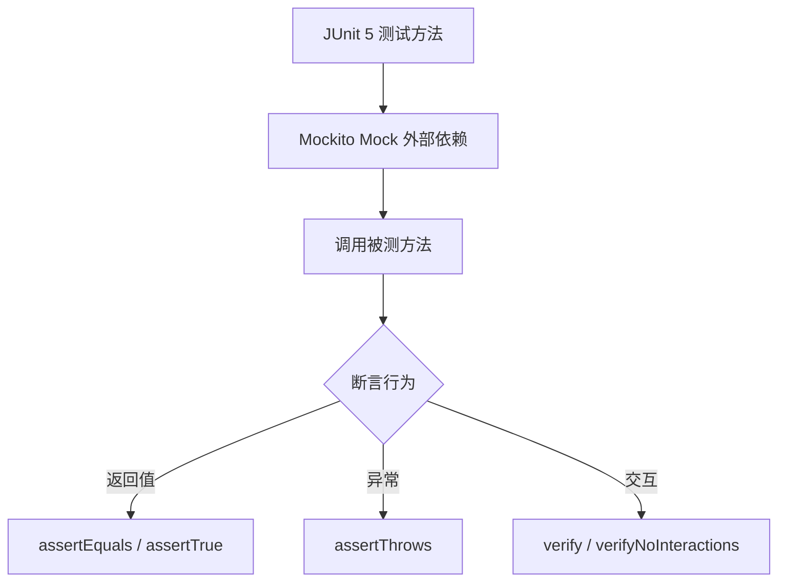
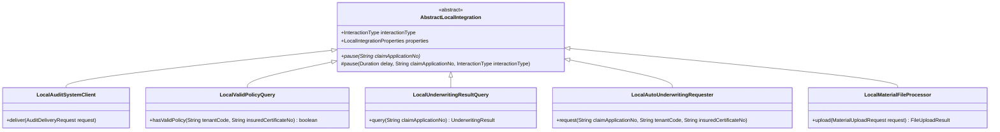

# 011 签收链路质量加固设计

## 一、改动模块

| 模块 | 类或文件 | 改动 |
|---|---|---|
| `test/intake` | 新增 `ClaimApplicationIntakeUseCaseTest` | 签收用例单元测试：首次创建、重复命中缓存、重复未命中缓存、唯一键冲突重试成功、重试耗尽 |
| `test/audit` | 新增 `AuditDeliveryUseCaseTest` | 审核交付用例单元测试：首次到达、重复到达、找不到申请、状态不匹配 |
| `test/resilience` | 新增 `RedisAvailabilityCircuitTest` | Redis 熔断单元测试：关闭态放行、打开态降级、半开态探测成功、半开态探测失败、探测超时重置、恢复标记消费一次 |
| `test/number` | 新增 `RedisMySqlClaimApplicationNoGeneratorTest` | 发号器单元测试：正常发号、降级发号、恢复后抬升、序号超限、降级串行化 |
| `infrastructure/integration/local` | 新增 `AbstractLocalIntegration` | Local 桩公共基类：封装 `pause()` 逻辑（日志 + 休眠 + 中断恢复） |
| `infrastructure/audit/external` | `LocalAuditSystemClient` | 继承 `AbstractLocalIntegration`，删除 `pause()` 方法 |
| `infrastructure/underwriting/external` | `LocalValidPolicyQuery`、`LocalUnderwritingResultQuery`、`LocalAutoUnderwritingRequester` | 继承 `AbstractLocalIntegration`，删除 `pause()` 方法 |
| `infrastructure/material/external` | `LocalMaterialFileProcessor` | 继承 `AbstractLocalIntegration`，删除 `pause()` 方法 |
| `usecase/audit` | `AuditDeliveryUseCase` | 找不到申请时改抛 `ClaimApplicationIntakeException`，异常信息包含 `claimApplicationNo` 与 `eventId` |

## 二、核心链路

### 单元测试链路



测试不启动 Spring 容器，不访问真实 Redis/MySQL/MQ，全部使用 Mock 或内存实现。

### Local 桩基类链路



子类通过构造函数传入 `InteractionType` 与 `LocalIntegrationProperties`，调用基类的 `pause(claimApplicationNo)` 方法。不需要申请编号的端口（如 `LocalValidPolicyQuery`）传占位符 `-`。

### 审核交付异常链路

```mermaid
sequenceDiagram
    participant MQ as RocketMQ
    participant C as AuditDeliveryConsumer
    participant U as AuditDeliveryUseCase
    participant DB as MySQL
    
    MQ->>C: 审核交付事件
    C->>U: deliver(command)
    U->>DB: findByClaimApplicationNo
    alt 找到申请
        U->>U: 校验状态 → 调审核系统 → 事务内写轨迹
    else 找不到申请
        U->>U: 抛 ClaimApplicationIntakeException(claimApplicationNo, eventId)
        U-->>C: 异常
        C->>C: log.warn(异常信息)
        C-->>MQ: 原样抛出交 binder 重投
    end
```



消费者捕获业务异常后按现有失败策略处理（log 后原样抛出交 binder 重投），不改变重投语义。异常日志级别为 `warn`，不升级为 `error`。

## 三、类职责

| 类 | 职责 |
|---|---|
| `ClaimApplicationIntakeUseCaseTest` | 验证签收用例的重试与幂等行为：首次创建、重复命中缓存、重复未命中缓存、唯一键冲突重试成功、重试耗尽 |
| `AuditDeliveryUseCaseTest` | 验证审核交付用例的事件判重与异常处理：首次到达、重复到达、找不到申请、状态不匹配 |
| `RedisAvailabilityCircuitTest` | 验证 Redis 熔断的三态转换：关闭态放行、打开态降级、半开态探测成功、半开态探测失败、探测超时重置、恢复标记消费一次 |
| `RedisMySqlClaimApplicationNoGeneratorTest` | 验证发号器的降级与恢复：正常发号、降级发号、恢复后抬升、序号超限、降级串行化 |
| `AbstractLocalIntegration` | 封装 Local 桩的公共 `pause()` 逻辑：日志 + 休眠 + 中断恢复，子类只需传入 `InteractionType` 与 `LocalIntegrationProperties` |
| `LocalAuditSystemClient` 等 5 个子类 | 继承 `AbstractLocalIntegration`，删除各自的 `pause()` 方法，调用基类的 `pause(claimApplicationNo)` |
| `AuditDeliveryUseCase` | 找不到申请时改抛 `ClaimApplicationIntakeException`，异常信息包含 `claimApplicationNo` 与 `eventId` |

## 四、数据模型

本 Spec 不涉及数据模型变更。

## 五、接口设计

本 Spec 不涉及接口变更。

## 六、基础设施变更

### 测试依赖

`claim-application-service/pom.xml` 新增测试依赖：

```xml
<dependency>
    <groupId>org.junit.jupiter</groupId>
    <artifactId>junit-jupiter</artifactId>
    <version>5.10.2</version>
    <scope>test</scope>
</dependency>
<dependency>
    <groupId>org.mockito</groupId>
    <artifactId>mockito-core</artifactId>
    <version>5.11.0</version>
    <scope>test</scope>
</dependency>
<dependency>
    <groupId>org.mockito</groupId>
    <artifactId>mockito-junit-jupiter</artifactId>
    <version>5.11.0</version>
    <scope>test</scope>
</dependency>
<dependency>
    <groupId>org.assertj</groupId>
    <artifactId>assertj-core</artifactId>
    <version>3.25.3</version>
    <scope>test</scope>
</dependency>
```

版本号由现有 BOM 统一管理的，不写死版本号；如果 BOM 中没有，则写死版本号。

### Local 桩基类

`AbstractLocalIntegration` 放在 `infrastructure/integration/local` 包下，与 `LocalIntegrationProperties` 同层。基类接收 `InteractionType` 与 `LocalIntegrationProperties` 作为构造参数，提供 `pause(String claimApplicationNo)` 方法。

### 审核交付异常

`AuditDeliveryUseCase` 找不到申请时改抛 `ClaimApplicationIntakeException`（或项目统一业务异常），异常信息包含 `claimApplicationNo` 与 `eventId`。

## 七、幂等、事务与异常处理

### 幂等

测试验证幂等场景：签收用例重复命中缓存直接返回 `REUSED`，审核交付事件重复到达跳过处理。

### 事务

测试不验证事务边界，事务由生产代码的 `@Transactional` 注解保证。

### 异常处理

审核交付找不到申请时改抛业务异常，异常信息包含业务标识，不暴露内部实现。消费者捕获业务异常后按现有失败策略处理（log 后原样抛出交 binder 重投），不改变重投语义。

## 八、对现有功能的影响

本 Spec 不改变任何业务行为，只补测试、提取公共基类、规范化异常类型。运行栈回归验证行为与 011 之前一致。
