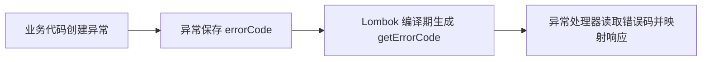

# 总体架构

本次仅调整 `claim-application-service` 的异常访问器实现，依赖模块既有的 Lombok 编译期依赖；不改变服务分层、接口、数据或基础设施。

## 改动模块

| 模块 | 改动 |
| --- | --- |
| `claim-application-service` | 在三类业务异常上使用 Lombok `@Getter` 生成错误码访问器，并删除等价手写方法。 |

## 核心链路设计

Lombok 在编译期为 `errorCode` 字段生成与原实现同签名的公共 getter；异常构造器和异常处理器调用链不调整。

## 主要类职责

| 类 | 变更后职责 |
| --- | --- |
| `ClaimApplicationIntakeException` | 保存签收错误码，并由 `@Getter` 提供读取入口。 |
| `ClaimApplicationAsyncException` | 保存异步错误码，并由 `@Getter` 提供读取入口。 |
| `ClaimApplicationIssueException` | 保存问题件错误码，并由 `@Getter` 提供读取入口。 |

## 数据模型和数据库变更

无数据模型、数据库表或迁移变更。

## 接口设计

对外保留 `getErrorCode()` 的方法名、可见性和返回类型，不新增或删除接口契约。

## 基础设施变更

复用已有 Lombok 编译期依赖和注解处理器配置；不调整 Redis、MQ、第三方系统或运行时依赖。

## 幂等、事务与异常处理

本次不涉及写操作、事务、消息或重试。异常构造器保留，错误码与 `cause` 的传递规则不变。

## 对现有功能的影响

字节码层面继续暴露相同 getter；调用方和异常处理逻辑无需改动。
