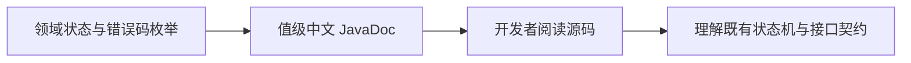

# 总体架构

本次是仅影响源码可读性的文档化改动。枚举继续作为领域状态、错误码、交互词汇和用例处理结果的唯一固定值定义，不调整模块依赖与运行时行为。

## 改动模块

| 模块 | 改动 |
| --- | --- |
| `claim-application-service` | 为缺少值级说明的领域、集成交互、Outbox、材料、承保、异步错误码和用例结果枚举补充中文 JavaDoc。 |

## 核心链路设计

注释只描述现有枚举值含义；编译产物中的枚举常量、字段和方法均不变化。

## 主要类或模块职责

| 枚举类别 | 说明重点 |
| --- | --- |
| 理赔申请、材料、承保和 Outbox 状态 | 当前所处业务环节与可预期处理方向。 |
| 签收与异步错误码 | 面向调用方的失败原因和触发条件。 |
| 交互方向、动作、结果和类型 | 调用方向、目标系统及交互结果语义。 |
| 用例处理结果 | 创建、复用、跳过或重新申请的结果边界。 |

## 数据模型和数据库变更

无数据模型、数据库表或迁移变更；与枚举名称对应的持久化值保持不变。

## 接口设计

无接口变更；枚举用于接口响应或消息体时，对外名称和序列化结果保持不变。

## 基础设施变更

无 Redis、MQ、第三方系统或依赖变更。

## 幂等、事务与异常处理

本次不涉及幂等、事务、异常处理逻辑或消息投递行为。

## 对现有功能的影响

仅增加源码注释，不改变编译字节码中的业务行为。
