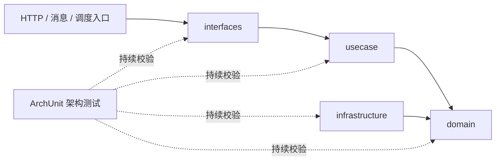

# 总体架构

本次保持现有 DDD 分层，不进行业务能力优先的整体包迁移。通过小范围包归位、包级文档和 ArchUnit 测试，强化现有结构的可读性与可执行约束。

# 改动模块

| 模块 | 改动 |
| --- | --- |
| `claim-application-service` | 补充关键入口注释，将 HTTP 响应模型和问题件 HTTP 适配器归入 `interfaces`，新增分层架构测试。 |
| `claim-gateway` | 补充启动、过滤器、环境初始化和关键包的职责说明。 |
| `claim-foundation-tenant` | 补充租户上下文根包及子包的职责说明。 |
| `claim-foundation-observability` | 补充可观测性与追踪包职责说明。 |
| `claim-case-service`、`claim-ai-service` | 标识预留模块当前边界，避免误解实现范围。 |

# 核心链路设计

# 主要类或模块职责

| 位置 | 职责 |
| --- | --- |
| `interfaces.web.ApiResponse` | 多个 HTTP 入口共享的统一响应协议。 |
| `interfaces.issue.web` | 问题件下发、关闭、异常映射及其请求/响应模型。 |
| `ClaimApplicationArchitectureTest` | 验证领域、用例、基础设施和入站适配之间不存在禁止的反向依赖。 |

# 数据模型和数据库变更

无数据模型、数据库表、MyBatis-Plus Mapper 或持久化值变更。

# 接口设计

Java 包名调整不改变 Controller 的请求映射、HTTP 请求/响应结构和消息契约；所有内部调用更新为新包 import。

# 基础设施变更

新增仅测试期使用的 ArchUnit 核心依赖，版本由根 POM 属性统一管理；不新增运行时依赖，不改 Redis、MQ 或第三方系统配置。

# 幂等、事务与异常处理

不修改签收幂等、事务、Outbox、消息消费登记或异常映射行为。架构测试只对依赖关系进行静态校验。

# 对现有功能的影响

运行时行为保持不变；新增测试会在未来代码违反分层依赖方向时阻止构建通过。
